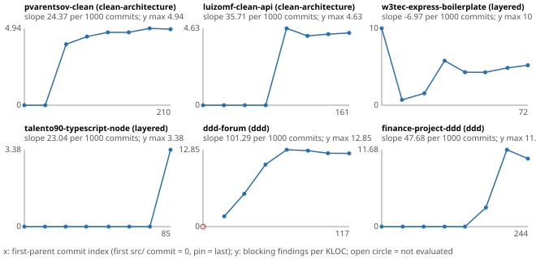

# v1.3 human erosion trajectories (job M1), 2026-10-16

> **Exploratory, descriptive, development-set evidence.** Six public repositories, eight commits each, one spec per repository written for the pinned layout. Nothing here claims validity by itself.

## Plan (committed before any trajectory evaluation)

Machine-readable form: `results/v1.3-human-erosion/plan.json`; sampled commits: `results/v1.3-human-erosion/samples.json`.

- **Question.** Under one fixed spec, does the blocking count of a human-written repository grow over its history? If it does, erosion is a real phenomenon the firewall measures outside agent greenfield work, and the Study 2 floor (#161) is a greenfield-agent artefact.
- **Repositories.** From the 15 external-set entries (`results/v1.3-external/selection.json` on `v1.3-external-set`, commit `b8492a7a`), the 2 with the most commits up to the pin in each of clean-architecture, layered and ddd:

| id | style | commits up to pin | first-parent chain from first `src/` commit |
|---|---|---|---|
| pvarentsov-clean | clean-architecture | 239 | 211 |
| luizomf-clean-api | clean-architecture | 178 | 162 |
| w3tec-express-boilerplate | layered | 714 | 73 |
| talento90-typescript-node | layered | 166 | 86 |
| ddd-forum | ddd | 165 | 118 |
| finance-project-ddd | ddd | 372 | 245 |

- **Sampling rule.** The first-parent chain from the pin, oldest first, starting at the oldest first-parent commit with at least one counted `.ts` file under `src/` (the external set's `srcTsFiles` definition: no `.d.ts`, no `*.spec.ts`/`*.test.ts`, nothing under `__tests__/`, `test/` or `tests/`). With chain length N, the samples are positions `round(i·(N−1)/7)`, i = 0..7: the first `src/` commit and the pin are always in. *Option taken under delegation:* the backlog says "evenly spaced by commit count"; the first-parent chain was chosen so that every sampled commit is a mainline state rather than a side-branch commit in the middle of a feature. For w3tec this makes the chain 73 long although the pin has 714 ancestors (most are merged branch commits).
- **Evaluation.** `npx tsx bin/firewall.ts evaluate --project <export>/<root> --spec <pinned spec> --symbolic-only --engine cypher-interp --scoring v1.3 --format json` on a `git archive` export of each sampled commit, without `node_modules` (as the external set). The spec is the external set's pinned spec, unchanged; its sha256 is in `plan.json` and checked before each repository. Exit 0/1 are verdicts. Any other exit or a missing JSON report is an **evaluation error**; a commit without counted `src/` files is **no-src**; one without `tsconfig.json` at the root is **no-tsconfig**. All three are reported per commit, never dropped silently.
- **Blocking.** A finding is blocking when its rule is in the report's own `tiers.blocking` table (`rule-tiers.md` for the style), as in `scripts/v1.3/external-sheet.ts`.
- **Identity rule.** `pilot-outcome-memo.md` §3, as implemented by `findingIdentity` in `scripts/lib/loop/pilot-metrics.ts`: rule id, template, file and target, lines ignored; for a cycle, rule id, template and the set of files. A finding is new at a sample if no earlier evaluated sample of the same repository holds its identity. Renames count as new (bias toward erosion, accepted). *Difference from the memo, option taken under delegation:* findings are not filtered through `check-correct.ts`; this job reports tool counts, not labelled erosion.
- **Measures per commit.** Blocking count, blocking per rule, LOC (non-blank lines of counted files), counted file count, blocking per KLOC, layer-coverage share (`layerAnnotation.mapped / (mapped + unmapped)`, the spec-drift indicator), new and gone identities per interval, status and error text.
- **Analysis.** Primary: per repository, the OLS slope of blocking/KLOC on the first-parent chain index over the evaluated samples (not computed with fewer than 4); an exact two-sided sign test across the 6 slopes (zero and missing slopes dropped). Secondary: the same for the raw blocking count; new identities after the first evaluated sample; layer coverage per commit.
- **Pass criterion.** The job passes when all 48 sampled commits have a recorded status and the slopes and sign tests are computed and reported, whatever their values. Interpretation fixed now: erosion under a fixed spec is called *present in this sample* only if the primary sign test gives p < 0.05 with positive slopes (with 6 repositories that needs 6/6 positive, p = 0.031); 5/6 positive is reported as a direction without significance; anything else is *no evidence of growth*.
- **Disclosure.** Before this plan was committed, one evaluation was run to check the engine: talento90-typescript-node at its pin under `cypher-interp` gave 4 blocking / 49 findings, the same as the external set's Neo4j run. That is a pin already reported by #133, not a trajectory point.

## Run

- Tool commit: branch `v1.3-human-erosion` from `origin/v1.3` `9768def4`, plan commit `55eb1aae`; Node v22.22.0; engine `cypher-interp` (in-process, no database); no LLM call. The evaluate child gets a minimal environment (PATH, HOME, TMPDIR, locale, TZ), with no key, proxy or database variable. A full re-run with that environment gave byte-identical `evals/`.
- 48 sampled commits: 47 evaluated, 1 `no-tsconfig` (ddd-forum's first `src/` commit, which has 11 files and no `tsconfig.json`), 0 errors.
- **Engine check.** All six pins reproduce the external set's Neo4j blocking counts exactly (18, 9, 8, 4, 92, 50).
- **Determinism.** Two complete runs gave byte-identical `evals/*.json`, including a hash of every report with its timing fields and run id removed.
- **Reference set.** `ue-baseline-live.ts --engine cypher-interp`: `raw/` (5 files), `report.json` and `report.md` are identical to `results/v1.3-reference/after-member-facts`; only `elapsedMs` differs. This job adds files and changes no existing code.
- Outputs: `results/v1.3-human-erosion/{plan.json, samples.json, evals/<id>.json, summary.json, summary.md, trajectories.svg}`. `summary.md` has the per-commit table of every repository. Licences and attribution of the six repositories are in the external set's `results/v1.3-external/NOTICE.md`; only paths, counts and finding keys are stored here, no source code.

## Results (pre-committed analysis)

| repo | style | evaluated | blocking, first → pin | per KLOC, first → pin | slope per KLOC | slope, count | new identities after first |
|---|---|---|---|---|---|---|---|
| pvarentsov-clean | clean | 8/8 | 0 → 18 | 0 → 4.88 | +0.0244 | +0.091 | 18 |
| luizomf-clean-api | clean | 8/8 | 0 → 9 | 0 → 4.35 | +0.0357 | +0.066 | 17 |
| w3tec-express-boilerplate | layered | 8/8 | 10 → 8 | 10.0 → 5.20 | **−0.0070** | +0.032 | 23 |
| talento90-typescript-node | layered | 8/8 | 0 → 4 | 0 → 3.38 | +0.0230 | +0.027 | 4 |
| ddd-forum | ddd | 7/8 | 2 → 92 | 1.72 → 12.23 | +0.1013 | +0.999 | 95 |
| finance-project-ddd | ddd | 8/8 | 0 → 50 | 0 → 10.33 | +0.0477 | +0.196 | 52 |

Slopes are per commit on the first-parent chain.

- **Primary (blocking per KLOC):** 5 positive and 1 negative; exact two-sided sign test p = 0.219. By the rule fixed in the plan, this is **a direction without significance**: the per-KLOC density grows in 5 of 6 histories, but this sample does not show erosion at p < 0.05.
- **Secondary (raw blocking count):** 6/6 positive, p = 0.031. The raw count grows in every repository, but it also grows with size, so it is not evidence of erosion on its own.
- **New identities.** After the first evaluated sample, 209 blocking identities appear for the first time (ddd-forum 95, finance-project-ddd 52, w3tec 23, pvarentsov 18, luizomf 17, talento90 4). Few go away once they appear. There are two exceptions: in w3tec, most of the early FF-S02 cycles disappear in the second interval, and in luizomf, 6 identities are replaced by 8 new ones at sample 6 (consistent with files being moved, which the identity rule counts as new).

## What the trajectories show (descriptive, read after the numbers)

- **The findings arrive in steps, not as a slow drift.** In every repository except w3tec, the blocking count jumps in one or two intervals in which the codebase grows fast (pvarentsov 0 → 13 between days 7 and 10; ddd-forum 14 → 49 → 88 in four days; finance-project-ddd 4 → 42 in seven weeks), and then it stays flat. After the last growth phase the density stays level or falls slightly (ddd-forum 12.8 → 12.2; finance-project-ddd 11.7 → 10.3; pvarentsov 4.7 → 4.9). The pattern looks more like violations *built in* as the structure is written than like a structure that degrades under maintenance.
- **Spec drift is a major confounder (stated in the plan).** The spec was written for the pinned layout. Early commits often do not have that layout, so their files are not mapped to any layer, and a rule cannot fire on unmapped files. Layer coverage at the early samples is 0 for talento90 (until the pin), 0.03–0.12 for finance-project-ddd (until sample 5), 0.69–0.72 for luizomf (until sample 4) and 0.13–0.41 for w3tec throughout. In talento90, finance-project-ddd and luizomf, the first blocking finding appears in the same interval in which coverage jumps. Part of the "growth" is therefore the layout coming into existence, not the layout eroding.
- **Post-hoc sensitivity, not pre-committed (option taken under delegation):** when only samples with layer coverage ≥ 0.9 are kept, a slope can be computed for 3 repositories only. ddd-forum stays positive (+0.101), pvarentsov is nearly flat (+0.006) and luizomf is nearly flat and slightly negative (−0.003). On the commits where the spec actually applies, the clear growth comes from ddd-forum alone.
- **w3tec is the counter-example.** Its early samples hold 10 FF-S02 cycles, which mostly disappear after a restructuring (55 → 43 files). Its coverage never exceeds 0.41, so the layered spec describes only a part of the code at any commit.

## Reading for SO5 and Study 2

- The firewall's outcome does move over human histories under a fixed spec: 209 new identities, and the raw count grows in 6/6 repositories. The outcome is not stuck at zero outside agent greenfield work.
- The movement is concentrated in **growth phases**, and much of it coincides with the spec's layout appearing. This sample does not support "humans erode a correct structure slowly over time". It is consistent with "violations are introduced while the structure is being built", which is the regime a greenfield agent is in during Study 2 steps. This job does not test the floor result (#161: hexagonal agents 0/14). The six repositories include no hexagonal style, the counts are unlabelled tool counts, and the primary test is not significant (p = 0.219). What it shows is narrower: on these clean, layered and ddd histories, the instrument's blocking count does change under a fixed spec. Brownfield precedent (job F2) remains the direct test of the floor.

## Limits

- Six repositories, eight commits each, one spec each; the specs are written for the pinned layout (spec drift; see layer coverage per commit in `summary.md`).
- Counts are tool counts. Unlike the pilot memo's primary outcome, they are not filtered through `check-correct.ts`, and no finding was labelled.
- `no-tsconfig` early commits are not evaluated (1 of 48). Clones have no `node_modules`, as in the external set. Package imports are external nodes.
- The first-parent chain was chosen over the full commit count (w3tec: 73 mainline commits out of 714).
- Descriptive and exploratory. With 6 repositories, only 6/6 could reach significance in the sign test. Nothing here claims validity on its own.
