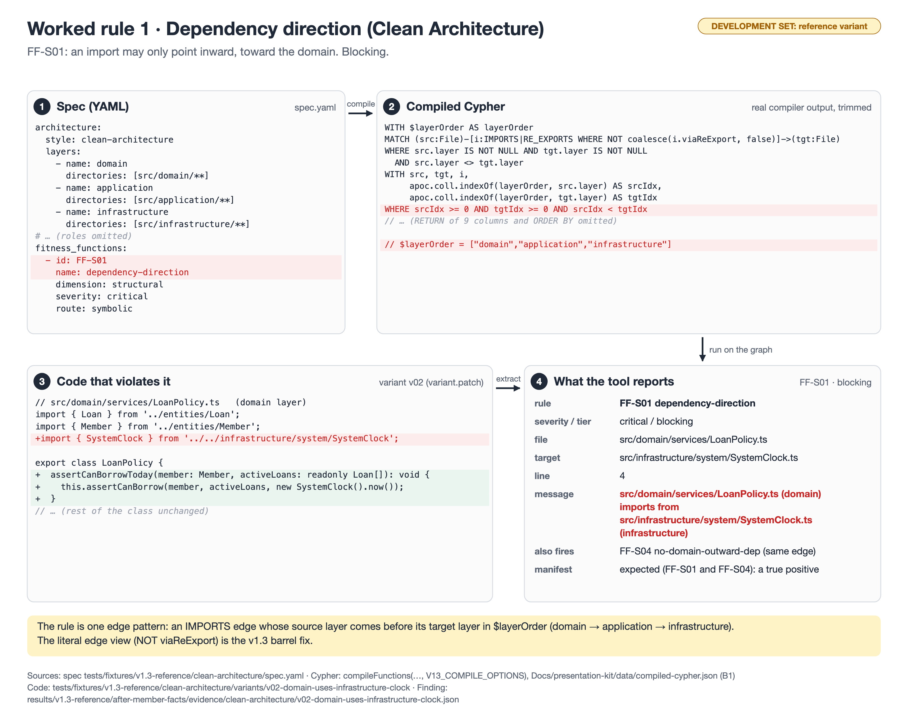

# Worked rule 1 · Dependency direction (Clean Architecture)

**Rule:** FF-S01 `dependency-direction` (Clean Architecture), blocking



**Badge:** development set (reference project or planted fixture). Not a validity estimate.

## 1. Spec (YAML)

Source: `tests/fixtures/v1.3-reference/clean-architecture/spec.yaml`

```yaml
architecture:
  style: clean-architecture
  layers:
    - name: domain
      directories: [src/domain/**]
    - name: application
      directories: [src/application/**]
    - name: infrastructure
      directories: [src/infrastructure/**]
# … (roles omitted)
fitness_functions:
  - id: FF-S01
    name: dependency-direction
    dimension: structural
    severity: critical
    route: symbolic
```

## 2. Compiled Cypher (real compiler output, full text)

Produced by `compileFunctions(compilerInputFromSpec(spec), V13_COMPILE_OPTIONS)`; stored in `Docs/presentation-kit/data/compiled-cypher.json` (key B1). The figure shows a trimmed copy; omitted parts are marked there.

```cypher
WITH $layerOrder AS layerOrder
MATCH (src:File)-[i:IMPORTS|RE_EXPORTS WHERE NOT coalesce(i.viaReExport, false)]->(tgt:File)
WHERE src.layer IS NOT NULL AND tgt.layer IS NOT NULL
  AND src.layer <> tgt.layer
WITH src, tgt, i,
     apoc.coll.indexOf(layerOrder, src.layer) AS srcIdx,
     apoc.coll.indexOf(layerOrder, tgt.layer) AS tgtIdx
WHERE srcIdx >= 0 AND tgtIdx >= 0 AND srcIdx < tgtIdx 
RETURN src.filePath AS source, tgt.filePath AS target, src.layer AS srcLayer, tgt.layer AS tgtLayer,
       type(i) AS relType,
       CASE type(i) WHEN 'IMPORTS' THEN 'imports' ELSE 're-exports' END AS verb,
       i.line AS line, i.lines AS lines, coalesce(i.isTypeOnly, false) AS isTypeOnly
ORDER BY source, target, relType
```

Parameters:

```json
{
  "layerOrder": [
    "domain",
    "application",
    "infrastructure"
  ]
}
```

## 3. Code that violates it

Source: `tests/fixtures/v1.3-reference/clean-architecture/variants/v02-domain-uses-infrastructure-clock/variant.patch`

```ts
// src/domain/services/LoanPolicy.ts   (domain layer)
import { Loan } from '../entities/Loan';
import { Member } from '../entities/Member';
+import { SystemClock } from '../../infrastructure/system/SystemClock';

export class LoanPolicy {
+  assertCanBorrowToday(member: Member, activeLoans: readonly Loan[]): void {
+    this.assertCanBorrow(member, activeLoans, new SystemClock().now());
+  }
// … (rest of the class unchanged)
```

## 4. What the tool reports

Source: `results/v1.3-reference/after-member-facts/evidence/clean-architecture/v02-domain-uses-infrastructure-clock.json` (the violation id field is left out).

```json
{
  "functionId": "FF-S01",
  "type": "LAYER_VIOLATION",
  "severity": "critical",
  "filePath": "src/domain/services/LoanPolicy.ts",
  "target": "src/infrastructure/system/SystemClock.ts",
  "line": 4,
  "isTypeOnly": false,
  "message": "src/domain/services/LoanPolicy.ts (domain) imports from src/infrastructure/system/SystemClock.ts (infrastructure)"
}
```

## What to say

- The spec names the rule; the compiler turns it into one Cypher pattern over IMPORTS edges, with the layer order as a parameter.
- The variant adds one import from the domain to infrastructure. The extractor turns it into one IMPORTS edge; the query returns it.
- The manifest expected this row (and FF-S04 on the same edge), so it is a true positive on the development set.
