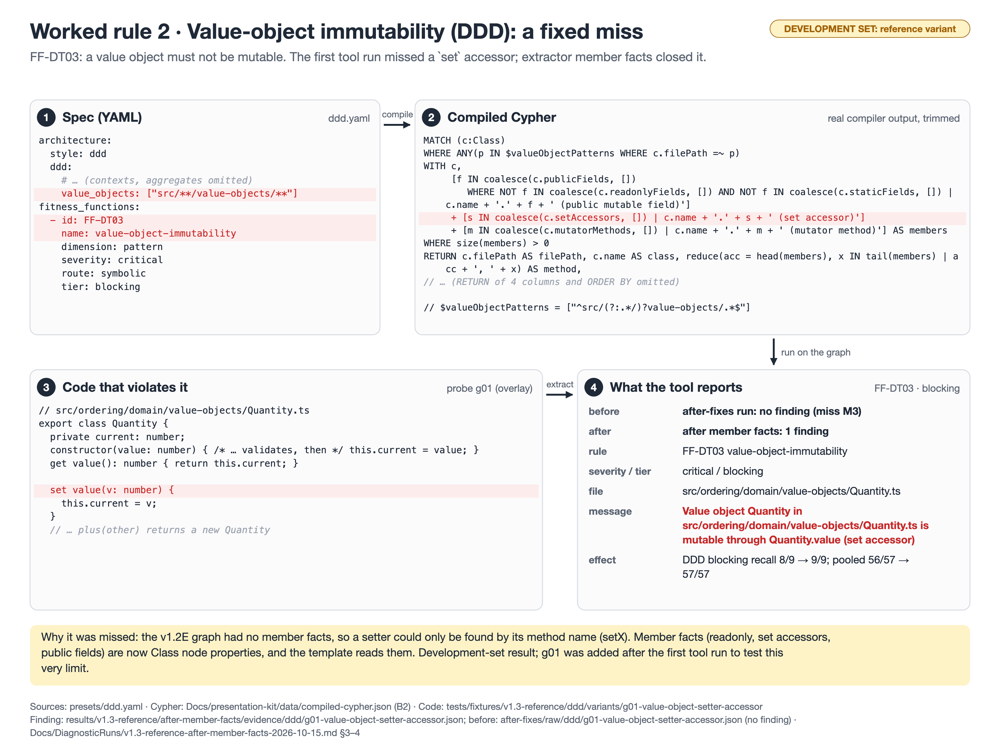

# Worked rule 2 · Value-object immutability (DDD): a fixed miss

**Rule:** FF-DT03 `value-object-immutability` (DDD), blocking



**Badge:** development set (reference project or planted fixture). Not a validity estimate.

## 1. Spec (YAML)

Source: `presets/ddd.yaml (`ddd.value_objects`, function FF-DT03)`

```yaml
architecture:
  style: ddd
  ddd:
    # … (contexts, aggregates omitted)
    value_objects: ["src/**/value-objects/**"]
fitness_functions:
  - id: FF-DT03
    name: value-object-immutability
    dimension: pattern
    severity: critical
    route: symbolic
    tier: blocking
```

## 2. Compiled Cypher (real compiler output, full text)

Produced by `compileFunctions(compilerInputFromSpec(spec), V13_COMPILE_OPTIONS)`; stored in `Docs/presentation-kit/data/compiled-cypher.json` (key B2). The figure shows a trimmed copy; omitted parts are marked there.

```cypher
MATCH (c:Class)
WHERE ANY(p IN $valueObjectPatterns WHERE c.filePath =~ p) 
WITH c,
     [f IN coalesce(c.publicFields, [])
        WHERE NOT f IN coalesce(c.readonlyFields, []) AND NOT f IN coalesce(c.staticFields, []) | c.name + '.' + f + ' (public mutable field)']
     + [s IN coalesce(c.setAccessors, []) | c.name + '.' + s + ' (set accessor)']
     + [m IN coalesce(c.mutatorMethods, []) | c.name + '.' + m + ' (mutator method)'] AS members
WHERE size(members) > 0
RETURN c.filePath AS filePath, c.name AS class, reduce(acc = head(members), x IN tail(members) | acc + ', ' + x) AS method,
       members
ORDER BY filePath, class
```

Parameters:

```json
{
  "valueObjectPatterns": [
    "^src/(?:.*/)?value-objects/.*$"
  ]
}
```

## 3. Code that violates it

Source: `tests/fixtures/v1.3-reference/ddd/variants/g01-value-object-setter-accessor/overlay/src/ordering/domain/value-objects/Quantity.ts`

```ts
// src/ordering/domain/value-objects/Quantity.ts
export class Quantity {
  private current: number;
  constructor(value: number) { /* … validates, then */ this.current = value; }
  get value(): number { return this.current; }

  set value(v: number) {
    this.current = v;
  }
  // … plus(other) returns a new Quantity
```

## 4. What the tool reports

Source: `results/v1.3-reference/after-member-facts/evidence/ddd/g01-value-object-setter-accessor.json (before: results/v1.3-reference/after-fixes/raw/ddd/g01-value-object-setter-accessor.json, no finding)` (the violation id field is left out).

```json
{
  "functionId": "FF-DT03",
  "type": "CUSTOM_value-object-immutability",
  "severity": "critical",
  "filePath": "src/ordering/domain/value-objects/Quantity.ts",
  "message": "Value object Quantity in src/ordering/domain/value-objects/Quantity.ts is mutable through Quantity.value (set accessor)"
}
```

## What to say

- This is the one real miss the development set found in the DDD rules (M3). The first runs saw only setter-named methods, so a `set value(v)` accessor went through.
- The fix was in the extractor, not the rule text: Class nodes now carry member facts (`publicFields`, `readonlyFields`, `setAccessors`, `mutatorMethods`), and the template reads them.
- Effect (development set): DDD blocking recall 8/9 → 9/9, pooled author-view blocking recall 56/57 → 57/57 (`Docs/DiagnosticRuns/v1.3-reference-after-member-facts-2026-10-15.md` §3). No other row moved.
- Caveat: g01 was written after the first tool run, to probe this limit. The comment above FF-DT03 in `presets/ddd.yaml` still describes the old name proxy.
