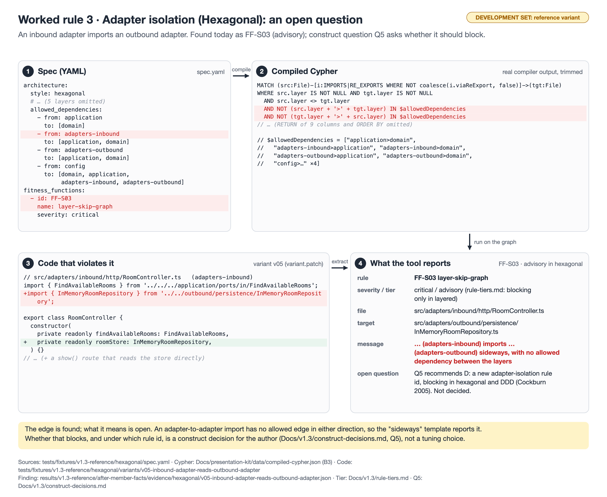

# Worked rule 3 · Adapter isolation (Hexagonal): an open question

**Rule:** Adapter isolation (Hexagonal): today FF-S03 `layer-skip-graph`, advisory; construct question Q5



**Badge:** development set (reference project or planted fixture). Not a validity estimate.

## 1. Spec (YAML)

Source: `tests/fixtures/v1.3-reference/hexagonal/spec.yaml (`allowed_dependencies`, function FF-S03)`

```yaml
architecture:
  style: hexagonal
  # … (5 layers omitted)
  allowed_dependencies:
    - from: application
      to: [domain]
    - from: adapters-inbound
      to: [application, domain]
    - from: adapters-outbound
      to: [application, domain]
    - from: config
      to: [domain, application,
           adapters-inbound, adapters-outbound]
fitness_functions:
  - id: FF-S03
    name: layer-skip-graph
    severity: critical
```

## 2. Compiled Cypher (real compiler output, full text)

Produced by `compileFunctions(compilerInputFromSpec(spec), V13_COMPILE_OPTIONS)`; stored in `Docs/presentation-kit/data/compiled-cypher.json` (key B3). The figure shows a trimmed copy; omitted parts are marked there.

```cypher
MATCH (src:File)-[i:IMPORTS|RE_EXPORTS WHERE NOT coalesce(i.viaReExport, false)]->(tgt:File)
WHERE src.layer IS NOT NULL AND tgt.layer IS NOT NULL
  AND src.layer <> tgt.layer
  AND NOT (src.layer + '>' + tgt.layer) IN $allowedDependencies
  AND NOT (tgt.layer + '>' + src.layer) IN $allowedDependencies 
RETURN src.filePath AS source, tgt.filePath AS target, src.layer AS srcLayer, tgt.layer AS tgtLayer,
       type(i) AS relType,
       CASE type(i) WHEN 'IMPORTS' THEN 'imports' ELSE 're-exports' END AS verb,
       i.line AS line, i.lines AS lines, coalesce(i.isTypeOnly, false) AS isTypeOnly
ORDER BY source, target, relType
```

Parameters:

```json
{
  "allowedDependencies": [
    "application>domain",
    "adapters-inbound>application",
    "adapters-inbound>domain",
    "adapters-outbound>application",
    "adapters-outbound>domain",
    "config>domain",
    "config>application",
    "config>adapters-inbound",
    "config>adapters-outbound"
  ]
}
```

## 3. Code that violates it

Source: `tests/fixtures/v1.3-reference/hexagonal/variants/v05-inbound-adapter-reads-outbound-adapter/variant.patch`

```ts
// src/adapters/inbound/http/RoomController.ts   (adapters-inbound)
import { FindAvailableRooms } from '../../../application/ports/in/FindAvailableRooms';
+import { InMemoryRoomRepository } from '../../outbound/persistence/InMemoryRoomRepository';

export class RoomController {
  constructor(
    private readonly findAvailableRooms: FindAvailableRooms,
+   private readonly roomStore: InMemoryRoomRepository,
  ) {}
// … (+ a show() route that reads the store directly)
```

## 4. What the tool reports

Source: `results/v1.3-reference/after-member-facts/evidence/hexagonal/v05-inbound-adapter-reads-outbound-adapter.json` (the violation id field is left out).

```json
{
  "functionId": "FF-S03",
  "type": "CUSTOM_layer-skip-graph",
  "severity": "critical",
  "filePath": "src/adapters/inbound/http/RoomController.ts",
  "target": "src/adapters/outbound/persistence/InMemoryRoomRepository.ts",
  "line": 2,
  "message": "src/adapters/inbound/http/RoomController.ts (adapters-inbound) imports src/adapters/outbound/persistence/InMemoryRoomRepository.ts (adapters-outbound) sideways, with no allowed dependency between the layers"
}
```

## What to say

- The edge is detected; its tier is the open part. In hexagonal, FF-S03 is advisory (`Docs/v1.3/rule-tiers.md`: "Hexagonal does not define strict layering"), so this finding does not fail the verdict today.
- Construct question Q5 (`Docs/v1.3/construct-decisions.md`) asks whether adapter → adapter should block, and under which id. Recommended: D, a new adapter-isolation rule id, blocking in hexagonal and DDD (Cockburn 2005: adapters talk only through ports). C (report under FF-S01) is the alternative. Not decided by the author yet.
- The blind manifest read this edge as FF-S01 (blocking), the author manifest as FF-S03 (advisory). That disagreement is what Q5 settles.
