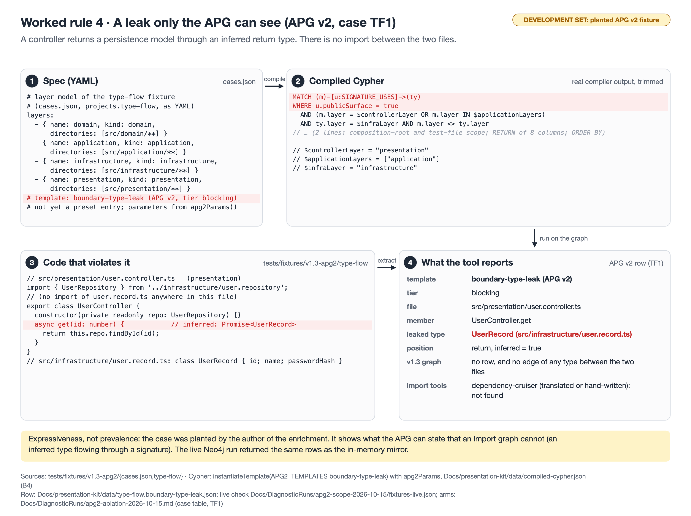

# Worked rule 4 · A leak only the APG can see (APG v2, case TF1)

**Rule:** APG v2 template `boundary-type-leak` (type flow), case TF1, tier blocking



**Badge:** development set (reference project or planted fixture). Not a validity estimate.

## 1. Spec (YAML)

Source: `tests/fixtures/v1.3-apg2/cases.json (`projects.type-flow` layer model); the template is not yet a preset entry: `src/fitness-compiler/apg2-templates.ts`, parameters from `apg2Params` (`src/fitness-compiler/apg2-in-memory.ts`)`

```yaml
# layer model of the type-flow fixture
# (cases.json, projects.type-flow, as YAML)
layers:
  - { name: domain, kind: domain,
      directories: [src/domain/**] }
  - { name: application, kind: application,
      directories: [src/application/**] }
  - { name: infrastructure, kind: infrastructure,
      directories: [src/infrastructure/**] }
  - { name: presentation, kind: presentation,
      directories: [src/presentation/**] }
# template: boundary-type-leak (APG v2, tier blocking)
# not yet a preset entry; parameters from apg2Params()
```

## 2. Compiled Cypher (real compiler output, full text)

Produced by `compileFunctions(compilerInputFromSpec(spec), V13_COMPILE_OPTIONS)` (here: `instantiateTemplate` on the APG v2 template with `apg2Params`); stored in `Docs/presentation-kit/data/compiled-cypher.json` (key B4). The figure shows a trimmed copy; omitted parts are marked there.

```cypher
MATCH (m)-[u:SIGNATURE_USES]->(ty)
WHERE u.publicSurface = true
  AND (m.layer = $controllerLayer OR m.layer IN $applicationLayers)
  AND ty.layer = $infraLayer AND m.layer <> ty.layer
  AND (m.layer IS NULL OR NOT m.layer IN $compositionRootLayers) AND NONE(sp IN $compositionRootPatterns WHERE m.filePath =~ sp)
  AND NONE(sp IN $testPatterns WHERE m.filePath =~ sp) 
RETURN m.filePath AS filePath, m.name AS member, ty.name AS leakedType, ty.filePath AS target,
       m.layer AS fromLayer, ty.layer AS toLayer, u.positions AS positions, u.inferred AS inferred
ORDER BY filePath, member, leakedType
```

Parameters:

```json
{
  "domainLayer": "domain",
  "applicationLayers": [
    "application"
  ],
  "infraLayer": "infrastructure",
  "controllerLayer": "presentation",
  "threshold": 0.7,
  "allowedAsync": [],
  "compositionRootLayers": [],
  "compositionRootPatterns": [
    "^(?:.*/)?(?:main|bootstrap|composition-root|compositionRoot|container|di)\\.(?:ts|tsx|mts|cts)$",
    "^(?:.*/)?[^/]+\\.(?:module|container)\\.(?:ts|tsx|mts|cts)$"
  ],
  "testPatterns": [
    "^(?:.*/)?[^/]*\\.(?:spec|test)\\.(?:ts|tsx|mts|cts)$",
    "^(?:.*/)?(?:__tests__|__mocks__|test|tests)/.*$",
    "^(?:.*/)?[Tt]est[A-Z._-][^/]*$"
  ],
  "aclPatterns": [],
  "minTypes": 4
}
```

## 3. Code that violates it

Source: `tests/fixtures/v1.3-apg2/type-flow/src/presentation/user.controller.ts (method `get`)`

```ts
// src/presentation/user.controller.ts   (presentation)
import { UserRepository } from '../infrastructure/user.repository';
// (no import of user.record.ts anywhere in this file)
export class UserController {
  constructor(private readonly repo: UserRepository) {}
  async get(id: number) {            // inferred: Promise<UserRecord>
    return this.repo.findById(id);
  }
}
// src/infrastructure/user.record.ts: class UserRecord { id; name; passwordHash }
```

## 4. What the tool reports

Source: `Docs/presentation-kit/data/type-flow.boundary-type-leak.json (row `UserController.get`); live Neo4j equality: Docs/DiagnosticRuns/apg2-scope-2026-10-15/fixtures-live.json` (the violation id field is left out).

```json
{
  "filePath": "src/presentation/user.controller.ts",
  "member": "UserController.get",
  "leakedType": "UserRecord",
  "target": "src/infrastructure/user.record.ts",
  "fromLayer": "presentation",
  "toLayer": "infrastructure",
  "positions": [
    "return"
  ],
  "inferred": true
}
```

## What to say

- The controller never imports `user.record.ts`. It returns `this.repo.findById(id)`, whose inferred type is `Promise<UserRecord>`: a persistence model leaks into an HTTP response.
- In the v1.3 graph there is no edge of any type between the controller file and the record file, so no v1.3 rule and no import rule can relate them (`Docs/DiagnosticRuns/apg2-ablation-2026-10-15.md`, "Reading the result per enrichment", (1)). The APG v2 SIGNATURE_USES edge holds it.
- Arms for TF1 in the ablation: APG v2 yes; same template on the v1.3 graph no; v1.3 rules no; dependency-cruiser translated no; hand-written no.
- Caveat: planted by the enrichment's author. It shows expressiveness, not how often this happens in real code.
