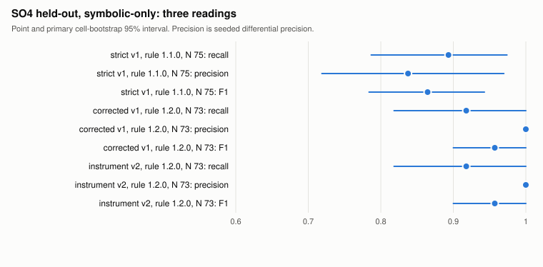
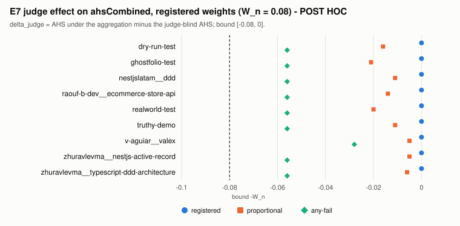
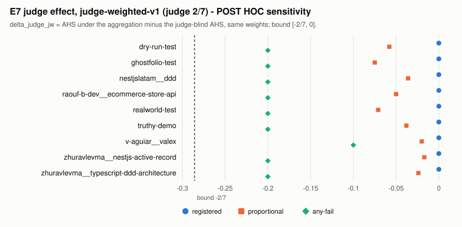
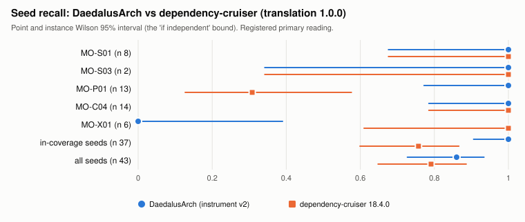
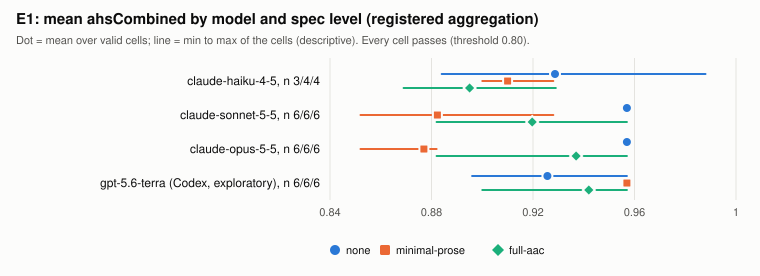

# Results report for the thesis director, October 2026

**Thesis**: *Governing AI-Agentic Development: A Spec-Driven Neuro-Symbolic Architectural Firewall* (MSc, Universidad Nacional de Colombia)
**Tool**: DaedalusArch, branch `v1.2e` at merge commit `b703468`
**Date of this report**: 2026-10-12
**Scope**: every result committed on `v1.2e`, including E1 (SO5, Section 4.8), the reproduction-audit corrections of ADR-033 (prereg v21), the P4 judge-vs-panel validation (ADR-034 and ADR-035, prereg v23), the plain LLM-review baseline pilot (ADR-036, prereg v24), the judge model robustness check (ADR-038, prereg v25) and the judge-probe site count (ADR-037, not run).
**Revision**: fourth version. It adds the plain LLM-review baseline pilot (Section 4.9), the judge model robustness check (Section 4.10) and the judge-catch test B finding (Section 4.11), and updates the executive summary, the SO3 status, Sections 5 to 7. The third version added the P4 judge-vs-panel validation (Sections 3.7, 4.8.5 and 7) and updates the executive summary, the SO3 and SO5 status and Section 6. The second version added the E1 results and replaced the withdrawn labelled SO4 table and the single-figure baseline precision with the ADR-033 figures.

**How to read this report**

- Every number carries the committed file it comes from, in brackets. Paths are relative to the repository root.
- A number with no direct source line was derived by me from the cited file. It is marked "derived", with the arithmetic.
- Every reading is labelled **pre-registered** or **post-hoc**. A post-hoc reading was defined or changed after some results were seen. The ADRs declare each one, and this report repeats the declaration.
- "Instrument v1" and "instrument v2" are the two versions of the rule set (ADR-026). "Rule 1.1.0" and "rule 1.2.0" are the two versions of the matching rule (ADR-025). Every table names the versions it uses.
- Figures are in `Docs/reports/figures/`. The script `make_figures.py` rebuilds them from the committed CSVs.

---

## 1. Executive summary

**What was built and frozen.** DaedalusArch compiles an architecture spec into graph queries (Cypher fitness functions) and runs them over an Architectural Property Graph (APG) extracted from TypeScript code. A frozen LLM judge (`claude-opus-5-5`) adds two semantic dimensions. Before any experiment ran, the analysis plan, the operator catalogue, the matching rule, the judge rubric and the corpus were registered under a hash-checked pre-registration. That registration now stands at version 25, with 85 registered artefacts [corpus/prereg.json]. `run-experiment` refuses any plan whose registered artefacts changed [Docs/threats-to-validity.md, TV-01].

**Main findings.**

1. **SO4, seeded detection (held-out, symbolic-only).**
   - Strict reading (instrument v1, rule 1.1.0, N = 75, pre-registered): recall 0.893, cell-bootstrap 95% CI 0.787 to 0.974. Seeded differential precision 0.838 (0.719 to 0.970) [results/so4-heldout/agg-strict/prf_overall.csv].
   - Corrected reading (rule 1.2.0, N = 73, post-hoc, ADR-025): recall 0.918 (0.818 to 1.000), precision 1.000, F1 0.957 (0.900 to 1.000) [results/so4-heldout/agg-corrected/prf_overall.csv].
   - Labelled reading (rule-1.1.0 false positives adjudicated by the P1 labels, N = 73, post-hoc, ADR-033): recall 0.918 (0.818 to 1.000), precision 0.957 (0.893 to 1.000), F1 0.937 (0.878 to 0.986) [results/so4-heldout/score.json; results/so4-heldout/agg/prf_overall.csv]. It replaces the earlier labelled table (N = 75, precision 1.000, F1 0.944), which ADR-033 withdrew because it mixed two regimes.
   - Instrument v2 (post-hoc, ADR-026) gives identical seeded detection [results/so4-heldout/v2/agg/prf_overall.csv].
   - All 6 remaining misses are the dynamic `import()` operator, which is outside the extractor's coverage [results/labels/fn-causes.json].
2. **The golden set is below its registered floor.** N = 75 scored instances against the floor of 80; 10 of the 85 registered applications failed the type-check [results/so4-heldout/agg-strict/golden_instances.csv]. The corrected and labelled readings have N = 73 [results/so4-heldout/agg/golden_instances.csv].
3. **Real-code precision is uncertain and depends on how `uncertain` labels count.** Baseline precision is the share of real (unseeded) findings that the labeller judged real. Under instrument v2 (n = 24 labelled items, effective n 11.5), it ranges from 0.328 (registered rule, `uncertain` counted as not real; Kish-Wilson 95% CI 0.132 to 0.609) through 0.608 (`uncertain` excluded, post-hoc; 0.351 to 0.816) to 0.789 (`uncertain` counted as real, post-hoc; 0.500 to 0.933) [results/so4-heldout/agg/precision_baseline.csv]. 8 of the 24 items are `uncertain`, so the rule moves the estimate more than the sampling error does. The registered figure, 0.33, stays the one to quote first. Every reading is below the seeded differential precision, and every interval is wide.
4. **SO2 (performance).** Every evaluated graph parses completely. On the largest base (ghostfolio, 241 files), the full evaluation takes 5.3 s against a 30 s budget for the cycle queries [results/latency-gate/so2/latency.csv]. The data-flow edge type (FLOWS_TO) is empty on all four real core bases [results/apg-ablation/so2/flows_to_stores.csv], which is a declared limitation (ADR-023).
5. **SO3 (the LLM judge).** On the 9 E7 projects the judge failed 73 of 331 judged units. Under the registered aggregation it changed **no** verdict and no AHS value [results/e7-corpus/judge-diagnostics/judge_summary.csv; results/e7-corpus/agg-proportional/ahs_by_aggregation.csv]. With the registered judge weight of 0.08, the judge can lower the combined AHS by at most 0.08 and can never raise it. The post-hoc variants let the judge move between 0 and 8 of the 9 verdicts. The judge moves 8 only under the most aggressive one: any-fail with judge weight 2/7.
6. **Tool comparison.** Against dependency-cruiser on the same seeds, the comparable rules agree except on two points, both explained [results/tool-comparison/recall.csv; Docs/DiagnosticRuns/tool-comparison-real-pairs-2026-10-10.md]:
   - dependency-cruiser finds the 6 dynamic-import seeds that DaedalusArch misses.
   - DaedalusArch's apparent advantage on domain-purity seeds comes from a translation defect, found post-hoc. The defect favours DaedalusArch.
7. **Real fix commits.** Both tools flag the same 2 of 5 real fix commits through the same rules [results/real-pairs/summary.json].
8. **SO5 (E1), LLM × spec quality.** 65 of the 72 cells were judged; the 7 others are Claude Haiku cells that failed the type-check (GEN-TYPECHECK) [results/e1-grid/agg/so5_grid.csv]. On the 47 valid Claude cells (pre-registered):
   - spec level has an effect, Holm p = 0.0003; model has none, Holm p = 0.438; the interaction is significant, Holm p = 0.026 [results/e1-grid/agg/so5_tests.csv];
   - the direction is reversed: `none` scores best (mean AHS 0.951), `minimal-prose` worst (0.887), `full-aac` between (0.920) [Docs/DiagnosticRuns/e1-size-analysis-2026-10-10.md §3];
   - every cell passes (minimum AHS 0.852) [results/e1-grid/agg/so5_grid.csv].

   The post-hoc size analysis explains the direction. Without a spec, the models build small, flat projects (about 9 files) where two rules, FF-C02 and FF-P02, rarely fire. Findings per file do not differ between levels. At equal size, `full-aac` beats `minimal-prose` (Cliff's δ 0.52; 0.47 after a LOC adjustment) [results/e1-grid/agg-size/size_tests.csv]. The registered directional self-preference check is positive (p = 0.014); the vendor self-preference check is not (p = 0.173) [results/e1-grid/agg/so5_tests.csv]. Under the registered weights the judge changes no E1 verdict [results/e1-grid/agg-proportional/ahs_by_aggregation.csv].

9. **SO3, judge validation (P4).** The judge agrees with the Gemini panel on the E1 headline: n = 36, agreement 0.982 (95% CI 0.949 to 1.000), Gwet's AC1 0.982, Cohen's κ 0 [results/e1-grid/label-plan-p4-api/labelling.json, row `judge-vs-panel`, `source` = `e1`, `headline` = true].
   - κ is 0 because of prevalence, not because of disagreement: the judge passed every one of the 36 items, so there is no variance in its labels. AC1 is the figure that holds up. The two errors were both lenient (the panel failed an item the judge passed), one on a Sonnet-written and one on a `gpt-5.6-terra`-written project [same file, `labels`; results/e1-grid/label-plan-p4/judge-verdicts.json].
   - The 8 fixture items agree 100%. Per generator the E1 agreement is 95% to 100% (n = 8 to 10 each) [same file].
   - Run vs run on the API route: agreement 0.957 (n = 46), κ 0.777 [same file, row `run-vs-run`].
   - **Read this as a weak test of the judge's fail detection.** On E1 the judge's labels are almost all `pass`, and the panel failed only 2 of the 36 items, so the data say the judge is not wrongly failing sound code. They say little about whether it catches unsound code. The 2 fixture fails are the only place where fail detection is checked, and the judge matched the panel there.
   - The panel is not independent ground truth, and no author audit covers P4 [Docs/threats-to-validity.md, TV-109]. The P4 labels came from a different route (Gemini API, tools off) from P1/MS/P2 (agy CLI), after the agy route was stopped by a pre-registered rule [Docs/labeller-route.md §7, §8; Docs/threats-to-validity.md, TV-110; ADR-034; ADR-035].
10. **Plain LLM-review baseline (ADR-036, exploratory).** Codex `gpt-5.6-terra` reviewed the same trees given the same spec as prose. It stopped at its registered credit budget after 25 of the 42 planned reviews [Docs/DiagnosticRuns/llm-review-pilot-2026-10-11.md, "Execution and the budget stop"; results/llm-review/cost.csv].
    - Seed detection: 9/10 seed-runs, Wilson 0.596 to 0.982 ("if independent"). The firewall matched 5/5 [results/llm-review/recall.csv].
    - Run-to-run consistency: mean pairwise Jaccard 0.727 over the 11 trees with two runs. The 0.571 in `summary.json` comes from a declared scorer defect [Docs/DiagnosticRuns/llm-review-pilot-2026-10-11.md, "Consistency"; results/llm-review/consistency.csv].
    - Overlap: 460 of 909 claims (50.6%) equal a firewall key, and the runs list 460 of the firewall's 1736 keys (26.5%) [results/llm-review/overlap.csv; results/llm-review/summary.json].
    - Cost: 5.92 credits and 3.2 minutes per valid review [Docs/DiagnosticRuns/llm-review-pilot-2026-10-11.md].
    - On the real fix pairs its hits are close to chance (Section 4.9).
11. **Judge model robustness (ADR-038).** `claude-sonnet-5-5` re-judged 100 recorded units on the same pinned route. Agreement 0.940 (Wilson 0.875 to 0.972), κ 0.766, AC1 0.931; population-weighted agreement 0.974 [results/judge-robustness/agreement.csv]. E1 agrees 50/50 and E7 44/50. All 6 disagreements are low-confidence E7 units that Opus failed and Sonnet passed. 0 verdict changes under the registered rule and under the any-fail rule [Docs/DiagnosticRuns/judge-robustness-2026-10-11.md]. The pre-declared reading is robust (κ ≥ 0.60).
12. **Judge-catch test B was not run (construct-validity finding).** The frozen operators MO-X02 and MO-X03 placed 0 seeds on the 7 held-out corpus bases and 0 seeds in the 65 E1 cells [Docs/DiagnosticRuns/judge-probe-e1-site-count.md; ADR-038 status line]. The judge's detection rate therefore could not be measured. A redesign is proposed in Section 4.11.

**What this supports.** The symbolic engine finds the canonical violation constructs it was designed for, reproducibly, on held-out code, and fast enough for CI use. It matches a mature import-graph checker on the rules both can express. Its extra rule families (patterns, SOLID proxies, metrics, data-flow) have no external comparator yet. In E1, the spec level changes the structure that the models build, and the AHS registers that change; a vague prose spec gives the worst score. On the P4 sample the judge agrees with an independent-vendor panel (0.982 on E1, AC1 0.982), so it is not failing sound code, although that test barely exercises its fail detection. Its unit verdicts are also stable when the judge model is swapped from Opus to Sonnet (κ 0.766, 0 verdict changes). In an exploratory pilot, a plain LLM review given the same spec found 9 of 10 planted seeds, but its findings were not repeatable (Jaccard 0.727), covered 26.5% of the firewall's keys and cost about 6 credits and 3 minutes per review, against seconds for the firewall. The firewall's case rests on determinism, exhaustiveness, speed and auditability, not on better seed detection.

**What it does not support yet.** It does not support these claims:

- that DaedalusArch's findings on real code are mostly correct (baseline precision 0.33 registered, 0.33 to 0.79 across the `uncertain` rules, wide CIs);
- that the LLM judge improves verdicts (no effect under the registered rule in E7 or E1), or that it detects violations: P4 shows agreement with the panel but barely tests fail detection on E1 (2 panel fails in 36 items), the panel is a single model, and no author audit covers P4. The robustness check shows model stability, not validity, and the planned detection test (B) could not be run because the frozen operators place no seeds;
- that the firewall detects seeds better than a plain LLM review (9/10 against 5/5 on 5 seeds, exploratory), or that a plain LLM review is worse on real code (n = 2 pairs, one run each);
- that specs make generated architecture worse (the reversed E1 effect runs through project size and structure);
- any SO5 claim beyond one vendor and two tasks, or about model differences (no model effect).

**Decisions needed from the director** (Section 7):

- how to frame the reversed E1 spec effect in the thesis, and where the Codex arm goes;
- how to report the P4 result, and whether to complete the author audit so that P4 has a check against a human (Section 7, items 1 and 2);
- whether to approve the judge-probe redesign (Section 4.11) and where the LLM-review baseline goes in the thesis (Section 7, items 6 and 7);
- the 30-item author audit;
- the remaining API-robustness experiments;
- the split into three papers;
- the two proposed extensions (a Grok arm and an MCP firewall-in-the-loop).

---

## 2. Objectives SO1 to SO5 and their status

| Objective | What it promises | Status on `v1.2e` | Main evidence |
|---|---|---|---|
| SO1 | Spec language and style libraries (Clean, Hexagonal, Layered) that compile to executable checks | **Done for Clean, Layered and a NestJS library; Hexagonal not built.** All 27 declared functions have a template in each of the 3 libraries. A layered acceptance run passed | [results/pre-tag/so1-metrics-53cfaed4a313.json; results/pre-tag/layered-53cfaed4a313.json; ADR-027 context] |
| SO2 | APG extraction: coverage, latency, value of the graph over a plain AST | **Done.** Latency gate passed. Ablation run. FLOWS_TO limitation declared | [results/latency-gate/so2/gate.json; results/apg-ablation/so2/] |
| SO3 | Symbolic rules plus a neural judge producing an Architectural Health Score (AHS) and verdicts | **Partly done.** E7 (9 of 9 projects) and E1 (65 judged cells) are complete. The judge's effect on verdicts is zero under the registered rule in both. Judge-vs-panel validation (P4) is done: agreement 0.982 on the E1 headline (n = 36), 100% on fixtures, but fail detection is barely tested and no author audit covers P4 (Section 4.8.5). Model robustness (ADR-038) is done: Sonnet agrees with Opus on 94% of 100 units, κ 0.766, 0 verdict changes (Section 4.10). The judge-catch test B is **not run**: the frozen operators place 0 seeds (Section 4.11), so detection of planted unsound code remains unmeasured | [results/e7-corpus/agg/; results/e7-corpus/agg-proportional/; results/e1-grid/agg-proportional/; results/e1-grid/label-plan-p4-api/labelling.json; results/judge-robustness/agreement.csv; Docs/DiagnosticRuns/judge-probe-e1-site-count.md] |
| SO4 | P/R/F1 on a seeded golden dataset (80 to 120 instances) | **Done with a shortfall** (N = 75 strict, 73 corrected and labelled). Strict, corrected, labelled and v2 readings committed. Baseline precision labelled, with `uncertain`-rule sensitivity rows. Author audit pending | [results/so4-heldout/; ADR-033] |
| SO5 | LLM × spec-quality study (E1) | **Run, P4 labelled.** 72 cells (54 Claude, 18 Codex); 65 judged, 7 Haiku cells not run (GEN-TYPECHECK). Registered tests, both aggregation passes, judge diagnostics and the post-hoc size analysis are committed. The judge-vs-panel labels (P4) are committed (Section 4.8.5) | [results/e1-grid/agg/; results/e1-grid/agg-proportional/; results/e1-grid/agg-size/; results/e1-grid/label-plan-p4-api/labelling.json] |

---

## 3. Method in brief

### 3.1 Pre-registration and the hash gate (pre-registered)

- The analysis plan, threats register, operator catalogue, matching rule, judge pre-registration, plans, specs and seeds are hashed in `corpus/prereg.json`. It is at version 25, with 85 artefacts [corpus/prereg.json].
- `run-experiment` refuses a plan when a registered artefact changed, or when `prereg.json` is uncommitted or newer than the first run. Every result records its `preregVersion` [Docs/threats-to-validity.md, TV-01].
- CI runs `--check-prereg` on every plan for pull requests to `v1.2e` [Docs/threats-to-validity.md, TV-91].
- Each bump has a dated reason in `Docs/prereg-reasons.md`. The bumps that matter for this report:

| Bump | Version | What it registered |
|---|---|---|
| P-1 | v2 | catalogue frozen, k = 2 |
| P-M | v3 | methodology corrections, ADR-020 |
| P-U6 | v4 | U6 integration unit |
| P-4 | v7 | judge freeze |
| P-SO4 | v8 | seeded SO4 entries |
| (ADR-025) | v9 | matching rule 1.2.0 |
| (ADR-026) | v10 | instrument v2 |
| (ADR-027) | v11 | E7 extension |
| P-A28 | v14 | proportional judge variant |
| P-A28R | v15 | review fixes to the variant |
| P-JW | v17 | judge-weighted variant |
| P-CX | v18 | Codex arm |
| P-TC | v19 | tool comparison |
| P-TS | v20 | E1 tsconfig fix |
| P-AUD | v21 | reproduction-audit corrections (post-hoc) |
| P-LR | v24 | plain LLM-review baseline pilot, exploratory (ADR-036) |
| P-JR | v25 | judge model robustness check, registered before any Sonnet call (ADR-038) |

Sources: [Docs/prereg-reasons.md; ADR-025, ADR-026, ADR-027, ADR-033, ADR-036, ADR-038].

### 3.2 Versions

| Component | Version | Source |
|---|---|---|
| Runtime | Node v24.5.0; Neo4j 5.26 community, APOC 5.26.24 | [aidlc-docs/construction/build-and-test/build-and-test-summary.md §1] |
| Judge | `claude-opus-5-5` through Claude CLI 2.1.294, pinned under a dedicated prefix. Rubric frozen 2026-10-09, `FROZEN_SHA256 f8b2dabb…eac5a` | [Docs/judge-preregistration.md; ADR-018 item 4; ADR-022 item 5] |
| Labeller | `gemini-3.1-pro-high` through the Antigravity CLI `agy` 1.3.2 for P1, MS and P2. For P4, `gemini-3.1-pro-preview` (the same model) through the Gemini API, tools off, temperature 0 | [results/labels/live-call-ledger.md; ADR-019 item 4; ADR-035; Docs/labeller-route.md §8] |
| Rule set | instrument v1 (last commit `febc918`) and instrument v2, which adds role exemptions for three proxy rules | [ADR-026] |
| Matching rule | 1.1.0 (registered) and 1.2.0 (post-hoc, ADR-025) | [Docs/matching-rule.md; ADR-025] |
| Baseline tool | dependency-cruiser 18.4.0 with typescript 5.9.3; translation 1.0.0 | [ADR-030 item 1] |
| LLM-review reviewer | `gpt-5.6-terra` through Codex CLI 0.162.1, effort medium, read-only confined | [ADR-036 item 1] |
| Robustness judge | `claude-sonnet-5-5` on the frozen route (CLI 2.1.294, ADR-018 config), effort high | [ADR-038 item 3] |
| E1 generators | `claude-opus-5-5`, `claude-sonnet-5-5`, `claude-haiku-4-5`; `gpt-5.6-terra` through Codex CLI 0.162.1 | [Docs/analysis-plan.md §2; ADR-029] |

### 3.3 Corpus and selection rules (pre-registered, with post-hoc steps declared)

**Inclusion criteria C1 to C6** [Docs/corpus-criteria.md §1]:

- C1: an OSI licence.
- C2: 20 to 300 TypeScript source files (20 to 800 in the E7-x round).
- C3: a TypeScript back end.
- C4: a named style.
- C5: an npm lock file.
- C6: not archived, not a fork, not a duplicate.

Candidates are drawn by a seeded RNG (`mulberry32`), never by stars or names [Docs/corpus-criteria.md §2].

**SO4 held-out set: 7 bases** [Docs/analysis-plan.md §2]:

- 4 core bases: realworld-test, ghostfolio-test `apps/api`, truthy-demo, dry-run-test.
- 3 E7 round-1 bases: zhuravlevma__nestjs-active-record, nestjslatam__ddd, v-aguiar__valex.

**E7 set: 9 projects.** These are the 7 bases above plus 2 E7-x additions: zhuravlevma__typescript-ddd-architecture and raouf-b-dev__ecommerce-store-api. The E7-x round searched 246 candidates; 22 were eligible, 6 were drawn and 2 admitted [Docs/corpus.md, "E7-x additions"].

**Exclusions by name** [aidlc-docs/construction/build-and-test/build-and-test-summary.md §6.4; Docs/corpus.md]:

- dev-nest and eryzerz: type errors.
- MarvinRF: a report-schema defect; it stays excluded for good (ADR-021 item 5).
- 4 of the 6 E7-x draws.

**Style imbalance.** The held-out set has 5 `nestjs` bases, 1 `clean-architecture` and 1 `layered`, by spec style [Docs/threats-to-validity.md, TV-89].

**Post-hoc or floor-motivated steps, declared:**

- the domain-layer remap;
- the ghostfolio preparation;
- the generated E7 specs, which were produced mechanically by the registered rule `Docs/e7-spec-rule.md`.

All three are declared [Docs/threats-to-validity.md, TV-06, TV-08, TV-88]. The E7-x extension was drafted after an API-only research pass had seen the candidates [ADR-027; TV-98].

### 3.4 The seeded golden set: operators and twins (pre-registered)

The frozen catalogue has 11 operators and 11 twins [Docs/operator-catalogue.md §1].

- **Operators.** Each operator is a literal negation of a rule template, applied at a site where the change is feasible. Example: MO-S01 makes a domain file import an infrastructure symbol.
- **Twins.** Each twin is a near-identical edit that the rule should not flag. Example: MO-S01n makes an infrastructure file import a domain symbol.
- **Seeding.** The catalogue was frozen at k = 2 applications per (operator, base), master seed 20261008 [ADR-019 item 6; ADR-024].
- **Count.** The registered feasibility count gave 85 held-out instances. Ten applications failed the type-check and are never re-drawn, so N = 75 (ADR-024, diagnosed as infeasible sites, not operator defects). The post-hoc MO-S01 style guard removed 2 more as not applicable to a layered spec, so N = 73 [ADR-025 item 2].
- **Coverage.** Held-out seeds exercise 9 of the 22 executed functions (FF-C04, FF-CV02, FF-P01, FF-P06, FF-S01, FF-S03, FF-S04, FF-SO01, FF-SO02) [results/so4-heldout/agg-corrected/prf_by_function.csv; results/so4-heldout/score-corrected.json `executedFunctions`].

### 3.5 The matching rule

**Registered core (pre-registered)** [Docs/matching-rule.md §3]:

- A violation's key is (function, file, target, discriminator). Line numbers never enter the key (MAT-02).
- The new violations of a seeded copy are the multiset difference against its own unseeded baseline (MAT-03).
- A seed is a true positive (TP) when a new violation of an expected function carries an expected key (MAT-04).
- Every other new violation that is not declared collateral is FP-strict (MAT-09).
- FP-labelled is FP-strict minus the items the labeller judged real (MAT-10).

**MAT-04a (post-hoc, rule 1.2.0, ADR-025).** It re-keys pre-existing violations of a class that a seed renamed. Without it, a rename counts old violations as new false positives.

### 3.6 Judge isolation and freeze (pre-registered)

**Isolation.** The judge runs with a dedicated config directory under a fail-closed allow-list, a pinned CLI version with auto-update off, `StructuredOutput` as its only tool, no MCP servers, and a fresh neutral working directory [ADR-018; aidlc-docs/construction/build-and-test/build-and-test-summary.md §4].

**Freeze.** The rubric was frozen on 2026-10-09, after the sensitivity check SEN-01 passed for both neural functions. It changes only through a registered ladder step [Docs/judge-preregistration.md].

**Residual channels.** These were not positively controlled:

- the user-level `CLAUDE.md` and the `UserPromptSubmit` hook;
- the ancestor `CLAUDE.md` channel, which is closed only by the neutral-cwd check (ISO-05).

They are listed as residual threats [Docs/threats-to-validity.md, TV-36].

**Recordings.** Every judge call is recorded as a cassette and replays without new calls [Docs/analysis-plan.md §12.2].

### 3.7 Labelling design (pre-registered; sizes amended before any live call)

**Labeller.** One Gemini model of a different vendor from the judge, run twice with permuted option order [Docs/analysis-plan.md §4, §10 B3].

**Populations** [Docs/analysis-plan.md §4; results/labels/label-plan-summary.json]:

- **P1**: every new violation of a seeded copy that is not an expected key (a census; 34 items under rule 1.1.0).
- **MS**: missed seeds without a mechanical cause (2 items).
- **P2**: baseline violations of the E7 projects (30 items, drawn with probability proportional to stratum size). Of these, 24 come from the v2 population and 6 from the rows only v1 reports.
- **P3**: 0 items (dropped, ADR-021 item 8.1).
- **P4**: judge units of E1 and the fixtures. 46 items are drawn (38 E1, 8 fixtures) and all 46 are labelled, on the Gemini API route (Section 4.8.5) [results/e1-grid/label-plan-p4/label-plan-summary.json; results/e1-grid/label-plan-p4-api/labelling.json].

**Budget and calls.** The budget is 300 label invocations, re-asks and retries included. Live labelling used 254: 142 for P1, MS and P2, 17 for the stopped agy P4 attempt, 3 for the API probe and 92 for P4 on the API (46 items, two runs each) [results/labels/live-call-ledger.md, rows 1 to 5].

**Validity rule.** Run-vs-run κ of at least 0.60 keeps the FP/FN taxonomy "as registered"; below that it is descriptive only [Docs/analysis-plan.md §5].

**Author audit.** A 30-item audit was drawn label-blind before any call (seed 6105), and its allocation is sealed. The author has not labelled it yet [results/labels/live-call-ledger.md; results/so4-heldout/agg/agreement.csv, panel-vs-audit n = 0].

### 3.8 Post-hoc declarations

Each item below was decided after some outputs were seen. Every one is reported beside the registered reading and replaces none.

| ADR | Post-hoc change | Effect on reported numbers |
|---|---|---|
| ADR-022 | FF-CV01 and FF-CV04 excluded after failed probes. FF-CV06 template fixed. Tooling fixes | Convention dimension rests on 4 functions. No measured value changed by the tooling fixes |
| ADR-024 | Type-check losses diagnosed. Declared post-hoc, but made before any SO4 evaluation | N = 75 instead of 85 |
| ADR-025 | Matching rule 1.2.0 (MAT-04a) and the MO-S01 layered style guard | Strict and corrected SO4 readings side by side |
| ADR-026 | Instrument v2 role exemptions for FF-CV05, FF-C02 and FF-C03 | Baseline volume on the 7 bases 1066 → 826. No seeded detection changed |
| ADR-027 | E7-x criteria drafted after the candidate research | E7 sample composition |
| ADR-028 | Proportional and judge-weighted variants | Their E7 readings are post-hoc. Their E1 readings are pre-registered |
| ADR-030 | Translation defect found after the run; sensitivity variant `dts` | Tool comparison has a registered and a post-hoc reading |
| ADR-032 | E1 extraction uses the pinned per-run tsconfig | Operational. All pass-1 E1 records discarded |
| ADR-033 | Reproduction-audit corrections: labelled SO4 reading at N = 73, degenerate-interval flags, one interval method per table, `uncertain`-rule sensitivity rows for baseline precision | Labelled SO4 precision 1.000 → 0.957 and F1 0.944 → 0.937. Baseline precision reported as a range. No registered outcome changed |
| ADR-036 | Plain LLM-review pilot, exploratory throughout. One scorer defect declared after the run: `summary.json` consistency (0.571) averages three one-run trees as 0; the per-tree CSV is the source (0.727) | No registered number changed. The registered scorer is not edited [Docs/DiagnosticRuns/llm-review-pilot-2026-10-11.md] |
| (none; diagnostic note) | E1 size analysis: tests on LOC, files, per-file density, density without FF-CV05, AHS residualised on ln LOC, per-function AHS deficit | Explains the reversed E1 spec effect. No registered E1 number changed [Docs/DiagnosticRuns/e1-size-analysis-2026-10-10.md §8] |

---

## 4. Results

### 4.1 SO1: spec language and style libraries

| Measure | Value | 95% CI | Reading | Source |
|---|---|---|---|---|
| Template coverage per library (functions with a template ÷ declared) | clean-architecture 27/27, layered 27/27, nestjs 27/27 | none | pre-registered (descriptive) | [results/pre-tag/so1-metrics-53cfaed4a313.json `libraries`] |
| Compiled ÷ declared, corpus specs | clean-architecture 48/54 (0.889); nestjs 144/162 (0.889); layered 36/54 (0.667) | none | pre-registered (descriptive) | [same file, `compiledShares`] |
| Validator first-pass rate, corpus specs | 6/10 (0.60) | Wilson 0.313 to 0.832 | pre-registered | [same file, `groups`] |
| Validator current pass rate, corpus specs | 10/10 (1.00) | Wilson 0.722 to 1.000 | pre-registered | [same file] |
| First-failure codes (corpus) | `INVALID_TEMPLATE_REF` 4 | none | descriptive | [same file] |
| Layered acceptance run (FR-20) on v-aguiar__valex | declared 27, compiled 18, disabled 9, skipped by mode 2, executed 16, failed 0; AHS 0.553, soft-block | none | pre-registered | [results/pre-tag/layered-53cfaed4a313.json] |
| Sensitivity probes (each check can fire on a seeded fixture) | 23 of 25 fire; FF-CV01 and FF-CV04 excluded after failure | none | registered procedure; FF-CV06 fix post-hoc | [results/sensitivity/step31/agg/function_sensitivity.csv; ADR-022] |

**Interpretation.**

- Each of the three built libraries maps every declared function to an executable template, and the layered library runs end to end on a real layered project with no failed function.
- The first-pass validator rate (0.60 on 10 specs) measures how often a spec passed at its first commit. It is not a usability result [Docs/threats-to-validity.md, TV-93].
- The Hexagonal library promised in SO1 does not exist [ADR-027 context]. Hexagonal projects are mapped to `clean-architecture`.

### 4.2 SO2: coverage, latency, the ablation, and the FLOWS_TO limitation

**Coverage and graph size** (full arm; instrument v1; pre-registered) [results/apg-ablation/so2/graph_coverage.csv]:

| Base | Files | Parse coverage | Nodes | Edges | Resolved internal imports | FLOWS_TO edges |
|---|---|---|---|---|---|---|
| realworld-test | 35 | 1.000 | 142 | 257 | 72 | 0 |
| ghostfolio-test | 241 | 1.000 | 1232 | 3666 | 1023 | 0 |
| truthy-demo | 131 | 1.000 | 494 | 1009 | 307 | 0 |
| dry-run-test | 155 | 1.000 | 468 | 1136 | 409 | 0 |

**Latency** (pre-registered gate; budget 30 000 ms per cycle query):

| Run | Total ms | FF-S02 cycle query ms | Universal cycle metric ms | Gate | Source |
|---|---|---|---|---|---|
| latency-gate, ghostfolio (241 files) | 5343 | 547 | 1346 | pass | [results/latency-gate/so2/latency.csv; results/latency-gate/so2/gate.json] |
| apg-ablation, 9 full-arm runs | 630 to 5244 | 1 to 552 | 2 to 1335 | 18/18 runs pass | [results/apg-ablation/so2/nfr07_latency.csv; results/apg-ablation/so2/gate.json] |
| apg-ablation v2 (post-hoc instrument), 9 full-arm runs | 592 to 5977 | 1 to 542 | 2 to 1313 | within budget | [results/apg-ablation/v2/so2/nfr07_latency.csv] |
| PROFILE, ghostfolio (3 repetitions after warm-up) | none | 594 to 654 | 1396 to 1415 | none truncated or timed out | [results/latency-gate/so2/profile-ghostfolio-test/profile.csv] |

No strongly connected component on the four core bases exceeds the cycle-length bound of 10. The largest has 4 files (truthy-demo) [results/latency-gate/so2/profile-*/scc_components.csv].

**Ablation: full APG vs AST-only** (IMPORTS, DECLARES and CONTAINS edges only; instrument v1; pre-registered, descriptive) [results/apg-ablation/so2/apg_ablation_summary.csv; results/apg-ablation/so2/apg_ablation.csv]:

| Base | Edges removed | Functions detecting (full → AST-only) | Functions lost | Violations (full → AST-only) |
|---|---|---|---|---|
| realworld-test | 32 | 6 → 6 | none | 41 → 41 |
| ghostfolio-test | 1012 | 13 → 12 | FF-P02; FF-SO01 fewer (22 → 16) | 436 → 375 |
| truthy-demo | 142 | 12 → 10 | FF-P02, FF-P04 | 125 → 112 |
| dry-run-test | 159 | 11 → 9 | FF-P02, FF-P04 | 156 → 142 |

Edges removed are from [results/apg-ablation/so2/apg_arms.csv]. On the five fixtures the AST-only arm loses FF-P02 and FF-P04 on four of them, and also gains detections that the full arm does not report: FF-P03 on correct-reference and on variants a and d, and FF-C04 on variant d [results/apg-ablation/so2/apg_ablation.csv].

**FLOWS_TO limitation** (pre-registered evidence step; limitation declared in ADR-023) [results/apg-ablation/so2/flows_to_stores.csv]:

| Base | Field stores found | Skipped: target not extracted | Skipped: union or intersection type | FLOWS_TO edges |
|---|---|---|---|---|
| realworld-test | 2 | 2 | 0 | 0 |
| ghostfolio-test | 23 | 21 | 2 | 0 |
| truthy-demo | 3 | 3 | 0 | 0 |
| dry-run-test | 3 | 3 | 0 | 0 |
| fixtures variant-a, variant-c | 2, 8 | 1, 7 | 0 | 1, 1 |

**Interpretation.**

- Extraction is complete on every base. The slowest cycle query took 1.35 s against its 30 s budget, and the whole evaluation of the largest base took 5.3 s [results/latency-gate/so2/latency.csv].
- The type-checker edges (CALLS, CONSTRUCTOR_INJECTS, EXTENDS, IMPLEMENTS) carry the pattern rules. Without them, dependency inversion (FF-P02) and use-case isolation (FF-P04) go blind on every real base where they fired, and the fixtures show false gains.
- The data-flow edge type is empty on real NestJS-style code, because collaborators arrive by constructor injection. SO4 domain purity therefore rests on CONSTRUCTOR_INJECTS plus IMPORTS, not on FLOWS_TO [ADR-023 item 4].
- The ablation cannot show what FLOWS_TO adds on real code: there are no such edges to remove [Docs/threats-to-validity.md, TV-96].

### 4.3 SO4: seeded detection, held-out, symbolic-only

**Overall rows.** The primary interval is the cell-percentile bootstrap over (project, operator) cells. Precision here is **seeded differential precision**.

| Reading | Status | N | TP | FP | FN | Recall (95% CI) | Precision (95% CI) | F1 (95% CI) | Twin specificity | Source |
|---|---|---|---|---|---|---|---|---|---|---|
| Strict: instrument v1, rule 1.1.0 | **pre-registered** | 75 | 67 | 13 (strict) | 8 | 0.893 (0.787 to 0.974; 40 cells) | 0.838 (0.719 to 0.970; 36 cells) | 0.865 (0.784 to 0.943) | 60/73 | [results/so4-heldout/agg-strict/prf_overall.csv; results/so4-heldout/score-strict.json] |
| Corrected: instrument v1, rule 1.2.0 plus style guard | **post-hoc** (ADR-025) | 73 | 67 | 0 | 6 | 0.918 (0.818 to 1.000; 39 cells) | 1.000 (bootstrap degenerate; Clopper-Pearson if independent 0.946 to 1.000) | 0.957 (0.900 to 1.000) | 68/73 | [results/so4-heldout/agg-corrected/prf_overall.csv; results/so4-heldout/agg-corrected/twins.csv; results/so4-heldout/score-corrected.json] |
| Labelled: instrument v1, guarded case, rule-1.1.0 FP set adjudicated by the P1 labels (MAT-10) | **post-hoc** (ADR-033; labelling procedure registered) | 73 | 67 | 3 (labelled; the 3 `uncertain` items) | 6 | 0.918 (0.818 to 1.000; 39 cells) | 0.957 (0.893 to 1.000; 36 cells; Wilson if independent 0.881 to 0.985) | 0.937 (0.878 to 0.986) | 60/73 | [results/so4-heldout/score.json; results/so4-heldout/agg/prf_overall.csv; results/so4-heldout/agg/twins.csv] |
| v2: instrument v2, rule 1.2.0 plus style guard | **post-hoc** (ADR-026) | 73 | 67 | 0 | 6 | 0.918 (0.818 to 1.000) | 1.000 | 0.957 (0.900 to 1.000) | 68/73 | [results/so4-heldout/v2/agg/prf_overall.csv; results/so4-heldout/v2/score.json] |

**Withdrawn table.** The first version of this report gave a labelled row at N = 75 with precision 1.000 and F1 0.944. It scored the unguarded case under rule 1.2.0, so the P1 labels never entered a precision. ADR-033 withdrew it; the labelled row above replaces it [ADR-033 item 1; Docs/analysis-plan.md §14 item 1].

**Strata** (corrected reading unless stated) [results/so4-heldout/agg-corrected/prf_overall.csv; results/so4-heldout/agg-strict/prf_overall.csv]:

| Stratum | Corrected recall (95% CI) | Strict recall (95% CI) |
|---|---|---|
| Core (4 bases, seen in development) | 0.950 (0.846 to 1.000) | 0.950 |
| E7 round 1 (3 bases, the only unseen stratum) | 0.879 (0.697 to 1.000; 17 cells) | 0.829 (0.647 to 1.000) |
| In coverage | 1.000 (36 cells) | 0.971 |

The project cluster bootstrap is descriptive only, because there are 7 projects and the registered threshold is 10. It gives corrected recall 0.865 to 0.972.

**Per operator** (status of every held-out instance) [results/so4-heldout/agg-strict/instances.csv; results/so4-heldout/agg-corrected/instances.csv]:

| Operator | Matched | Missed (strict) | Corrected status of the misses |
|---|---|---|---|
| MO-C04 | 14 | 0 | none |
| MO-P01 | 13 | 0 | none |
| MO-CV02 | 12 | 0 | none |
| MO-SO01 | 11 | 0 | none |
| MO-S01 | 8 | 2 | 2 not applicable (layered style guard) |
| MO-DF01 | 5 | 0 | none |
| MO-S03 | 2 | 0 | none |
| MO-SO02 | 2 | 0 | none |
| MO-X01 | 0 | 6 | 6 missed |

**N against the floor of 80.** 75 scored golden instances, 5 below the floor. The registered total was 85; 10 yielded no scored instance [results/so4-heldout/agg-strict/golden_instances.csv]. The 10 losses were type-check rejections: MO-SO02 5, MO-X01 2, MO-P01 1, MO-SO01 1, MO-DF01 1. Each was diagnosed as an infeasible site, not an operator defect [ADR-024]. The corrected and labelled readings have N = 73, 7 below the floor [ADR-025 item 2; results/so4-heldout/agg/golden_instances.csv]. Under ADR-019 item 1, k stays frozen and the shortfall is reported as a deviation.

**Causes of the misses.**

- **Six MO-X01 seeds:** RC-DYNAMIC-IMPORT, assigned mechanically. The extractor does not ingest `import()` [results/labels/fn-causes.json; results/so4-heldout/agg/fp_fn_taxonomy.csv].
- **Two MO-S01 seeds on v-aguiar__valex (strict reading only):** an oracle error. Under the layered spec the seeded business → persistence import is allowed, so no rule should fire [ADR-025 context]. The labeller marked both as `uncertain` [results/labels/labels.json, population MS].

**Twins.**

- **Specificity 68/73 = 0.932** under the corrected reading [results/so4-heldout/agg-corrected/twins.csv]. The labelled reading uses the rule-1.1.0 diff and gives 60/73, the same as the strict reading [results/so4-heldout/agg/twins.csv].
- **Three dirty twins** (FF-CV05 on `index.ts` in nestjslatam__ddd) are a twin-site artefact: the twin edit turns a barrel into a non-barrel [ADR-026 item 3].
- **Two dirty twins** (valex MO-S01n) are real upward violations under a layered spec, so these twins are not true negatives [ADR-025 effect].
- **The strict and labelled readings' 60/73** is lower because MO-CV02n renames re-keyed old violations [ADR-025 context].
- **Registered caveat:** twin specificity holds by construction of the twin preconditions. It is not a false-alarm rate on real code [Docs/analysis-plan.md §10 B2].

**Interpretation.**

- On held-out code, every in-coverage seed is detected under the corrected reading. Under the strict reading, 2 seeds and 13 false positives come from defects in the oracle and scorer, which were fixed after they were seen.
- The registered strict figures (recall 0.893, precision 0.838) must be quoted first. The corrected and labelled figures go beside them, labelled post-hoc. They are two independent corrections of the same 13 strict false positives: MAT-04a removes them by rule (precision 1.000), and the labeller judges 10 of them real and leaves 3 `uncertain` (precision 0.957) [ADR-033 item 1].
- Recall is **construct sensitivity**: whether the query matches the canonical construct that the same author wrote. It is not detection of naturally occurring violations [Docs/analysis-plan.md §10 B1].
- The unseen E7 stratum has a lower point estimate (0.879) than the core (0.950), with overlapping intervals.

### 4.4 Real-code precision and the FP/FN taxonomy from labelling

**Baseline precision** (registered secondary outcome; labeller `gemini-3.1-pro-high`; frame = the 9 E7 projects' baseline violations; P2 drawn from plan `e7-corpus`) [results/so4-heldout/agg/precision_baseline.csv]:

The registered rule counts `uncertain` as not real [Docs/analysis-plan.md §3]. ADR-033 added two post-hoc sensitivity rules: `uncertain` counted as real, and `uncertain` excluded from numerator and denominator [Docs/analysis-plan.md §14 item 4]. A third of the items are `uncertain`, so the estimate should be read as a range.

| Row | Instrument | n | TP-class | Uncertain | Uncertain as not real (**pre-registered**) | Uncertain excluded (**post-hoc**) | Uncertain as real (**post-hoc**) |
|---|---|---|---|---|---|---|---|
| Overall | v2 (post-hoc instrument) | 24 | 11 | 8 | 0.328 (0.132 to 0.609) | 0.608 (0.351 to 0.816; n 16) | 0.789 (0.500 to 0.933) |
| Overall | v1 (registered instrument) | 30 | 11 | 11 | 0.264 (0.110 to 0.510) | 0.508 (0.287 to 0.725; n 19) | 0.744 (0.498 to 0.895) |
| Tier: core | v2 | 10 | 7 | 3 | 0.591 (0.285 to 0.840) | counts only (n 7) | 1.000 (Clopper-Pearson-Kish 0.631 to 1.000) |
| Tier: E7 | v2 | 14 | 4 | 5 | 0.212 (0.047 to 0.593) | counts only (n 9) | 0.696 (0.331 to 0.914) |
| v1-only set alone | v1 | 6 | 0 | 3 | counts only | none | none |

Intervals are Kish-Wilson 95% unless stated, on effective n 11.5 (v2 overall), 15.8 (v1 overall), 8.3 (core) and 6.4 (E7). Per-function rows have n ≤ 6 and give counts only. The tier rows now carry the tier estimate, not the overall one (ADR-033 item 4).

**Labeller reliability.** Run-vs-run agreement 0.875, n = 64, Wilson 0.772 to 0.935. Cohen's κ 0.774 (bootstrap 0.617 to 0.913). AC1 0.859. Taxonomy rule: `as-registered` [results/so4-heldout/agg/agreement.csv]. Under the registered wording this is **order sensitivity of one model**, not inter-rater reliability [Docs/analysis-plan.md §10 B3].

**P1 census** (34 new non-expected violations on seeded copies, strict rule 1.1.0) [results/so4-heldout/label-items.json; results/labels/labels.json]:

- 20 labelled `unseeded-TP`: real violations the seed did not intend.
- 9 labelled FP.
- 5 labelled `uncertain`.

**FP/FN taxonomy** (labeller root causes; pre-specified closed list; the κ rule keeps it as registered) [results/so4-heldout/agg/fp_fn_taxonomy.csv]:

| Population | Root cause | Count | Weighted count |
|---|---|---|---|
| P1 | RC-GENUINE-UNSEEDED | 20 | 20 |
| P1 | RC-EXTRACT-BARREL | 3 | 3 |
| P1 | RC-LAYER-MAP | 3 | 3 |
| P1 | RC-TYPE-ONLY | 3 | 3 |
| P2 | RC-GENUINE-UNSEEDED | 10 | 546.5 |
| P2 | RC-TYPE-ONLY | 3 | 237.5 |
| P2 | RC-TEST-CODE | 2 | 91.1 |
| P2 | RC-LAYER-MAP | 1 | 126.0 |
| P2 | RC-STYLE-INAPPLICABLE | 1 | 74.0 |
| P2 | RC-OTHER | 1 | 45.1 |
| MS | RC-DYNAMIC-IMPORT | 6 | 6 (mechanical) |

**Informal agent spot checks.** These are not registered and enter no table [ADR-026 items 9, 10]:

| Check | REAL | FALSE ALARM | DEBATABLE | Source |
|---|---|---|---|---|
| v1, 20 baseline items, seed 20261009 | 6 | 6 | 8 | [Docs/DiagnosticRuns/baseline-spot-check-2026-10-09.md] |
| v2, 20 items, seed 20261010 | 6 | 5 | 9 | [Docs/DiagnosticRuns/baseline-spot-check-v2-2026-10-09.md] |

**Interpretation.**

- Under the registered rule, about one in three real-code findings is judged real (0.33 under v2, 0.26 under v1), with intervals that run from about 0.1 to 0.6. Counting the `uncertain` items as real raises this to 0.79 (v2) and 0.74 (v1); excluding them gives 0.61 and 0.51. The honest summary is "between about a third and about four fifths, depending on the `uncertain` items", and the registered 0.33 is the figure to quote first.
- Precision on the core tier (0.59) is higher than on the E7 tier (0.21), but n is 10 and 14.
- The false alarms come from metric and convention proxies, type-only imports, and spec layer mapping, not from the structural import rules.
- Instrument v2 lowered baseline volume by 22.5% on the 7 bases. That is not a validity gain: v2's precision interval overlaps v1's [ADR-026 rationale; Docs/threats-to-validity.md, TV-97].

### 4.5 SO3 and E7: verdicts and the judge effect

**Runs.** E7 ran in full mode on 9 projects; 9 of 9 runs were accepted, under prereg v11 and instrument v2 [Docs/analysis-plan.md §12; results/e7-corpus/agg/ahs_by_project.csv].

**Judge units.** FF-N01 (architectural integrity) judged 152 units and failed 31. FF-N02 (intent alignment) judged 179 and failed 42. No unit was invalid or a split vote [results/e7-corpus/judge-diagnostics/judge_summary.csv]. In 25 of the 31 FF-N01 fails and 38 of the 42 FF-N02 fails, a symbolic rule also flags a file of the unit [same file, `units_fail_rules_also_flag`].

**Verdicts and readings** (registered spec weights unless stated). Every reading except "Registered" is post-hoc for E7 [results/e7-corpus/agg-proportional/ahs_by_aggregation.csv; results/e7-corpus/agg/ahs_by_project.csv]:

| Project | Rules-only AHS | Rules-only verdict | Registered AHS | Registered verdict | Proportional AHS | Any-fail AHS | Any-fail verdict | Judge-weighted, registered: AHS and verdict | Judge-weighted, any-fail: AHS and verdict |
|---|---|---|---|---|---|---|---|---|---|
| realworld-test | 0.721 | warning | 0.743 | warning | 0.723 | 0.687 | warning | 0.800 pass | 0.600 soft-block |
| ghostfolio-test | 0.387 | hard-block | 0.437 | hard-block | 0.416 | 0.381 | hard-block | 0.563 soft-block | 0.363 hard-block |
| truthy-demo | 0.387 | hard-block | 0.441 | hard-block | 0.430 | 0.385 | hard-block | 0.566 soft-block | 0.366 hard-block |
| dry-run-test | 0.504 | soft-block | 0.547 | soft-block | 0.531 | 0.491 | **hard-block** | 0.649 soft-block | 0.449 hard-block |
| zhuravlevma__nestjs-active-record | 0.571 | soft-block | 0.608 | soft-block | 0.603 | 0.552 | soft-block | 0.695 warning | 0.495 hard-block |
| nestjslatam__ddd | 0.354 | hard-block | 0.411 | hard-block | 0.400 | 0.355 | hard-block | 0.542 soft-block | 0.342 hard-block |
| v-aguiar__valex | 0.553 | soft-block | 0.591 | soft-block | 0.586 | 0.563 | soft-block | 0.683 warning | 0.583 soft-block |
| zhuravlevma__typescript-ddd-architecture | 0.392 | hard-block | 0.443 | hard-block | 0.437 | 0.387 | hard-block | 0.568 soft-block | 0.368 hard-block |
| raouf-b-dev__ecommerce-store-api | 0.175 | hard-block | 0.247 | hard-block | 0.233 | 0.191 | hard-block | 0.415 hard-block | 0.215 hard-block |

**Judge effect under every reading and weight.** "Judge mattered" means the verdict differs from the judge-blind verdict under the same weights. Counts are derived from [results/e7-corpus/agg-proportional/ahs_by_aggregation.csv], columns `judge_mattered_*`, `any_fail_changed` and `verdict_changed_jw_*`.

| Weights | Aggregation | Status for E7 | Judge mattered (of 9) | Range of delta_judge | Bound |
|---|---|---|---|---|---|
| Registered (W_n = 0.08) | registered (majority of units) | pre-registered | 0 | 0.000 | [−0.08, 0] |
| Registered | proportional | post-hoc (pre-registered for E1) | 0 | −0.021 to −0.005 | [−0.08, 0] |
| Registered | any-fail | post-hoc | 1 (dry-run-test, soft-block → hard-block) | −0.056 to −0.028 (derived: any-fail AHS minus judge-blind AHS) | [−0.08, 0] |
| Judge-weighted (2/7) | registered | post-hoc (pre-registered for E1) | 0 | 0.000 | [−2/7, 0] |
| Judge-weighted | proportional | post-hoc | 2 (ghostfolio-test, realworld-test) | −0.075 to −0.017 | [−2/7, 0] |
| Judge-weighted | any-fail | post-hoc | 8 (all but raouf) | −0.200 to −0.100 | [−2/7, 0] |

**The algebraic bound** [Docs/analysis-plan.md §10 B9, §12.3]:

- With every neural AVR (violation ratio) in [0, 1], the judge's effect on the combined AHS lies in [−W_n, 0].
- So the judge can lower `ahsCombined` by at most W_n and can never raise it above the judge-blind value.
- A verdict can move only when the judge-blind AHS is within W_n of a threshold.
- Under the registered weights W_n = 0.08, so the judge's stated role of moving verdicts is nearly unreachable by construction.

**Diagnostics.**

- **Dilution artefact.** The combined AHS sits 0.022 to 0.072 above the rules-only AHS (`delta_dilution`). This is an artefact of adding a clean-scoring dimension with weight 0.08, not a judge finding [results/e7-corpus/agg-proportional/ahs_by_aggregation.csv; Docs/analysis-plan.md §10 B9 rule (i)].
- **Reweighting is not a judge effect.** Changing to judge-weighted weights moves 7 of 9 registered verdicts (`verdict_changed_jw_registered`) without any judge effect (`judge_mattered_jw_registered` = 0). The judge dimensions score clean, so a larger weight raises the AHS [same file; B9 rule (iv)].
- **Coding frame 1.1.0** (post-hoc for E7) [results/e7-corpus/judge-diagnostics/judge_discrimination.csv]:
  - Pooled over projects, only one of 7 criteria separates fail from pass rationales at the pre-declared threshold of 0.3: JC-N01-DUP, duplicated rules, discrimination 0.323.
  - 15 of 63 per-project rows pass the threshold, each on 1 to 9 failing units.
- **Instrument v1 sensitivity row.** Under v1 the rules-only AHS and verdicts are unchanged on 8 of 9 projects. zhuravlevma__nestjs-active-record goes 0.538 (v1) → 0.571 (v2), soft-block in both [results/e7-corpus/v1/ahs_v1_sensitivity.csv].

**Interpretation.**

- The judge works as a process: 331 units judged, 0 invalid, 73 fails, most of them on files that the rules also flag. Under the registered rule, though, it never changes a score or a verdict.
- The only readings in which it moves verdicts are post-hoc for E7 and use the any-fail rule. Under that rule a single failing unit fails the function.
- The P4 validation (Section 4.8.5) found agreement with the panel on E1 judge units (0.982, n = 36). It covers E1 only. The E7 judge units are not in P4, so E7 judge claims are validated only by transfer, and the validation barely tests fail detection [Docs/analysis-plan.md §10 B9; results/e1-grid/label-plan-p4-api/labelling.json].

### 4.6 Tool comparison against dependency-cruiser

Setup: symbolic-only, DaedalusArch instrument v2, dependency-cruiser 18.4.0 with translation 1.0.0. Registered under prereg v19 before it ran [ADR-030].

| Operator (rule) | n | DaedalusArch hits (Wilson 95%) | dependency-cruiser hits (Wilson 95%), registered | dependency-cruiser, `dts` variant (post-hoc) | Source |
|---|---|---|---|---|---|
| MO-S01 (FF-S01) | 8 | 8 (0.676 to 1) | 8 (0.676 to 1) | 8 | [results/tool-comparison/recall.csv; results/tool-comparison/recall-dts.csv] |
| MO-S03 (FF-S03) | 2 | 2 (0.342 to 1) | 2 (0.342 to 1) | 2 | same |
| MO-P01 (FF-P01) | 13 | 13 (0.772 to 1) | 4 (0.127 to 0.576) | 12 (0.667 to 0.986) | same |
| MO-C04 (FF-C04) | 14 | 14 (0.785 to 1) | 14 (0.785 to 1) | 14 | same |
| MO-X01 (FF-S01, dynamic `import()`) | 6 | 0 (0 to 0.39) | 6 (0.61 to 1) | 6 | same |
| In-coverage seeds | 37 | 37 (0.906 to 1) | 28 (0.599 to 0.866) | 36 (0.862 to 0.995) | same |
| All seeds | 43 | 37 (0.727 to 0.934) | 34 (0.648 to 0.886) | 42 (0.879 to 0.996) | same |
| Twins fired (lower is better) | 42 | 2 (0.013 to 0.158) | 2 (0.013 to 0.158) | 2 | same |

**Baseline volume on the 7 unseeded bases** (unique keys, DaedalusArch / dependency-cruiser / overlap) [results/tool-comparison/baseline-volume.csv]:

| Rule | DaedalusArch | dependency-cruiser | Overlap |
|---|---|---|---|
| FF-S01 | 69 | 25 | 25 |
| FF-S04 | 33 | 0 | 0 |
| FF-S03 | 3 | 3 | 3 |
| FF-P01 | 20 | 19 | 19 |
| FF-S02 (cycles) | 27 | 78 | 11 |
| FF-C04 | 6 | 7 | 4 |

**Runtime** (indicative only, on a shared machine): median wall time per run 2.66 s for DaedalusArch and 0.76 s for dependency-cruiser, over 94 runs [results/tool-comparison/summary.json].

**Interpretation.**

- On the rules both tools can state, they agree on every seed except two groups:
  - MO-X01: dependency-cruiser parses `import()` and DaedalusArch does not, as stated before the run.
  - MO-P01: a post-hoc-declared translation defect that dropped `.d.ts` package targets and favoured DaedalusArch. Under the `dts` variant dependency-cruiser scores 42/43, against DaedalusArch's 37/43.
- The baseline volume gap is almost all ghostfolio: dependency-cruiser does not resolve the monorepo alias, and it follows a second alias into `libs/`. Cycle counts use different units, so their overlap is not a precision measure [Docs/DiagnosticRuns/tool-comparison-real-pairs-2026-10-10.md].
- DaedalusArch's distinct value is in the rules dependency-cruiser cannot express: patterns, SOLID proxies, metrics, data-flow and the judge [ADR-030 item 3]. No external comparator measures those yet.

### 4.7 Real fix-commit pairs

Setup: 5 author-mined before/after pairs; 4 from raouf-b-dev__ecommerce-store-api and 1 from zhuravlevma__typescript-ddd-architecture. Symbolic-only, instrument v2. Descriptive only, n = 5 [ADR-030 item 6].

| Pair | Fix | DaedalusArch, all symbolic rules | DaedalusArch, comparable rules | dependency-cruiser | Source |
|---|---|---|---|---|---|
| p1 | domain service moved to application | no | no | no | [results/real-pairs/pairs.csv] |
| p2 (merge) | cross-module dependency replaced by a port | no | no | no | same |
| p3 (merge) | bounded contexts isolated with gateway adapters | yes, 3 resolved (strict: no) | yes, 2 (strict: no) | yes, 2 (strict: no) | same |
| p4 | DDD boundaries hardened | yes, 30 resolved (strict: no) | yes, 22 (strict: yes) | yes, 22 (strict: yes) | same |
| p5 | wiring only: typeorm moved to infra module | no | no | no | same |
| **Detected, primary / strict** | | **2 / 0** | **2 / 1** | **2 / 1** | [results/real-pairs/summary.json] |

**Interpretation.**

- Both tools flag the same 2 of 5 real fixes, through the same import-direction findings. DaedalusArch's extra rules resolve more findings on p3 and p4 but detect no additional fix.
- p1 is invisible because the generated spec maps both locations to the domain layer.
- p5 is a module-wiring change that no rule reads.
- With four pairs from one repository, this is a set of cases, not an estimate [Docs/threats-to-validity.md, TV-106].

### 4.8 SO5 / E1: LLM generators × spec quality

#### 4.8.1 Design and yield (pre-registered)

**Grid** [Docs/analysis-plan.md §2, §6, §6.1; ADR-029]:

- 54 registered Claude cells: 3 models (`claude-haiku-4-5`, `claude-sonnet-5-5`, `claude-opus-5-5`) × 3 spec levels (`none`, `minimal-prose`, `full-aac`) × 2 tasks (`task-management`, `order-fulfilment`) × 3 runs.
- 18 Codex cells (`gpt-5.6-terra`, Codex CLI 0.162.1), an added arm registered at prereg v18 before any of its cells ran. Every registered test stays on the Claude cells; the Codex cells enter only the vendor families.
- Evaluation: full mode, instrument v2, registered neural aggregation, under prereg v20 after the ADR-032 tsconfig fix.

**Yield** [results/e1-grid/agg/so5_grid.csv]:

| Model | Coordinates | Judged (`accepted`) | Not run | Code |
|---|---|---|---|---|
| claude-opus-5-5 | 18 | 18 | 0 | none |
| claude-sonnet-5-5 | 18 | 18 | 0 | none |
| claude-haiku-4-5 | 18 | 11 | 7 | GEN-TYPECHECK (the generated project failed the type-check of record) |
| gpt-5.6-terra (Codex arm) | 18 | 18 | 0 | none |
| **Total** | **72** | **65** | **7** | |

The valid Claude cells number 47, and the Haiku cells per spec level are 3 (`none`), 4 (`minimal-prose`) and 4 (`full-aac`) [Docs/DiagnosticRuns/e1-size-analysis-2026-10-10.md §3]. Valid-generation yield differs by model (exploratory family, Holm p = 0.0003; Haiku − Opus = −0.39) and not by spec level (Holm p = 1.000) [results/e1-grid/agg/so5_tests.csv, family `secondary:valid_generation_yield`].

**Every judged cell passes.** The lowest `ahsCombined` is 0.852 against the 0.80 pass threshold, and the structural AVR (dependency direction, cycles) is 0 in every cell [results/e1-grid/agg/so5_grid.csv; results/e1-grid/agg/so5_tests.csv, family `secondary:avr_structural`]. E1 is therefore a study of differences inside the pass band, not of pass and fail.

#### 4.8.2 Registered tests (Claude arm, n = 47)

| Outcome | Status | Model, Holm p | Spec level, Holm p | Interaction, Holm p | Source |
|---|---|---|---|---|---|
| `ahsCombined` | **pre-registered, primary (confirmatory)** | 0.438 | **0.0003** | **0.026** | [results/e1-grid/agg/so5_tests.csv, family `primary:ahsCombined`] |
| `ahsDeterministic` | **pre-registered**; co-primary for the model effect, exploratory otherwise | 0.753 | 0.0003 | 0.044 | [same file, family `co-primary:ahsDeterministic`] |
| `violations_per_kloc` | **pre-registered, exploratory secondary** | 0.146 | 0.0003 | 0.0032 | [same file, family `secondary:violations_per_kloc`] |

**Spec-level pairs** (`ahsCombined`; mean difference, descriptive cluster-bootstrap 95% interval, Cliff's δ) [results/e1-grid/agg/so5_tests.csv]:

| Contrast | Difference | 95% interval (descriptive) | Cliff's δ |
|---|---|---|---|
| full-aac − none | −0.031 | −0.044 to −0.019 | −0.54 |
| minimal-prose − none | −0.064 | −0.071 to −0.058 | −0.93 |
| full-aac − minimal-prose | +0.033 | +0.019 to +0.047 | +0.52 |

**Mean `ahsCombined` per level** (Claude arm): `none` 0.951, `minimal-prose` 0.887, `full-aac` 0.920 [Docs/DiagnosticRuns/e1-size-analysis-2026-10-10.md §3; results/e1-grid/agg-size/size_levels.csv].

**Reading.**

- The spec-level effect is significant, but in the reverse of the hypothesised direction: the projects generated with no spec score best, and the prose spec scores worst.
- There is no model effect on either co-primary field. Opus, Sonnet and Haiku differ by at most 0.014 in mean `ahsCombined` [results/e1-grid/agg/so5_tests.csv, model pairs].
- The interaction (p = 0.026) is visible in the figure: Opus and Sonnet follow the order none > full-aac > minimal-prose, while Haiku follows none > minimal-prose > full-aac (0.929, 0.910, 0.895) with wide, overlapping ranges [Docs/DiagnosticRuns/e1-size-analysis-2026-10-10.md §3]. With 3 or 4 Haiku cells per level, this is not interpreted further.

#### 4.8.3 The size analysis (post-hoc, except where marked)

The analysis is a diagnostic note on committed data, with no new run or model call. It reproduces all 27 registered rows of the three families above to the last digit [Docs/DiagnosticRuns/e1-size-analysis-2026-10-10.md §2; results/e1-grid/agg-size/size_tests.csv, `reproduces_registered`]. Every test in it that is not one of those rows is **post-hoc** (decided on 2026-10-10, after the E1 results were known), each in its own Holm family of three with no correction across families [same note, §8].

**1. No-spec projects are small and flat.** On the Claude arm, the mean file count is 9.1 for `none`, 27.4 for `minimal-prose` and 29.6 for `full-aac` [results/e1-grid/agg-size/size_levels.csv]. The spec level changes the file count with Cliff's δ 1.00 (none vs minimal-prose) and 1.00 (none vs full-aac) (post-hoc test, Holm p 0.0003) [results/e1-grid/agg-size/size_tests.csv, outcome `files`].

**2. Two functions drive the gap: FF-C02 (module fan-out) and FF-P02 (dependency inversion).** A function lowers the AHS once when it fires, however many findings it has. So the AHS records which functions fire, not how many findings there are [Docs/DiagnosticRuns/e1-size-analysis-2026-10-10.md §5].

| Function | Fires on `none` | Fires on `minimal-prose` | Fires on `full-aac` | Share of the 0.064 gap, minimal-prose − none | Share of the 0.031 gap, full-aac − none |
|---|---|---|---|---|---|
| FF-C02 module fan-out | 0 of 15 | 15 of 16 | 5 of 16 | +0.028 | +0.009 |
| FF-P02 dependency inversion | 2 of 15 | 11 of 16 | 6 of 16 | +0.025 | +0.011 |
| FF-C06 abstraction ratio | 0 of 15 | 4 of 16 | 2 of 16 | +0.008 | +0.004 |
| FF-CV05 test-file pairing | 15 of 15 | 16 of 16 | 16 of 16 | 0 | 0 |

Sources: firing counts [results/e1-grid/agg-size/size_functions.csv, `cells_fired`]; gap shares [Docs/DiagnosticRuns/e1-size-analysis-2026-10-10.md §5, from `size_functions.csv` `ahs_deficit_mean`]. The decomposition is post-hoc. It agrees with the pre-registered exploratory dimension tests: `avr_coupling` spec Holm p 0.0003 and `avr_pattern` 0.009 [results/e1-grid/agg/so5_tests.csv].

**3. Findings per file are the same at every level.** Deterministic findings per file are 1.14 (`none`), 1.15 (`minimal-prose`) and 1.15 (`full-aac`); the post-hoc spec test gives Holm p 0.95 [results/e1-grid/agg-size/size_levels.csv; results/e1-grid/agg-size/size_tests.csv, outcome `violations_deterministic_per_file`]. Without FF-CV05 the result is the same (Holm p 0.77) [same file, outcome `violations_per_file_excl_fpat_pattern`]. Per KLOC (the registered exploratory density), `none` has about half the findings of the other two levels, 27.0 against 58.1 and 57.0, because its files are about twice as long [Docs/DiagnosticRuns/e1-size-analysis-2026-10-10.md §3, §6].

**4. The clean comparison: `full-aac` against `minimal-prose`.** These two levels have nearly the same size (files δ 0.12, LOC δ 0.19, both post-hoc) and the same density (δ −0.09, registered exploratory) [results/e1-grid/agg-size/size_tests.csv]. `full-aac` still scores higher on the registered primary field: +0.033, δ **0.52** [results/e1-grid/agg/so5_tests.csv]. After adjusting the AHS for ln LOC (post-hoc) the gap is +0.034, δ **0.47** [results/e1-grid/agg-size/size_tests.csv, outcome `ahsCombined_resid_lnloc`]. This is the one spec contrast that size cannot explain, and it favours the architecture-as-code spec over the prose spec.

**5. Size is a mechanism, not a confounder.** The spec prompt causes the size difference, so size lies on the causal path and no file-count adjustment is identifiable. After the LOC adjustment the spec effect remains (Holm p 0.0003, post-hoc); `full-aac` − `none` shrinks from δ −0.54 to −0.28 [results/e1-grid/agg-size/size_tests.csv; Docs/DiagnosticRuns/e1-size-analysis-2026-10-10.md §6]. Within a level, size does not predict the AHS consistently: in `full-aac` the larger projects score higher (files–AHS Pearson r +0.59, descriptive) [results/e1-grid/agg-size/size_correlations.csv].

**Recommended framing for the thesis.** The spec level changes the structure that the models build. A spec makes the generator build more modules and layers, which gives the coupling and dependency-inversion rules places to fire; a 9-file `none` project gives them little to check. The AHS scores the smaller structure as cleaner, which does not show that it is the better design. Between the two spec styles, at equal size, the vague prose spec is worst and the architecture-as-code spec is better. The thesis should **not** claim that specs make architecture worse.

#### 4.8.4 Failure profile

Symbolic findings by registered `FPAT-*` family, Claude arm, are unlabelled and unweighted (the P3 labels were dropped, ADR-021 item 8.1) [Docs/analysis-plan.md §6; results/e1-grid/agg/so5_patterns.csv, `basis = symbolic`]:

- **FF-CV05 (test-file pairing) makes 83% of the symbolic findings** on the Claude arm: 1 003 of 1 208 [Docs/DiagnosticRuns/e1-size-analysis-2026-10-10.md §5; results/e1-grid/agg-size/size_functions.csv]. Over both arms the FPAT-PATTERN family, which on E1 holds only FF-CV05, has 1 184 of 1 423 symbolic findings (derived: 1 184 ÷ (1 184 + 183 + 56) = 0.832) [results/e1-grid/agg/so5_patterns.csv].
- It fires once per source file without a test file: 0.96 findings per file on the Claude arm and 1.00 on the Codex arm [Docs/DiagnosticRuns/e1-size-analysis-2026-10-10.md §5].
- **It does not move the AHS.** It fires in all 47 Claude cells and costs each one the same 0.0125, so it contributes 0 to every spec contrast [results/e1-grid/agg-size/size_functions.csv, `cells_fired`, `ahs_deficit_mean`].
- The registered FPAT family label and the AVR dimension disagree for two functions: FF-CV05 is family FPAT-PATTERN but dimension `convention`, and FF-P02 is family FPAT-SOLID but dimension `pattern` [same note, §5]. Raw counts by family therefore mostly count files.

The registered exploratory open coding of labeller rationales (§6) has not run. The P4 labels now exist, but P3 has none (dropped, ADR-021 item 8.1), so it remains open.

#### 4.8.5 The judge in E1

Unlike E7, every judge reading below is **pre-registered** for E1: the proportional variant (§12.2), the judge-weighted variant (§12.5), the any-fail re-score (§12.3) and coding frame 1.1.0 (§12.4) were all registered before any E1 run [Docs/analysis-plan.md §12; results/e1-grid/agg-proportional/ahs_by_aggregation.csv, `reading` and `reading_judge_weighted` = `pre-registered` on all 65 rows]. They are sensitivity analyses: descriptive, with no test and no Holm family.

**Judge effect under every reading and weight** (65 judged cells) [results/e1-grid/agg-proportional/ahs_by_aggregation.csv]:

| Weights | Aggregation | Judge mattered (of 65) | Verdicts after | Range of delta_judge | Bound |
|---|---|---|---|---|---|
| Registered (W_n = 0.08) | registered (majority of units) | 0 | 65 pass | −0.029 to 0 | [−0.08, 0] |
| Registered | proportional | 0 | 65 pass | −0.032 to 0 | [−0.08, 0] |
| Registered | any-fail | 0 | 65 pass | −0.068 to 0 (derived: any-fail AHS minus judge-blind AHS) | [−0.08, 0] |
| Judge-weighted (2/7) | registered | 0 | 65 pass | −0.100 to 0 | [−2/7, 0] |
| Judge-weighted | proportional | 0 | 65 pass | −0.114 to 0 | [−2/7, 0] |
| Judge-weighted | any-fail | **8** | 57 pass, **8 warning** | −0.243 to 0 | [−2/7, 0] |

The 8 cells that move to warning are 6 Haiku cells (2 per spec level, all `order-fulfilment`) and 2 Codex cells [same file, `judge_mattered_jw_any_fail`]. The registered-vs-proportional comparison changes no verdict. The dilution artefact is at most 0.015 (`delta_dilution`), because the symbolic AVRs are low [same file].

**Judge units and diagnostics** [results/e1-grid/judge-diagnostics/judge_summary.csv]:

- FF-N01 (architectural integrity) judged 300 units and failed 36; FF-N02 (intent alignment) judged 933 and failed 19. No unit was invalid, split or unstable.
- Every one of the 55 failing units is on a file that a symbolic rule also flags (`units_fail_rules_also_flag`).
- Fails concentrate on two generators: Haiku 33 of 209 valid units, `gpt-5.6-terra` 18 of 230, Opus 2 of 450, Sonnet 2 of 344 (derived: sums of `units_fail` and `units_valid` by generator).
- **Coding frame 1.1.0 (pre-registered for E1).** Pooled over cells, **none** of the 7 criteria reaches the pre-declared discrimination threshold of 0.3; the highest is JC-N02-TRANSPORT at 0.258 [results/e1-grid/judge-diagnostics/judge_discrimination.csv, rows `*`]. 25 of 455 per-cell rows pass it (derived from the same file, `informative`). On E7 one criterion passed (JC-N01-DUP, 0.323, post-hoc); on E1 it reaches 0.225.
- 15 FF-N02 units have no cassette join by project id, because the cassettes are content-keyed and shared across cells [aidlc-docs/audit.md, E1 grid entry].

**Self-preference checks** [results/e1-grid/agg/so5_tests.csv]:

| Check | Status | Statistic (mean d difference) | p (one-sided) | Cliff's δ | Result |
|---|---|---|---|---|---|
| Directional: Opus-written vs other Claude-written cells, d = `ahsNeuronal` − `ahsDeterministic` | **pre-registered**, family of one | +0.083 | **0.014** | 0.20 | positive and significant |
| Vendor: Claude-written vs GPT-written cells | **pre-registered**, family of one | +0.033 | 0.173 | 0.28 | not significant |

- Under the registered wording, the directional result "is reported as evidence of judge self-preference" [Docs/analysis-plan.md §6]: the Opus judge scores Opus-written code more leniently, relative to the rules, than code from the other Claude models.
- The pattern behind it calls for care. Mean d is +0.083 for Opus, +0.088 for Sonnet and −0.144 for Haiku (derived from [results/e1-grid/agg/so5_grid.csv], `ahs_neuronal` − `ahs_deterministic`). Opus and Sonnet both have `ahsNeuronal` = 1.000 in every cell. The contrast is therefore driven by the Haiku cells, and the data cannot separate a preference for Opus from a judge that sees more problems in Haiku code than the rules do.
- The vendor check is not significant, and the plan states in advance that a null here is not evidence of no self-preference: one GPT model and 18 cells give low power [Docs/analysis-plan.md §6.1].
- The model effect on `ahsNeuronal` is large (exploratory, Holm p 0.0003), while the co-primary `ahsDeterministic` shows none (p 0.753). Under ADR-020 item 7, a model effect seen only in the judge-bearing field is not read as a model effect [results/e1-grid/agg/so5_tests.csv; Docs/analysis-plan.md §6].

**Judge validation (P4).** The P4 sample has 46 items: 38 from E1 and 8 from the fixtures, with a planned half-width of ±0.186 at p = 0.5 for the E1 headline [results/e1-grid/label-plan-p4/label-plan-summary.json]. All 46 are now labelled.

*How the labels were obtained.* The first route, the `agy` CLI with Gemini 3.1 Pro, was stopped by a pre-registered rule. Gemini on agy 1.3.2 ran web search (`search_web`), which passes no permission check and cannot be disabled by settings. Under the rule, 2 of the first 10 P4 items ended as `uncertain` / `tool-use`, with 5 tool-use discards, and the run stopped [Docs/labeller-route.md §7; ADR-034; results/labels/live-call-ledger.md, "Stop, 2026-10-11 05:56Z"]. The relabelling route, chosen by the author, was the Gemini API with tools off and temperature 0, on the same model [ADR-035; Docs/labeller-route.md §8]. All 46 items were relabelled with 92 calls (46 items, two runs each), with 0 retries and 0 tool use, and replay of the cassettes is byte-identical [results/labels/live-call-ledger.md, row 5]. The 8 answers that agy had produced validly are kept apart and are not mixed in [results/e1-grid/label-plan-p4/agy-partial.json]. Panel labels: 40 `pass`, 4 `fail`, 2 `uncertain` [results/labels/live-call-ledger.md; results/e1-grid/label-plan-p4-api/labelling.json].

*Judge vs panel* [results/e1-grid/label-plan-p4-api/labelling.json, rows `judge-vs-panel`; judge `claude-opus-5-5`; 2 `uncertain` items excluded in the registered reading]:

| Row | n | Agreement (95% CI) | Gwet's AC1 | Cohen's κ |
|---|---|---|---|---|
| E1 headline (pre-registered) | 36 | 0.982 (0.949 to 1.000) | 0.982 | 0 |
| Fixtures | 8 | 1.000 | 1.000 | 1.000 |
| E1, generator `claude-haiku-4-5` | 8 | 1.000 | 1.000 | not defined |
| E1, generator `claude-opus-5-5` | 9 | 1.000 | 1.000 | not defined |
| E1, generator `claude-sonnet-5-5` | 9 | 0.968 | 0.967 | 0 |
| E1, generator `gpt-5.6-terra` | 10 | 0.953 (0.809 to 1.000) | 0.951 | 0 |
| E1, `uncertain` counted as a category (post-hoc) | 38 | 0.965 (0.920 to 0.993) | 0.964 | 0.192 |

The per-generator and fixture rows have no usable interval and are descriptive. The agreement rows are flagged `weighted` in the file and each item carries an inclusion probability, so the figures are not simple item counts (0.982 on 36 items is not a ratio of integers). I did not re-derive the weighting [results/e1-grid/label-plan-p4-api/labelling.json].

*Run vs run on the API route.* Agreement 0.957 (95% CI 0.855 to 0.988), κ 0.777, AC1 0.955, n = 46 [results/e1-grid/label-plan-p4-api/labelling.json, row `run-vs-run`]. On agy the same row was 0.875, κ 0.774, n = 64 (Section 4.4). The two are different routes (temperature 0 against default sampling) and are not directly comparable [Docs/threats-to-validity.md, TV-110].

*What this shows.*

- **High agreement, 95% to 100% in every row.** The judge's labels match the panel's on almost every item, on the fixtures and on each generator's code.
- **κ is 0 because of prevalence, not disagreement.** The judge passed every one of the 36 comparable E1 items, so its labels have no variance, and κ is zero whatever the panel says. AC1, which is robust to this, is 0.982. This is why AC1 is the figure to quote [results/e1-grid/label-plan-p4-api/labelling.json; results/e1-grid/label-plan-p4/judge-verdicts.json].
- **Both errors were lenient.** The panel failed an item that the judge passed: one in `claude-sonnet-5-5/order-fulfilment/none` and one in `gpt-5.6-terra/order-fulfilment/none`, both on `src/infrastructure` (FF-N01) [same files]. No error runs the other way among the comparable items.
- **The judge's fail detection is barely tested on E1.** The panel failed only 2 of the 36 comparable E1 items, and the judge missed both. The one E1 item the judge failed (`claude-haiku-4-5/task-management/none`, `src/application`) is one of the 2 `uncertain` items, so it is outside the headline. The 4 panel fails in all of P4 are these 2 E1 items and 2 fixture items, and the judge caught the 2 fixture fails. The test shows that the judge does not fail sound code, but the sample cannot say how often it misses unsound code. The two misses are the only evidence, and they point to leniency.
- **No self-preference shows in agreement.** The only disagreements are on Sonnet-written and GPT-written code, none on Opus-written code, and agreement on Opus-written items (1.000, n = 9) is inside the range of the others. Agreement does not separate the models. This does not contradict the positive directional check above (p = 0.014), which is on AHS differences, not on agreement with a panel, and with 2 disagreements the power is very low.

*Limits.*

- **Different transport from P1/P2.** P4 labels come from the Gemini API (tools off, temperature 0, `systemInstruction` for the persona, thinking level high). P1/MS/P2 labels come from the agy CLI with default sampling. The model and prompts are the same, the transport is not, so the P4 run-vs-run row describes the API route only [Docs/labeller-route.md §8; Docs/threats-to-validity.md, TV-110].
- **The author audit does not cover P4.** The 30-item audit was drawn from the first live plan before P4 existed and contains no P4 item. The P4 rows therefore have no panel-vs-audit check [ADR-034 item 7; Docs/threats-to-validity.md, TV-109].
- **The route change was forced by a registered stop rule**, before any P4 label existed and before any judge-vs-panel figure had been computed [ADR-035, classification].
- **One panel model.** The panel is a single Gemini model, run twice. Agreement with it is not agreement with a human.
- **Small n.** 36 comparable E1 items, 2 panel fails, 2 `uncertain` items. The per-generator rows have 8 to 10 items each.

#### 4.8.6 The Codex arm (exploratory)

The Codex arm is one model, `gpt-5.6-terra`, with 18 of 18 cells valid [results/e1-grid/agg/so5_grid.csv]. It enters only the vendor families; its spec-level tests are post-hoc, a family of one each [Docs/analysis-plan.md §6.1; Docs/DiagnosticRuns/e1-size-analysis-2026-10-10.md §7].

| Spec level | Mean `ahsCombined` | Files | Source |
|---|---|---|---|
| none | 0.926 | 6.3 | [Docs/DiagnosticRuns/e1-size-analysis-2026-10-10.md §7; results/e1-grid/agg/so5_grid.csv] |
| minimal-prose | **0.957** | 10.5 | same |
| full-aac | 0.942 | 13.3 | same |

- **On Codex, `minimal-prose` is best and `none` is worst**: the opposite of the Claude arm. The post-hoc spec test gives p 0.028 [results/e1-grid/agg-size/size_tests.csv, arm `codex`, outcome `ahsCombined`].
- On `none`, Codex loses AHS through the SOLID proxies (FF-SO01 and FF-SO02, each firing in 2 of 6 cells) and through judge integrity [Docs/DiagnosticRuns/e1-size-analysis-2026-10-10.md §7].
- Codex projects are smaller and grow less with the spec (6 to 13 files) [same note].
- The vendor contrast (exploratory) favours `gpt-5.6-terra` over every Claude model: `ahsCombined` p 0.012, differences +0.018 to +0.032 [results/e1-grid/agg/so5_tests.csv, family `vendor:ahsCombined`]. One OpenAI model makes vendor and model the same contrast, so this is not a vendor effect in general [Docs/analysis-plan.md §6.1].
- With 6 cells per level, the arm shows only that the Claude-arm direction is not universal. It supports no claim.

#### 4.8.7 Limits of E1

1. **n per cell.** At most 3 runs per cell, and 47 valid Claude cells in all. The Haiku cells number 3 or 4 per level, because 7 of its 18 failed the type-check. The pairwise intervals resample 3 replicates within each cell and are descriptive only [Docs/analysis-plan.md §6].
2. **Two tasks.** Only `task-management` and `order-fulfilment` were generated. Task is a blocking factor, not a sample of tasks, so no claim extends to other tasks.
3. **A single vendor for the confirmatory tests.** Every registered test is on Claude models, judged by a Claude model. The Codex arm is one model and exploratory [ADR-029; Docs/analysis-plan.md §6.1].
4. **The ADR-032 tsconfig fix (post-hoc, operational).** Pass 1 first ran without a tsconfig rule for E1 trees: 42 records were rejected, 5 not run and 1 accepted before it was stopped. All pass-1 records were discarded and pass 1 re-ran under prereg v20 with the pinned per-run tsconfig for every cell [ADR-032; Docs/prereg-reasons.md, P-TS].
5. **The usage-limit misclassification during pass 1.** In the re-run, one usage window was hit at cell 35. The init-probe usage limit was classified as `transport-error`, not as the registered usage-limit pause. The same command was re-run with the cassettes reused, and it gave 72 records: 65 accepted, 7 not run [aidlc-docs/audit.md, E1 grid entry]. No cell was lost, but the stop was not recorded through the registered pause path, and the classifier patterns remain unverified [Docs/threats-to-validity.md, TV-38].
6. **Known confounds**, stated with every E1 effect [Docs/analysis-plan.md §10 B5, B10]:
   - `full-aac` shows the generator the evaluator spec;
   - tier is confounded with model generation (Haiku 4.5 against the 5.5 models);
   - the judge is a Claude model;
   - the Codex arm differs in harness, confinement and time.
7. **Every cell passes.** The AHS differences lie between 0.852 and 0.988, inside the pass band, and the structural rules never fire. The study measures differences in coupling and pattern proxies, not architectural violations that block a merge.
8. **The panel validation of the judge is weak where it matters.** P4 is labelled and agrees with the judge (Section 4.8.5), but it barely tests fail detection on E1, uses one panel model on a different transport from P1/P2, and has no author audit behind it [Docs/threats-to-validity.md, TV-109, TV-110]. There is also **no open coding** of labeller rationales yet.

---

### 4.9 Plain LLM-review baseline pilot (ADR-036; exploratory)

**Question.** A reviewer can ask why a firewall is needed when a coding agent can be asked to review the code against the architecture. The pilot gave Codex `gpt-5.6-terra` (CLI 0.162.1, effort medium, read-only sandbox) the architecture spec as prose and a tree, and scored its listed violations with the firewall's own matching keys. All readings are **exploratory**: no test, and no claim beyond 12 trees and one prompt [ADR-036 items 1, 3, 6, 7; Docs/threats-to-validity.md, TV-111, TV-113].

**Execution.** The registered budget stop (150 credits) ended the run before `p4-after` run 1. **25 of the 42 planned reviews ran and are valid**: run 0 of all 14 trees, and run 1 of the 10 seeded and baseline trees and of `p4-before`. There were 26 calls, including 1 discarded attempt. The valid runs cost 139.97 credits (147.96 with the discard), or 5.92 per valid review, and took 3.2 minutes each [Docs/DiagnosticRuns/llm-review-pilot-2026-10-11.md, "Execution and the budget stop"; results/llm-review/cost.csv].

**Seed detection** (5 seeds, one per operator, 2 runs each) [results/llm-review/seeds.csv; results/llm-review/recall.csv]:

| Seed | Runs detecting | Firewall |
|---|---|---|
| truthy-demo, MO-S01 | 2/2 | matched |
| v-aguiar__valex, MO-P01 | 2/2 | matched |
| dry-run-test, MO-C04 | 2/2 | matched |
| realworld-test, MO-SO01 | 1/2 | matched |
| zhuravlevma__nestjs-active-record, MO-CV02 | 2/2 | matched |
| **Seed-runs** | **9/10 = 0.90** (Wilson 0.596 to 0.982, "if independent") | **5/5** |

The primary, presence and family readings give the same 9/10 [results/llm-review/recall.csv]. Every seed was found in at least one run. The MO-C04 seed creates a file named `OrphanHelper.ts`, a name that hints at the rule; it is a declared leakage channel [Docs/threats-to-validity.md, TV-112].

**Run-to-run consistency.**

- Mean pairwise Jaccard over the 11 trees with two valid runs: **0.727**. Over the 10 seeded and baseline trees: 0.799, range 0.54 to 0.94. `p4-before`, the largest tree, gave 28 and 2 findings, Jaccard 0.000 [results/llm-review/consistency.csv; Docs/DiagnosticRuns/llm-review-pilot-2026-10-11.md, "Consistency"].
- **Declared scorer defect.** The value 0.571 in `summary.json` averages the three one-run trees as 0. The per-tree CSV is correct and is the source of 0.727. The registered scorer was not edited after the run [same note].

**Overlap with the firewall** (all valid runs, listed rules only) [results/llm-review/overlap.csv; results/llm-review/summary.json; Docs/DiagnosticRuns/llm-review-pilot-2026-10-11.md, "Overlap with the firewall"]:

| Claims by the LLM (909) | Count | Share |
|---|---|---|
| Equal a firewall key (same rule and file) | 460 | 50.6% |
| On a file the firewall flags under another listed rule | 119 | 13.1% |
| On a file with no listed-rule firewall finding | 210 | 23.1% |
| Name a judge rule (FF-N01, FF-N02) or an unlisted id | 120 | 13.2% |

The runs list 460 of the firewall's 1736 run-paired keys (26.5%). Nothing is labelled, so neither side's precision is claimed.

**Real fix pairs** (one before and after run pair each) [Docs/DiagnosticRuns/llm-review-pilot-2026-10-11.md, "Real fix pairs"; results/llm-review/pairs.csv]:

| Pair | LLM flags the fix (primary / strict) | Chance control | DaedalusArch / dependency-cruiser |
|---|---|---|---|
| p4 | 1/1, 1/1 | 1 of 2 run pairs of the unchanged before tree "resolve" a finding | detects / detects |
| p5 | 1/1, 0/1 | not computable (one before run) | no / no |

The p4 flag cannot be told from run-to-run variation: the control fires in 1 of 2 run pairs, and the two `p4-before` runs listed 28 and 2 findings. The p5 flag is an instability finding on a module root that no rule tool reads, and rests on one run. So **on the real fix pairs the LLM's hits are close to chance**.

**Interpretation (exploratory).**

- A plain LLM review is good at spotting planted violations (9/10), about as well as the firewall on these five clear-cut seeds.
- It is **not repeatable** (Jaccard 0.727, and 0.000 on the largest tree), **not exhaustive** (it lists 26.5% of the firewall's keys) and **costly** (about 6 credits and 3 minutes per review, against seconds and no credits for the firewall [results/tool-comparison/runtime.csv]).
- The firewall's case is therefore that it is deterministic, exhaustive, fast and auditable. This pilot does not show that it detects more seeds.
- Limits: 5 seeds and 2 pairs, 1 to 2 runs each, one model, one prompt written by the author, the budget stop, the firewall's outcomes known beforehand, and the cuts made for cost (two large bases not admitted, advisory rules not listed) [ADR-036 items 2, 5; TV-111 to TV-113].

### 4.10 Judge model robustness (ADR-038)

**Design** (registered before any Sonnet call, prereg v25). `claude-sonnet-5-5` re-judged 100 recorded units on the same pinned route: 25 units from each of E7 and E1 for each of FF-N01 and FF-N02, drawn with seed 9401. The prompts are byte-identical to the recorded ones; only the model differs. There were 300 calls (3 runs per unit), 0 invalid runs and 0 retries, and every run was served by `claude-sonnet-5-5` [Docs/DiagnosticRuns/judge-robustness-2026-10-11.md; ADR-038 items 1 to 3].

**Unit agreement, Opus vote against Sonnet vote** [results/judge-robustness/agreement.csv]:

| Scope | n | Agreement (95% CI) | κ | AC1 |
|---|---|---|---|---|
| All, unweighted (**primary**) | 100 | **0.940** (0.875 to 0.972, Wilson) | **0.766** (0.565 to 0.926) | **0.931** (0.872 to 0.978) |
| All, population-weighted | 100 | 0.974 (0.950 to 0.992) | 0.886 | 0.970 |
| E7 | 50 | 0.880 (44/50) | 0.603 | 0.859 |
| E1 | 50 | 1.000 (50/50) | 1.000 | 1.000 |
| FF-N01 / FF-N02 | 50 / 50 | 0.960 / 0.920 | 0.852 / 0.672 | 0.954 / 0.909 |
| E7 FF-N02 | 25 | 0.840 | 0.432 | 0.815 |

**Disagreements.** There are 6, all of one kind: **Opus failed, Sonnet passed**. Opus passed and Sonnet failed in 0 units. All 6 are E7 units with low Opus confidence (0.60 to 0.66): 2 FF-N01 DTO modules and 4 FF-N02 files [results/judge-robustness/transition.csv; Docs/DiagnosticRuns/judge-robustness-2026-10-11.md, "Unit agreement"]. Fail rate: Opus 18/100, Sonnet 12/100 [results/judge-robustness/fail-rates.csv].

**Verdict impact.** Replacing the sampled votes with Sonnet's in the 41 affected reports changes **0 function verdicts and 0 project or cell verdicts**, under the registered majority rule and under the any-fail rule. Every unsubstituted report reproduced its stored AHS and verdict [results/judge-robustness/verdict-impact.csv].

**Reading (pre-declared, analysis plan §16.2).** The primary κ 0.766 is at or above 0.60, so the unit verdicts are **robust** to the judge model within the frozen route. Where the models differ, Sonnet is the more lenient: it clears 6 of Opus's 18 fails, all low-confidence and all on real E7 projects.

**Limits.** This is agreement between two Claude models on one route, not validity: shared training can make both wrong in the same way (TV-114). n = 100 with about 18% fails, and the E7 FF-N02 κ of 0.43 rests on 25 units (TV-115). The substitution replaces only the sampled units. The reading is pre-declared and registered, so it is not post-hoc.

### 4.11 Judge-catch test B (ADR-037): not run

**What was planned.** Experiment B would seed unsound constructs that the judge should fail (operators MO-X02 for FF-N02 and MO-X03 for FF-N01) and measure the judge's detection rate, with twins for the false-alarm rate. It is the test that P4 lacks (Section 4.8.5). ADR-037 is reserved and on hold, and nothing of it is registered [ADR-038 status line; Docs/ADR table, row 037].

**Finding.** The frozen operators placed **no seed** where they were tried [Docs/DiagnosticRuns/judge-probe-e1-site-count.md]:

| Population | MO-X02 seeds | MO-X03 seeds | Twins placeable |
|---|---|---|---|
| 7 held-out corpus bases (2026-10-09) | 0 | 0 | not reported in the note |
| 65 E1 cells | 0 (3 cells had candidates, all rejected) | 0 (11 cells had candidates, all rejected) | 12 twins in 11 cells (MO-X02n 1, MO-X03n 11) |

Candidates were rejected as `not-removable-guard` or `type-shape`. The seed constructions need a boolean entity method used only as the condition of guard statements (`if (!e.m()) throw ...`). The generated and real code validates inline, uses methods that do more than return a boolean, or uses methods the type checker would not let be removed [same note, "Reading"].

**Why this is a construct-validity finding.** The operators encode one author-chosen shape of the anti-pattern, and that shape is rare in both real NestJS code and LLM-generated code. The judge's detection rate cannot be measured with them on either population; only the twin false-alarm rate can. The result says nothing against the judge. It says the test instrument does not match how the anti-patterns occur in practice.

**Proposed redesign (my proposal; not registered, no ADR, needs the author's approval).**

- Derive seed shapes from anti-patterns that occur in the corpus and the E1 projects, found by a label-free survey of the committed code, instead of a single imagined shape. Examples of the kind of shape to survey: business rules moved into controllers or transport classes, persistence calls inside domain entities, and use cases that bypass their ports.
- Freeze the new operators and a site-count rule before any judge call, as was done for the site count in `judge-probe-e1-site-rule.md`, and report the site count first so that a zero is visible before cost is spent.
- Keep the twin design and the call cap of the existing plan, and register it as a new ADR under a new prereg version.
- Reading would stay exploratory until the site count shows enough seeds.

### 4.12 Summary of Sections 4.9 to 4.11

| Question | Result | Reading | Source |
|---|---|---|---|
| Does a plain LLM review find planted seeds? | 9/10 seed-runs (0.596 to 0.982); firewall 5/5 | exploratory | [results/llm-review/recall.csv] |
| Is it repeatable? | Jaccard 0.727 (0.000 on the largest tree) | exploratory | [results/llm-review/consistency.csv] |
| Does it cover the firewall's findings? | 26.5% of firewall keys; 50.6% of its claims equal a firewall key | exploratory | [results/llm-review/overlap.csv] |
| What does it cost? | 5.92 credits, 3.2 minutes per review | exploratory | [results/llm-review/cost.csv] |
| Does the judge depend on its model? | agreement 0.940, κ 0.766, 0 verdict changes | pre-registered | [results/judge-robustness/agreement.csv] |
| Can the judge's detection be measured with the frozen operators? | No: 0 seeds on the corpus and the E1 cells | construct-validity finding | [Docs/DiagnosticRuns/judge-probe-e1-site-count.md] |

---

## 5. Honest limitations

1. **Circularity.**
   - The operators, the expected keys, the rules and the dependency-cruiser translation were all written by the same author. SO4 recall measures whether the queries match the author's canonical constructs (construct sensitivity) [Docs/threats-to-validity.md, TV-12, TV-104].
   - The only naturally occurring positives are the labelled P2 and P1 items (11 TP-class of 24 in P2 v2) [results/so4-heldout/agg/precision_baseline.csv] and the 5 real fix pairs.
   - Twin specificity holds by construction [TV-13].
2. **A NestJS-heavy corpus.**
   - 5 of the 7 held-out bases are `nestjs` by spec style. Only 1 is layered and 1 is clean-architecture [TV-89].
   - Every core base is NestJS [Docs/analysis-plan.md §10 B1].
   - Two E7 projects share an owner [TV-99].
   - Generalisation is limited to TypeScript NestJS or layered back ends of 35 to 819 files [TV-82; Docs/corpus.md].
3. **A single-model labeller.**
   - One Gemini model was run twice. κ 0.774 measures order sensitivity, not agreement between independent raters [results/so4-heldout/agg/agreement.csv; TV-31].
   - The labeller sees a 31-line window. It cannot see the APG excerpt that the judge sees [TV-34, TV-94].
   - The author audit, the only human check, is pending and is not blind to the rule [TV-33].
4. **The post-hoc fixes.** Matching rule 1.2.0, the style guard, instrument v2, the FF-CV06 template fix, the `dts` translation variant, the E7 judge readings, the ADR-032 extraction fix, the ADR-033 audit corrections and the E1 size analysis were all decided after outputs were seen (Section 3.8). The registered readings stay primary and are reported first.
5. **v1 vs v2.**
   - v2 removes 240 baseline violations on the 7 bases (1066 → 826) by role conventions chosen after a spot check named the noisy rules [ADR-026 item 8; TV-97].
   - It exempts some files that hold real logic: 3 named files, and 17 of 102 `*.module.ts` files [ADR-026 item 5].
   - SO4 and SO2 report v1 as primary. E7 and E1 run on v2. E7 has a v1 sensitivity row; the E1 v1 density row needs a symbolic re-evaluation and is not produced [Docs/DiagnosticRuns/e1-size-analysis-2026-10-10.md, header].
6. **The judge weight bound.** With W_n = 0.08 the judge cannot raise an AHS and can lower it by at most 0.08 [Docs/analysis-plan.md §12.3]. Under the registered design the judge therefore cannot fulfil its stated role of moving verdicts. The judge-weighted variant (2/7) is a sensitivity analysis, not a redesign.
7. **No Hexagonal library.** SO1 promises Clean, Hexagonal and Layered. Only Clean, Layered and NestJS exist, and hexagonal projects are mapped to `clean-architecture` [ADR-027 context; Docs/corpus.md].
8. **The dynamic-import gap.** The extractor ignores `import()`. All 6 MO-X01 seeds are missed [results/labels/fn-causes.json], and dependency-cruiser finds them [results/tool-comparison/recall.csv]. Real code that loads layers lazily is invisible to DaedalusArch's structural rules.
9. **Other limits named in the register.**
   - N = 75 is below the floor of 80.
   - The 7-project cluster bootstrap is descriptive only.
   - FLOWS_TO is empty on real code.
   - Cycles longer than 10 files are not detected (none found).
   - Two canary channels of the judge are not positively controlled.
   - Runtimes come from a shared machine.

   Sources: [results/so4-heldout/agg-strict/golden_instances.csv; Docs/analysis-plan.md §5; ADR-023; TV-36, TV-52, TV-105].
10. **Baseline precision depends on an unregistered choice.** 8 of the 24 v2 items are `uncertain`. Counting them as not real (registered), excluded or real (both post-hoc) gives 0.33, 0.61 or 0.79 [results/so4-heldout/agg/precision_baseline.csv]. Only the author audit or a second labeller can narrow this.
11. **E1 limits** (Section 4.8.7): at most 3 runs per cell and 3 or 4 valid Haiku cells per level; 2 tasks; one vendor in the confirmatory tests; the ADR-032 fix; the usage-limit misclassification during pass 1; every cell in the pass band.
12. **The stale register entries named in the first version are fixed.** ADR-033 item 5 replaced the "No run has happened yet" row of the threats register §3 and corrected TV-17 (floor not met: 75 strict, 73 corrected and labelled). ADR-033 item 6 records ADR-031 as withdrawn [ADR-033; Docs/threats-to-validity.md, TV-17, TV-108].
13. **The two latest experiments are small.**
    - The LLM-review pilot has 5 seeds, 2 pairs and 1 to 2 runs per tree, stopped at its credit budget (25 of 42 reviews), with one model and one author-written prompt [Docs/DiagnosticRuns/llm-review-pilot-2026-10-11.md; TV-111 to TV-113].
    - The judge robustness check has 100 units, about 18% fails, and two models from one vendor [TV-114, TV-115].
    - Judge detection (test B) is unmeasured because the frozen operators place no seeds (Section 4.11).

---

## 6. What the results support and what they do not

**Supported, with the stated caveats.**

- The registered pipeline (spec → compiled queries → APG → scores) runs reproducibly on 9 real projects and the fixtures. Every run was accepted, and the replays are byte-identical [results/e7-corpus/agg/ahs_by_project.csv; results/labels/live-call-ledger.md].
- On held-out code, the symbolic rules detect the seeded canonical constructs that are in coverage: recall 0.971 strict and 1.000 corrected [results/so4-heldout/agg-strict/prf_overall.csv; results/so4-heldout/agg-corrected/prf_overall.csv]. Overall, the registered strict reading gives recall 0.893 and precision 0.838 (N = 75); the post-hoc labelled reading gives recall 0.918, precision 0.957 and F1 0.937 (N = 73) [results/so4-heldout/score.json; results/so4-heldout/agg/prf_overall.csv]. The rules stay silent on most twins (68/73 corrected, 60/73 strict).
- Latency is compatible with CI use on projects up to about 240 files: 5.3 s total [results/latency-gate/so2/latency.csv].
- The type-checker edges of the APG are needed for the pattern rules. Without them FF-P02 and FF-P04 stop firing [results/apg-ablation/so2/apg_ablation.csv].
- On import-graph rules, DaedalusArch is equivalent to dependency-cruiser on the same specs, apart from the dynamic-import gap [results/tool-comparison/recall-dts.csv].
- In E1, the spec level given to Claude generators changes the AHS of what they build (pre-registered, Holm p 0.0003). The post-hoc size analysis shows that the change runs through project structure: with no spec the models build small, flat projects where the coupling and dependency-inversion rules rarely fire. At equal size, the architecture-as-code spec beats the prose spec (δ 0.52; 0.47 after the LOC adjustment) [results/e1-grid/agg/so5_tests.csv; results/e1-grid/agg-size/size_tests.csv].
- The E1 generation and evaluation pipeline worked at scale: 72 cells, 65 judged, 1 233 judge units with none invalid [results/e1-grid/agg/so5_grid.csv; results/e1-grid/judge-diagnostics/judge_summary.csv].
- The judge does not fail code that an independent-vendor panel passes: on the E1 headline, agreement is 0.982 (95% CI 0.949 to 1.000, n = 36, AC1 0.982), and 100% on the fixtures. Both disagreements were lenient. κ is 0 because the judge passed every item, so AC1 is the figure to quote [results/e1-grid/label-plan-p4-api/labelling.json]. This is agreement with a single-model panel, not proof of correctness.
- The judge's unit verdicts do not depend on the choice between two Claude models on the frozen route: Sonnet agrees with Opus on 94% of 100 units (κ 0.766, AC1 0.931), and swapping the sampled votes changes no verdict [results/judge-robustness/agreement.csv; results/judge-robustness/verdict-impact.csv]. This is model robustness, not validity.
- (Exploratory.) A plain LLM review given the same spec finds most planted seeds (9/10 runs), but is not repeatable (Jaccard 0.727), reproduces 26.5% of the firewall's keys, and costs about 6 credits and 3 minutes per review [results/llm-review/recall.csv; results/llm-review/consistency.csv; results/llm-review/overlap.csv; results/llm-review/cost.csv]. This supports the firewall's case on determinism, exhaustiveness, speed and auditability, not on seed detection.

**Not supported (yet).**

- That most DaedalusArch findings on real code are correct. Baseline precision under v2 is 0.33 (0.13 to 0.61) by the registered rule, and 0.61 or 0.79 under the post-hoc `uncertain` rules [results/so4-heldout/agg/precision_baseline.csv]. The range itself is the finding.
- That the LLM judge improves verdicts or AHS. In E7 and in E1 it changes no verdict under the registered weights. Only the any-fail readings move verdicts: in E7, 1 of 9 projects at registered weights and 8 of 9 at judge-weighted weights (both post-hoc); in E1, only judge-weighted any-fail, 8 of 65 cells to warning (pre-registered). The P4 validation shows agreement with the panel but cannot show that the judge catches violations.
- That the judge is free of self-preference. The registered directional check is positive (p 0.014), although the contrast is driven by the Haiku cells [results/e1-grid/agg/so5_tests.csv]. P4 agreement shows no self-preference pattern, but with 2 disagreements it cannot rule one out [results/e1-grid/label-plan-p4-api/labelling.json].
- That DaedalusArch detects real architectural fixes better than an import checker. Both detect 2 of 5, the same two.
- That the judge detects unsound architecture. On E1 the panel failed only 2 of 36 comparable items and the judge missed both; its fail detection is checked mainly on the 2 fixture fails [results/e1-grid/label-plan-p4-api/labelling.json].
- That the firewall beats a plain LLM review at finding violations. Seed detection is 5/5 against 9/10 on 5 seeds, the real-pair hits of the LLM are close to chance on n = 2, and nothing is labelled, so neither side's precision is claimed [Docs/DiagnosticRuns/llm-review-pilot-2026-10-11.md].
- That the judge's detection rate is known. Test B could not be run, because the frozen MO-X02 and MO-X03 place 0 seeds on the corpus and on the 65 E1 cells [Docs/DiagnosticRuns/judge-probe-e1-site-count.md].
- That the judge is valid because it is robust to the model. Two Claude models agreeing is not agreement with a human [Docs/threats-to-validity.md, TV-114].
- Anything about the Hexagonal style, non-NestJS frameworks, projects beyond about 800 files, or languages other than TypeScript.
- That specs make generated architecture worse. The reversed E1 effect is an effect of spec level on project size and structure, which the AHS then scores.
- Any difference between Claude models (no model effect, Holm p 0.438), or any SO5 claim beyond Claude generators, these two tasks and small projects. The Codex arm reverses the spec order and is exploratory.
- Recall on naturally occurring violations. SO4 recall is construct sensitivity.

---

## 7. Next steps and decisions for the director

**E1 (SO5) is complete, including P4.** Both passes ran under prereg v20; the aggregates, the judge decomposition, the judge diagnostics, the post-hoc size analysis and the P4 labels (prereg v23) are committed [results/e1-grid/].

- *Decision:* adopt the framing of Section 4.8.3 for the thesis: the registered spec effect is reported first, in its reversed direction, followed by the post-hoc size analysis that explains it and the size-matched `full-aac` vs `minimal-prose` contrast. The thesis does not claim that specs worsen architecture.
- *Decision:* whether the Codex arm's 18 cells are reported in the thesis body or in an appendix. They are exploratory except the vendor self-preference check [Docs/analysis-plan.md §6.1]. My recommendation is a short body paragraph (it reverses the spec order) with the tables in an appendix.
- *Decision:* whether to register a follow-up that adds a per-file or size-matched outcome before any new E1-style run. It cannot be applied to the current E1 data as anything but post-hoc.

**Decisions requested.** (Items 6 and 7 are new in this revision.)

1. **P4 judge-vs-panel result.** P4 is labelled: 46 items, 92 calls on the Gemini API, 254 of the 300 label invocations used, 46 left [results/labels/live-call-ledger.md, rows 1 to 5; derived 300 − 254]. The result is in Section 4.8.5: E1 headline agreement 0.982 (n = 36, AC1 0.982, κ 0 from prevalence), fixtures 100%, both errors lenient.
   - The result is reassuring but weak on fail detection: the panel failed only 2 of 36 E1 items, and the judge missed both [results/e1-grid/label-plan-p4-api/labelling.json].
   - The route change (agy to the Gemini API) was forced by the pre-registered tool-use stop rule [ADR-034; ADR-035]. P4 and P1/MS/P2 differ in transport.
   - *Decision:* whether the thesis states the judge as "validated against a single-model panel on E1, fail detection barely tested", which is my recommendation, or spends part of the remaining 46 invocations on a targeted P4 extension that over-samples likely fails. The second needs a new registration and changes the sample design, so it would be post-hoc relative to the current P4.
2. **The 30-item author audit.** The view is drawn and the allocation sealed. It needs about one sitting of author time [results/labels/live-call-ledger.md].
   - *Decision:* complete it before the thesis draft, so that the panel-vs-audit row is not empty. It is a sanity check, not a validation (B6). The audit draws no P4 item, so a human check of P4 would need a new draw [ADR-034 item 7].
3. **API robustness experiments.** These are not yet in any committed plan. *Proposal to register before running:*
   - repeat the judge on a fixed sample, to measure verdict stability across days and quota windows;
   - inject faults (timeouts, malformed responses, usage limits) to exercise the degradation ladder;
   - re-run the labeller on the same items after a quota reset.

   Each needs its own registered plan and budget.
4. **Three papers.**
   - **E1 empirical paper:** LLM × spec quality. Its result is the reversed spec effect, explained through project structure, with the size-matched contrast favouring architecture-as-code. Main risks: the confounds B5 and B10, the post-hoc status of the size analysis, two tasks, and the positive self-preference check.
   - **Tool paper:** DaedalusArch with SO1, SO2 and SO4, the dependency-cruiser comparison and the real pairs. It must lead with the circularity caveat and the baseline precision range (0.33 registered, up to 0.79 by the `uncertain` rule).
   - **LLM-judge lessons paper:** a negative result. A registered majority rule with an 8% weight leaves the judge without effect, in E7 (post-hoc readings) and in E1 (pre-registered readings). It covers the algebraic bound, the dilution artefact, the variants, the self-preference result, and a coding frame in which at most 1 of 7 criteria discriminates.
   - *Decision:* order and venues. The judge paper can now cite the P4 agreement, but should state its limits (weak fail detection, one panel model, different transport).
5. **Extensions.** Neither is in a committed plan; both would be new registrations.
   - **A Grok arm in E1.** It would follow the ADR-029 pattern: its own plan, seed and sandbox confinement, and the vendor families only.
   - **An MCP firewall-in-the-loop.** DaedalusArch served as an MCP tool the generating agent calls during generation, compared with post-hoc evaluation. This is a new experiment with its own isolation design. It cannot reuse the E1 confinement unchanged, because that confinement forbids MCP [ADR-029 item 4; Docs/threats-to-validity.md, TV-95].
   - *Decision:* thesis scope or future work. My recommendation is future work for both, given the time left and the limits of the P4 validation.

6. **Plain LLM-review baseline (ADR-036).** The pilot is complete but small and stopped at its budget (25 of 42 reviews).
   - *Decision:* report it in the thesis as an exploratory comparison, with the framing "good at planted seeds, not repeatable, not exhaustive, costly", and the firewall's case as determinism, exhaustiveness, speed and auditability. My recommendation is a short subsection plus the tables in an appendix.
   - *Decision:* whether to spend more credits to complete the 17 missing reviews or to extend the pilot (more seeds, a second model, labelled precision). Either needs a new registration; the current one cannot be extended without being post-hoc. My recommendation is not to extend it, and to say plainly that it is a pilot.
7. **Judge detection (test B) and the judge robustness result.**
   - *Decision:* approve the redesign in Section 4.11 (anti-patterns surveyed from the committed code, a site-count gate before any judge call, a new ADR and prereg version), or state in the thesis that the judge's detection rate is unmeasured. My recommendation is to state it as unmeasured in the thesis and to run the redesign only if time allows.
   - The robustness result (Section 4.10) can be cited in the judge paper as model robustness, beside the P4 agreement, with both limits stated (one vendor, no human check).

**Housekeeping before the thesis draft.**

- Done in ADR-033 (prereg v21): the stale threats-register entries and the ADR-031 gap (Section 5, item 12).
- Still open: close threat TV-84, the developer study dropped with no ADR recording it [Docs/threats-to-validity.md, TV-84].
- New: add a threats-register entry for the E1 usage-limit misclassification (Section 4.8.7, item 5), which is recorded only in the audit log.
- New: the `summary.json` consistency value of the LLM-review pilot (0.571) is a declared scorer defect (Section 4.9). Quote 0.727 from `consistency.csv`.
