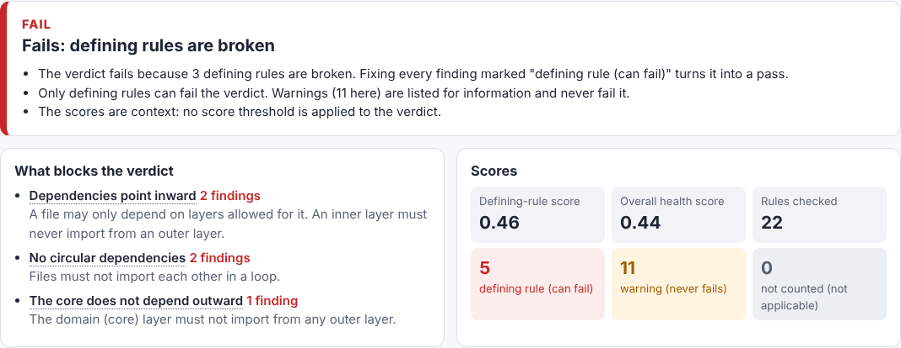
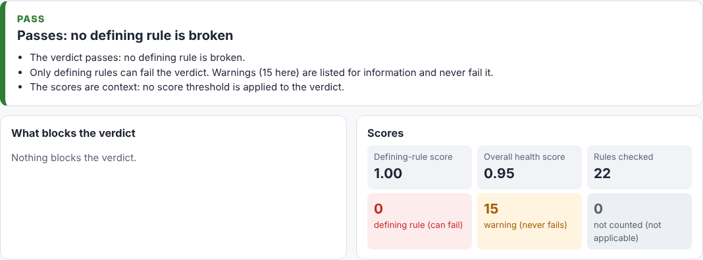
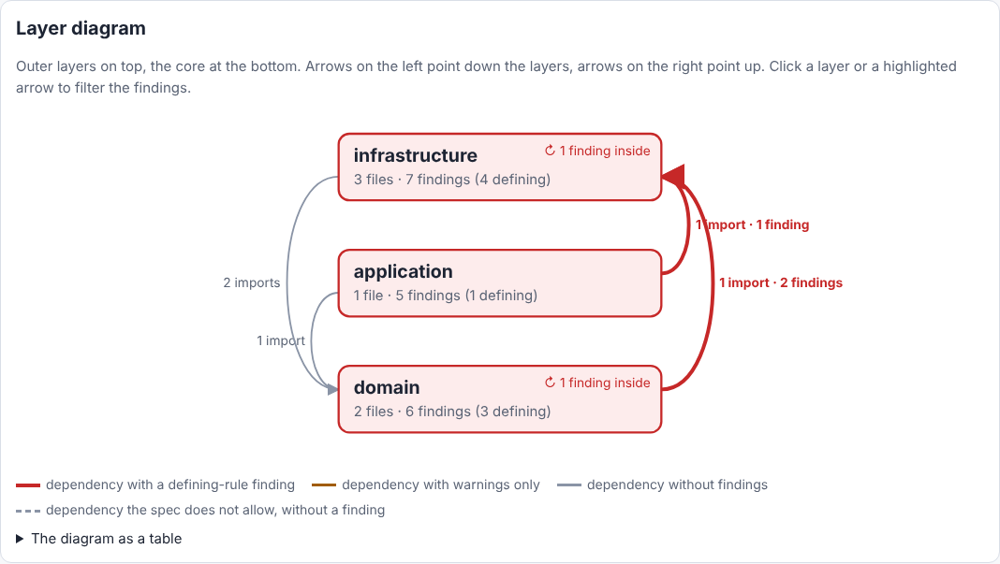
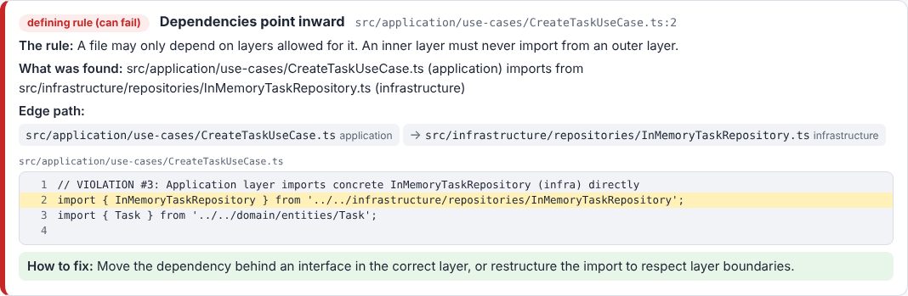
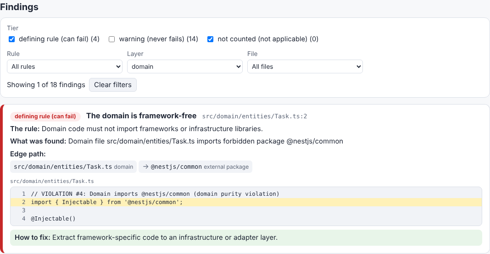
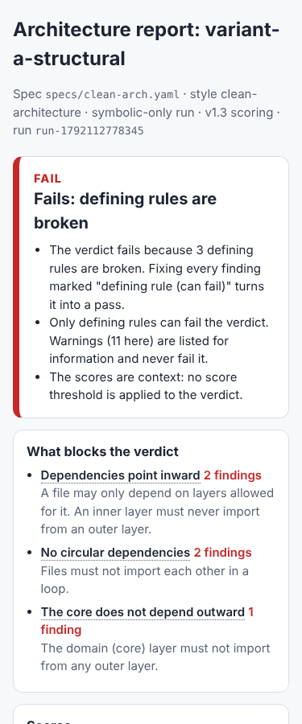

# Architect HTML report (`evaluate --html`)

`firewall evaluate --html <out.html>` writes one static HTML file next to the normal output. The file explains a run in plain language, so an architect can see at a glance what fails, where and why.

```bash
NEO4J_URI=bolt://localhost:7687 NEO4J_PASSWORD=... \
  npx tsx bin/firewall.ts evaluate --project fixtures/variant-a-structural \
    --spec specs/clean-arch.yaml --symbolic-only --html report.html
```

The flag is opt-in. Without `--html`, every output of `evaluate` (stdout, stderr and the exit code) stays the same as before. With the flag, the run prints one extra stderr line, `HTML report written to <path>`. If the file cannot be written, the run exits 2.

## What the page shows

### Summary: score, verdict, and what blocks the verdict



- **Verdict.** Under the default v1.3 scoring the verdict fails as soon as one *defining rule* is broken (`any-blocking-violation`, [rule-tiers.md](rule-tiers.md)). The panel lists the broken defining rules and how many findings each has. Fixing them turns the verdict into a pass.
- **Scores.** The *defining-rule score* is the health score over the defining rules only (`tiers.blockingAhs`). The *overall health score* is `ahsDeterministic`. Both are context only: no threshold is applied to either of them.
- **Counts by tier.** The page counts findings per tier. Defining rules that could not run are named, because they can neither pass nor fail.
- With `--scoring v1.2e` there are no tiers. In that case the summary says the verdict comes from the overall score and the spec's thresholds.

A clean run says that nothing blocks the verdict:



### Plain-language tiers

| Label on the page | v1.3 tier | Meaning |
|---|---|---|
| **defining rule (can fail)** | blocking | States what the architecture is. One finding fails the verdict. |
| **warning (never fails)** | advisory | A metric, proxy or convention. It is reported and never fails the verdict. |
| **not counted (not applicable)** | partial rule, N/A part | Currently only the FLOWS_TO field rows of `domain-state-purity`. They are shown but not counted. |

A finding gets its tier from the same lookup the scoring uses: `ruleTier`, the construct-switch resolver (when a switch is set) and the partial-rule split. The snapshot tests check that the number of defining findings equals `tiers.blocking.violationCount`, and that the listed blockers are the violated blocking rules. The page does not change any tier, rule or Cypher template.

Rule ids (`FF-S01`, …) do not appear in the visible text. They are only in the tooltip of the rule title, as `Rule id: FF-S01`.

### Layer diagram



- Each box is a layer of the spec. Outer layers are on top and the core is at the bottom. A box gives the layer's file count and finding count. *↻ N findings inside* counts dependency findings, such as a cycle, that stay inside that layer.
- Arrows on the left point down the layers. Arrows on the right point up. Each arrow is labelled with its file-level import count and its finding count.
- **Red arrows** carry a defining-rule finding. **Amber arrows** carry warnings only. **Grey arrows** carry no finding. A grey dashed arrow is a dependency the spec does not allow but that no finding reports.
- Clicking a layer filters the findings to that layer. Clicking a highlighted arrow filters them to findings on that dependency. A table version of the diagram sits under *The diagram as a table*.
- The diagram uses the run's APG: the File nodes and their literal IMPORTS edges, without resolved re-export edges. Files are assigned to layers by the spec's globs, the same way ingestion assigns them. Files outside every layer appear in a dashed *(no layer)* box.

### Findings



Each finding shows:
- its tier label and the rule's title in plain words (rule id in the tooltip);
- **The rule:** what the rule asks, in one sentence;
- **What was found:** the violation message;
- **Edge path:** `file (layer) → file (layer)` for an import. A cycle is shown as a closed loop. An imported package is marked *external package*. A project-wide metric shows *the whole project*;
- the **code excerpt**: up to two lines of context around the reported line or lines, with line numbers and the hit lines highlighted;
- **How to fix:** the existing fix hint of the actionable formatter (`src/report/actionable-formatter.ts`). v1.3 has no separate per-rule hint feature, so this is the hint shown.

### Filters



The findings can be filtered by tier (checkboxes), rule, layer and file. The diagram adds a filter by dependency edge. *Clear filters* resets all of them. If JavaScript is off, every finding is shown.

On a phone the page reflows to one column. The diagram scrolls inside its own box:



## Self-contained by construction

- One file. CSS and JavaScript are inline. The diagram is inline SVG, drawn when the report is generated. No third-party library is used, so there is nothing to vendor or pin.
- A `Content-Security-Policy` meta tag (`default-src 'none'`, inline style and script only, `data:` images) blocks every network request. The browser test checks that loading the page makes no request.
- Code excerpts are read only from source files (`.ts`, `.tsx`, `.js`, …) inside `--project`. Paths outside the project, `.env*` files and files named like secrets or credentials are never read (`src/report/architect/excerpt.ts`).
- The output is deterministic: the same report, spec and project give the same bytes. It contains no timestamp. The run id comes from the report.

## Code

| File | Role |
|---|---|
| `src/report/architect/model.ts` | Reads the report under the v1.3 tiers, the layers and the import graph, and builds the page model |
| `src/report/architect/rule-text.ts` | Plain-language rule titles and sentences, tier labels |
| `src/report/architect/excerpt.ts` | Safe excerpt reader |
| `src/report/architect/render.ts`, `styles.ts`, `client-script.ts` | HTML, CSS and the filter script |
| `src/cli/cli.ts` | The `--html` option of `evaluate` |

## Tests

- **Snapshots:** `tests/unit/report/architect-html.test.ts`, run on three reference variants. `correct-reference` is clean and passes. `variant-a-structural` and `variant-b-pattern` violate rules and fail. The suite also checks the tiers against the run's tiered scoring, that rule ids appear only in tooltips, that the page is self-contained and deterministic, and the excerpt guard.
- **Browser:** `tests/integration/report/architect-html.browser.test.ts` uses Playwright (`playwright-core` 1.56.1, Chromium). It renders the three variants at 1280, 768 and 375 px. It checks that nothing makes the page scroll sideways or spills out of its box (code blocks, the diagram and the table scroll inside their own boxes). It also checks that there is no console error or warning, no page error and no network request, and it exercises every filter. Without a Chromium the suite is skipped. Set `HTML_REPORT_BROWSER_REQUIRED=1` to make a missing browser fail the suite.

```bash
npx jest --maxWorkers=2 tests/unit/report/architect-html.test.ts
HTML_REPORT_BROWSER_REQUIRED=1 npx jest --maxWorkers=2 tests/integration/report
```

The snapshot inputs are in `tests/fixtures/html-report/*.json`: the report and the file-level import graph of each variant. They come from a symbolic-only v1.3 run with the default settings against Neo4j 5.26.24 with APOC 5.26.24, run from the Neo4j community tarball. To regenerate the inputs and the screenshots:

```bash
NEO4J_URI=bolt://localhost:7687 NEO4J_PASSWORD=... npx tsx scripts/v1.3/html-report-fixtures.ts
npx jest --maxWorkers=2 tests/unit/report/architect-html.test.ts -u
npx tsx scripts/v1.3/html-report-screenshots.ts   # writes docs/images/html-report-*.png
```
