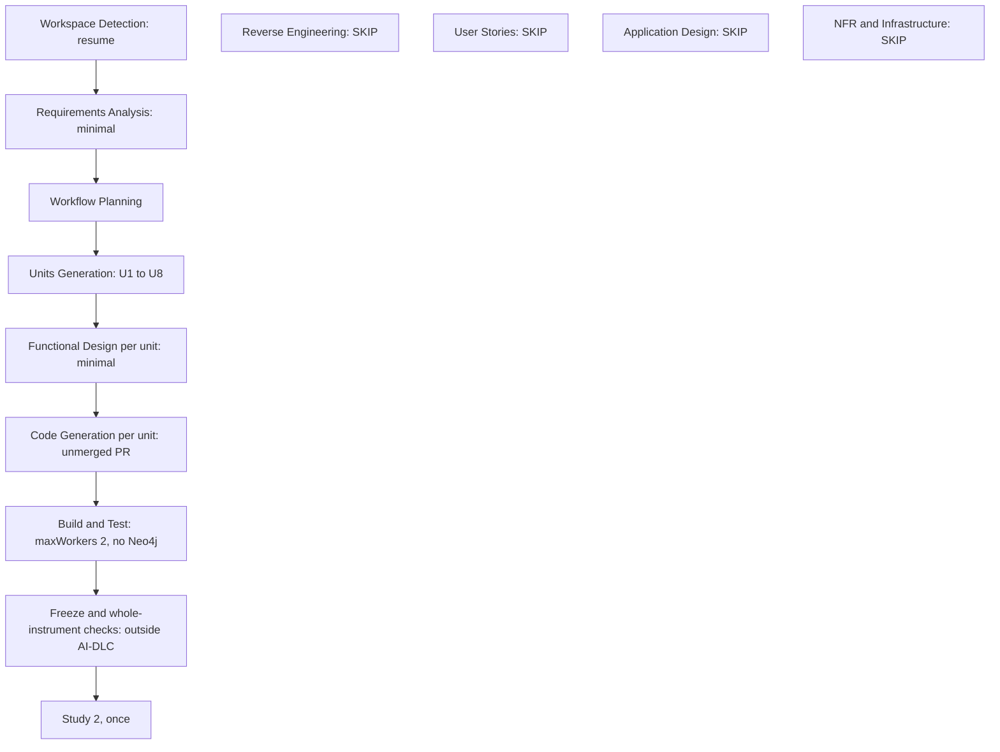

# v1.4 Instrument-Alignment: Workflow Plan

**Depth:** minimal throughout. **Requirements:** [`requirements.md`](requirements.md). **Units:** [`unit-of-work.md`](unit-of-work.md).

## 1. Stages

| Phase | Stage | Decision | Why |
|---|---|---|---|
| Inception | Workspace Detection | EXECUTE (resume) | Existing code and state file; brownfield |
| Inception | Reverse Engineering | SKIP | Artifacts exist under `aidlc-docs/inception/reverse-engineering/`; the map in `ops/01-instrument-map.md` is the current description of the system |
| Inception | Requirements Analysis | EXECUTE, minimal | Intent is clear; design lives in `ops/` and is linked, not restated |
| Inception | User Stories | SKIP | One persona (the author); no user-facing workflow change; the build list already states "done when" per item |
| Inception | Workflow Planning | EXECUTE | This page |
| Inception | Application Design | SKIP | No new components beyond those the map and the design notes already define (`ops/notes/ns-02-*`, `g08-*`, `s2d-01-*`, `eff-01-*`, `mean-01-*`) |
| Inception | Units Generation | EXECUTE, minimal | Eight units (U1 to U8) with map parts and dependencies |
| Construction | Functional Design | EXECUTE, minimal, per unit where there is new logic (U2, U3, U4, U5, U7, U8); SKIP for U6 (design only, its output is ADR drafts) and U1 (own PR) | Business rules need pinning before code; the design notes are the input |
| Construction | NFR Requirements | SKIP | NFRs are fixed at cycle level (requirements §3): machine limits, reproducibility, no model calls |
| Construction | NFR Design | SKIP | Follows from skipping NFR Requirements |
| Construction | Infrastructure Design | SKIP | No infrastructure change; no Neo4j; no deployment |
| Construction | Code Generation | EXECUTE per unit | Plan with checkboxes, then code and tests; each unit ends in an unmerged PR |
| Construction | Build and Test | EXECUTE, minimal | One run of the suite with `--maxWorkers=2` on the in-process interpreter; Neo4j-only tests skipped and listed |
| Operations | Operations | SKIP | Placeholder stage |

**After this cycle (outside AI-DLC, in `ops/03-build-list.md`):** freeze, hold-out, meaning labels, 2-case pilot, efficiency test, then Study 2. Each is counted first and needs the author's OK.

## 2. Execution order

Lanes respect the limit of two build lanes at once.

| Wave | Lane A | Lane B | Notes |
|---|---|---|---|
| 0 | U1 (in progress, own PR) | none | |
| 1 | U2 norm rules | U4 identity and drift | independent |
| 2 | U3 semantic facts | U7 meaning analysis | U3 benefits from U2 (Q26 removes framework leaks from the K3 set) |
| 3 | U5 evasion and Gemini adapter | U8 efficiency harness | U5 needs U4 (evasion counts identities) |
| any | U6 recall-fix design | | design only; slots into any free lane |

## 3. Workflow visualization

Validated per `common/content-validation.md`: node ids are alphanumeric, every label is quoted, no unescaped quotes inside labels, only `-->` edges.



### Text alternative

```
INCEPTION
- Workspace Detection ........ EXECUTE (resume)
- Reverse Engineering ........ SKIP (artifacts exist)
- Requirements Analysis ...... EXECUTE (minimal)
- User Stories ............... SKIP (one persona)
- Workflow Planning .......... EXECUTE
- Application Design ......... SKIP (design notes in ops/notes)
- Units Generation ........... EXECUTE (U1 to U8)
CONSTRUCTION (per unit)
- Functional Design .......... EXECUTE minimal (U2, U3, U4, U5, U7, U8)
- NFR Requirements / Design .. SKIP
- Infrastructure Design ...... SKIP
- Code Generation ............ EXECUTE (unmerged PR per unit)
- Build and Test ............. EXECUTE (maxWorkers 2, no Neo4j)
OPERATIONS
- Operations ................. SKIP (placeholder)
THEN (outside AI-DLC)
- Freeze -> hold-out, meaning labels, 2-case pilot, efficiency test -> Study 2 once
```

## 4. Gates

- Inception artifacts: the author approves this plan, or delegates per `ops/decisions.md`.
- Code: the author's review of each unmerged PR is the code-approval gate.
- No live model call, no Neo4j and no sealed read in any stage of this cycle.
