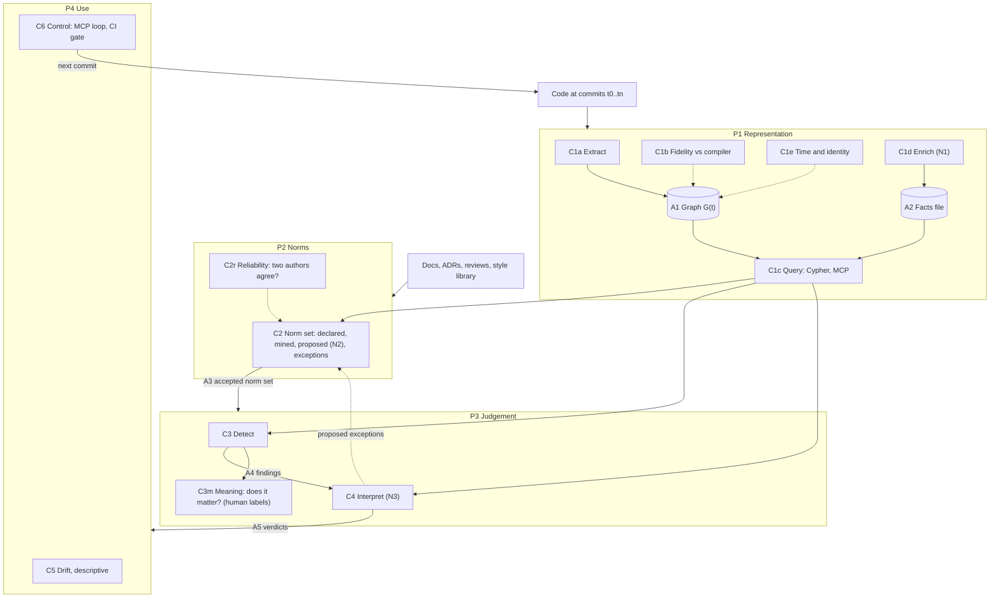

# The instrument map: its parts, how they connect, and the work left

**Status:** draft v3, 2026-10-18. This is a conceptual refactor, not a code change. It comes from the author's decomposition, the adversarial review REV-01 ([`notes/rev-01-instrument-map-fable.md`](notes/rev-01-instrument-map-fable.md)), the examiner review REV-02 ([`notes/rev-02-examiner-fable.md`](notes/rev-02-examiner-fable.md)) and the conditions register ([`02-defensibility-conditions.md`](02-defensibility-conditions.md)). Nothing new has been run for it. Every figure cites its source. Comment inline with `> AUTHOR:`.

**What changed in v3, after REV-02:**
- **New part C3m, meaning:** is a correct finding architecturally meaningful? REV-02 found it had dropped out of the map. It is now the **weakest link**, ahead of C2r.
- **C2r corrected:** the κ 0.21 comes from two Claude sessions. That makes it an upper bound on agreement between humans, not an estimate of it.
- **§1:** the claim is now the contribution statement (F1–F3) plus Study 2. "Tacit knowledge" becomes an interpretation, with what would refute it.
- **New:** a table mapping SO1–SO5 to the parts (§7b), and a four-week path with a cut list, replacing the old work list (§8).

**Contents**
1. The claim we would defend
2. The map: four planes, ten parts, six artifacts
3. The contracts between the parts
4. Each part evaluated on its own
5. The chain of trust: what each claim inherits
6. Risks not yet in view
7. Studies, placed on the map
8. The work left, in order
9. Questions for you

**What changed from v1, after REV-01:**
- Drift no longer redesigns Study 2. Study 2 stays as declared. Drift becomes a separately registered exploratory study (REV-01 findings 1 and 2).
- Time and identity become their own part, C1e (finding 6).
- Exceptions live only in C2. C4 proposes them, and a human accepts them (finding 6).
- The status figures are corrected (finding 5), with two notes:
  - **Parity.** 72,388 statements over 81 projects *is* now on main, in `Docs/v1.3/cypher-interpreter.md:20`, after #151. The claims ledger still calls it unmerged (`Docs/v1.3/compendium/claims-ledger.md:274`). That ledger line is stale, so REV-01 was half right here.
  - **MCP tool counts (corrected 2026-10-18, `ops/notes/g07-ledger-and-tool-counts.md`).** The 11 tools are the 9 spec tools that Study 2's arm allow-lists, plus `evaluate_project` and `propose_spec`. The neural tools `review_unit` and `explain_and_fix` come only with `--neural`, which makes 13. Study 2 excludes them (`Docs/v1.3/study2-outline-v2.md:43` and §3). The earlier "9 + 2 neural" was wrong.
- New: a norm-reliability part (C2r), the chain of trust (§5), and the risks (§6).

---

## 1. The claim we would defend (draft, yours to change)

**v3, after REV-02: the claim is the contribution statement plus Study 2.** The contribution statement is `Docs/v1.3/contribution-statement.md:30-32`:
- **F1:** the spec level affects the score, in the reverse direction.
- **F2:** detection is accurate. Registered held-out recall is 0.893 [0.787, 0.974], and 283/283 blocking findings are correct on human code.
- **F3:** the judge has a bounded, complementary role.

Study 2 adds whether an agent in the loop changes what it builds. The text below, on tacit knowledge, moves to the **discussion** as an interpretation, together with what would refute it. Two pieces of evidence already count against it:
- Study 1: `none` scored best (N141).
- Agents gave zero blocking findings on Clean and Hexagonal, which suggests they *do* hold those standards.

The rival reading predicts the same nulls (N128) and is simpler: "the encoded standard isn't what practitioners mean by architecture". Only C3m, meaning, can tell the two readings apart.

*Interpretation (v2 text, kept for the discussion):*

> Architectural standards are mostly **tacit**. Human teams carry them in their heads and enforce them in review. Coding agents don't have them. DaedalusArch makes these standards **explicit**, as declarative rules over a graph that matches the compiler, so that an agent or a CI gate can check code against them. The thesis shows four things:
> 1. the graph and the rule engine are correct (P1, C3);
> 2. where the norms come from limits everything downstream (P2);
> 3. a model helps where rules can't express the knowledge, by **supplying facts, not verdicts** (C1d, C4);
> 4. whether putting the instrument in an agent's loop changes the architecture the agent builds (C6, Study 2).

**Why this framing helps.** All three tests based on developer behaviour are null (N128): maintainers don't remove flagged code faster, and good repos don't score better. Under the old framing that is a hole. Under this one it is motivation: humans manage without the tool because they hold the standard tacitly, and agents need it written down.

---

## 2. The map: four planes, ten parts, six artifacts

```
                code at commits t0 ... tn
                          |
                          v
+----------------------------------------------------------+
| P1 REPRESENTATION                                        |
|   C1a extract    C1b fidelity    C1c query               |
|   C1d enrich (N1)                C1e time and identity   |
+----------------------------------------------------------+
        | A1 graph G(t)         | A2 facts file
        v                       v
+----------------------------------------------------------+
| P2 NORMS                                                 |  <-- docs, ADRs,
|   C2 norm set: declared | mined | proposed (N2)          |      reviews,
|      + exceptions, each with a justification             |      style library
|   C2r reliability: do two norm authors agree?            |
+----------------------------------------------------------+
        | A3 norm set, accepted by a human
        v
+----------------------------------------------------------+
| P3 JUDGEMENT                                             |
|   C3 detect: G(t) x norms               -> A4 findings   |
|   C4 interpret (N3): exception? severity? -> A5 verdicts |
|   C3m meaning: does a correct finding matter? (human)    |
+----------------------------------------------------------+
        | A4 findings, A5 verdicts
        v
+----------------------------------------------------------+
| P4 USE                                                   |
|   C5 drift: findings across t0 ... tn (descriptive)      |
|   C6 control: MCP in the agent loop, CI at the PR        |
+----------------------------------------------------------+
        |              A6 run record (per study)
        +----> next commit (back to P1)
```



**The four planes in one line each:**
- **P1, Representation:** can we trust the graph as a stand-in for the code?
- **P2, Norms:** what counts as a rule, and who says so?
- **P3, Judgement:** given the graph and the norms, what is wrong, and does it matter?
- **P4, Use:** what happens when this runs over time, or inside the loop?

**The neural layer isn't a part of its own.** It plays three roles:
- **N1** writes facts into A2.
- **N2** proposes norms into C2.
- **N3** interprets findings in C4.

~~In all three it reads the code only through C1c, the query layer.~~ **Corrected 2026-10-19, after the brownfield pilot (`ops/notes/ns-03-graph-complements-reading.md`): in every role the model reads the code and the docs, then uses the graph (C1c) to check and quantify what it found. The graph complements reading; it never replaces it.** Every output cites both kinds of evidence. Results are scored against two references, declared intent and code reality, and the gap between them is a measure of drift. This remains the operational form of NS-01's Claim B: the model supplies facts, and the rules reason over them.

**One engine, two sources of rules.** "Violates a rule" and "doesn't fit the rest of the graph" are the same mechanism. A deviation is a norm *mined* from G, such as "47 of 50 use cases go through a repository", which C3 then checks like any other rule. **One caveat (REV-01 §6):** this holds only for K0 and K1 knowledge. A mined majority rule needs a count-and-threshold query shape that the sealed templates don't have. K2m and K3 rules also need facts from A2. So for the higher knowledge levels, some of C3's variety leaks into C1d.

---

## 3. The contracts between the parts

Every arrow in §2 is a saved, versioned file. This is what makes each part testable on its own (§4) and the neural parts reproducible (§6, risk 5).

| Artifact | Produced by | Holds | Exists today? |
|---|---|---|---|
| **A1 graph G(t)** | C1a | nodes and edges for one commit, with the commit id | yes |
| **A2 facts file** | C1d (N1) | per fact: subject, predicate, value, source (`parser` or `model`), model id, prompt hash, date, confidence | **no**, it is new |
| **A3 norm set** | C2 | rules as YAML + Cypher; per rule: origin (`declared`, `mined` or `proposed`), the evidence cited, accepted by whom and when; exceptions with their justifications | partly: specs and presets exist, but the per-rule origin and acceptance tags are new |
| **A4 findings** | C3 | rule, location, the edge or edges involved | yes (`schemas/report.schema.json`) |
| **A5 verdicts** | C4 (N3) | per finding: exception or problem, severity, the evidence read, model id and prompt hash | partly: judge outputs exist, but the contract is not written |
| **A6 run record** | each study | inputs (A1–A3 versions), arm, model, seed, outputs | yes for Study 1, designed for Study 2 |

**Rule:** a part never reads another part's internals, only its artifact. So rules don't care whether a fact came from the parser or from a model. That is the IRIS framing, and it gives us ablations for free: run C3 with and without A2.

---

## 4. Each part evaluated on its own

Each part is tested with a **correct input handed in from upstream** (an oracle input), so that an error can be traced to the part that made it.

| Part | Question | Fed with | Truth | Evidence now | Status | Work left |
|---|---|---|---|---|---|---|
| **C1a / C1b** | does G match the code? | real repos | tsc | import edges 1.000 on 15 external repos. The DDD blocking rules use class facts that tsc doesn't check; optional constructor parameters are invisible (N38); one external verdict was computed on half its graph (N33) | **GREEN** for imports, **AMBER** for the DDD class-fact rules | D6: register as matched to the compiler, and state the DDD limit |
| **C1c** | do the engines agree? | the same Cypher on both engines | Neo4j | 72,388 statements, 81 projects, 0 content differences (`cypher-interpreter.md:20`) | **GREEN** | refresh the stale ledger line 274 |
| **C1c, efficiency** | does a model answer better or more cheaply through the graph than through raw files? | 10 written questions, 2 repos of stated size, fixed tool sets and caps | answers written first | none. Track 1 lists this as RED | **RED** | a sanity check, after the NS thread (REV-01 §8) |
| **C1d** | are N1's facts right? | hand-written K2m/K3 cases with twins | answers committed first | never run on a real model | **RED** | **the current thread:** the 2-case pilot |
| **C1e** | can one violation be followed across commits? | fix-mining histories | rename, delete and bot taxonomy | 8,319 snapshot evaluations over 36 histories (`v1.3-validity-fixes-mined-2026-10-16.md:34`) | **AMBER** | write down a formal identity for a violation |
| **C2, declared** | are the style libraries a fair reading of each style? | — | the cited literature | sealed, not expert-reviewed | **AMBER** | D1 |
| **C2, mined** | does mining recover the declared norms? | the code | the hand-written specs | 24/52 vs 50/52; DDD 1/12 (N07, dev) | **AMBER** | rerun as recall of the declared rules on the 15 external specs |
| **C2r** | do two independent norm authors agree? | the same repo, two blind authors | each other | verdict κ 0.21; same verdict on 10/15 repos (N02). **Both authors were Claude sessions**, so this is an upper bound on agreement between humans (`v1.3-spec-author-reliability.md:99-100`) | **RED**, second-weakest link | report as a limit this month. A human measurement is future work (REV-02) |
| **C3** | given correct norms, are the findings right? | the gold norm set | the norms, and the hold-out | correctness 283/283 external; clustered at the repo level, 11/11 repos, Wilson [0.741, 1]. Blind recall 0.78 [0.67, 0.86], with four styles below 0.90 (N105). Hold-out not run. **Tool baseline:** parity with dependency-cruiser on the rules both express (N61); 4 blocking rules in 7 style rows that no compared tool can express (`v1.3-validity-convergent-2026-10-16.md`) | **GREEN** for correctness, **AMBER** for recall | R1: F23, then the hold-out. **Blocker:** gate V4 may be unpassable at this size (§8, board V4) |
| **C3m** | is a correct finding architecturally meaningful? | about 60 external blocking findings, stratified by rule | one free human rater against the author, with κ ≥ 0.60 under a definition dated before the first label (V6) | 0 labels (N114); registered real-code precision 0.328 [0.132, 0.609] (N115); 51/60 human style-claiming repos fail (N116) | **RED, the weakest link** | board L4 (the definition) and D3 (the rater labels meaning) |
| **C4** | given correct findings, does N3 tell an exception from a problem? | gold findings plus intent cases | answers written first | catch rate 16/21 = 0.76 vs a target of 0.80; v1 false-fails 16/48 clean units (`study2-outline-v2.md`) | **AMBER / RED** | the NS thread, after C1d |
| **C5** | how do findings evolve in human histories? | fix-mining snapshots | the t0 norm set | survival 0.76 vs 0.75 for unflagged edges (N123); fix commits name architecture in 5/14 (N123) | **null so far** | a zero-call descriptive now, and a registered exploratory brownfield study after Study 2 |
| **C6** | does the instrument in the loop lower violations? | Study 2 as declared | the declared norms | Study 1 ran the "wrong" way; floor at N144–N150; Study 2 not run | **RED** | Study 2, unchanged, once |

---

## 5. The chain of trust: what each claim inherits

```
C6 "the gate helps"
  <- needs C3m "a finding means an architectural problem"
       <- needs C3 "the findings are right"
            <- needs A3 "the norms are right"
                 <- needs C2r "independent authors agree on the norms"
                 <- needs C1 "the graph is the code"
```

A downstream claim is only as strong as its weakest upstream link. **v3: that link is C3m, meaning.** Without it, "fewer violations" in Study 2 means fewer rule hits, not better architecture. Today it has 0 labels (N114) and a registered real-code precision of 0.328 (N115). It is also the link we can close this month: about 60 labels from the one free rater. **C2r is second.** Its κ 0.21 comes from two Claude sessions (N02), so it is reported as a limit, and a human measurement is future work.

*(v2 text, kept for the record:)* the weakest link was C2r: on the external set, two blind spec authors agree on the verdict at κ 0.21 (N02). Every external figure inherits this. That is why external results are AMBER even when C3 is perfect.

**What follows for the design:**
- **Greenfield claims can be confirmatory.** In greenfield, the norms are *declared* (the spec and the style library), so C2r shrinks to "is the style library a fair reading of the style", which is a sourcing question (SO1). Study 2 lives here.
- **Brownfield claims stay exploratory until C2r improves.** On an existing repo, someone has to *recover* the norms, and recovered norms disagree. Norm recovery, drift on human histories and review-history truth all sit here.
- **The free rater (v3, reversed after REV-02):** they label the **meaningfulness** of about 60 findings (C3m), plus the K3 cases. Writing specs blind for 3–4 repos can't give a κ with a usable interval: 15 repos gave Bland–Altman limits of −28 to +33 (N02). Labelling meaning also matches what gate V5 asks of an independent labeller.

---

## 6. Risks not yet in view

| # | Risk | It hits | Mitigation | When |
|---|---|---|---|---|
| 1 | **C2 dominates.** Correct detection against a contested spec means little | every external claim | §5: confirmatory claims in greenfield only; the rater on C2r | now, as a framing decision |
| 2 | **"So what?"** All criteria based on developer behaviour are null (N128) | the defence, SO4 | the tacit-knowledge claim (§1). Report the nulls as they are | now, in the framing |
| 3 | **Gaming.** The MCP arm lowers its count by dodging rules (moving code to unchecked places, wrapping or inlining calls), not by respecting the architecture | Study 2 (C6) | an evasion check, pre-registered: acceptance tests pass, a sample of passing diffs is read for code that was only moved, and findings outside any rule's scope are counted | **before pre-registration** |
| 4 | **Same model family.** Generator, judge and semantic layer are all Claude, so their blind spots correlate (gate V10) | C1d, C4, Study 2 | a cross-family check through one adapter (the Gemini key now; Codex about Nov 9). Plan it, don't just allow it | at the C1d pilot |
| 5 | **Reproducibility.** Model versions change before the defence | A2, A5 | saved artifacts with model id, prompt hash and date. Results are **replayed**, not regenerated | the A2 contract, at the pilot |
| 6 | **Contamination.** The external repos are public, and their rule baselines are from 2026 and the AI era (40/42 depcruise baselines, track 2). Models may have seen them | C1d, C2 mined, C4 | hand-written cases as the clean control; state it in the threats to validity | in writing |
| 7 | **Deviation count.** Study 2 already has a declared deviation. Each further change after the seal reads as hunting for a design that works | the examiner's view of SO5 | a freeze date; anything new becomes a separate exploratory study, never a change to Study 2 | now |

---

## 7. Studies, placed on the map

| Study | Parts it tests | Norms come from | Kind | State |
|---|---|---|---|---|
| Study 1 (v1.2E) | C6 | declared | registered, done | GREEN as registered. It ran the "wrong" way |
| Hold-out (R1) | C3 | declared | confirmatory | not run; F23 first |
| NS thread (R3) | C1d, then C4 | declared, plus hand-written intent | pilot, then confirmatory on its own set | **current thread** |
| Meaning labels (new R2, v3) | C3m | declared | measurement, κ ≥ 0.60 | week 2; needs board L4 and D3 |
| Norm reliability | C2r, C2 mined | blind authors | limit this month | future work (REV-02) |
| Study 2 | C6 | declared | confirmatory, runs once | designed; readiness 1/42 (Oct 16) |
| Drift (exploratory) | C5, C1e | recovered (brownfield) | exploratory, registered separately | after Study 2; `floor-escape-design-2026-10-16.md` row 4 already says "not for Study 2" |
| Efficiency check | C1c | — | sanity check | later |

---

## 7b. The objectives, placed on the parts

The proposal's own research questions are **not in the repo**. Its compliance register is Notion-only, cited in `Docs/v1.3/research/distinction-readiness.md` as K7. The table below therefore uses SO1–SO5 and K7's recorded status. Before the director meeting, check it against the proposal itself.

| Objective | Parts | K7 status, and what that means for us |
|---|---|---|
| SO1 specs and style libraries | C2 declared | The promise of "30+ rules over 7 symbolic dimensions" was not reached. Argue it as a declared deviation |
| SO2 graph and tooling | C1a–C1e, C3 | strongest objective (F2) |
| SO3 neuro-symbolic gate | C1d, C4 | "Partial"; judge κ against human labels unmeasured. This month: **design plus the 2-case pilot**, stated as such |
| SO4 validity | C3 (hold-out), **C3m** (meaning) | SO4-7 independent labelling "Not met". The C3m labels deliver it in part |
| SO5 agent study | C6 | Study 1 as registered. Study 2 once, as declared, most likely **Layered** in practice (§8) |

---

## 8. The work left: a four-week path (v3, from REV-02)

The working mode still holds: a note before any call, 2-case pilots, and the director at the design stage. "One thread at a time" applies to **your attention**. Zero-call agent work runs alongside it.

**Week 1 (Oct 19–25), zero calls**
- F23. The B2 and T1 re-scores.
- **The count of expected blocking findings per Study 2 style**, then the V4 ADR if a style falls short.
- Confirm the decision sheet.
- The meaningfulness codebook (board L4), with one κ definition dated before the first label.
- The six K3/K2m cases, with answers committed.
- Three rows in the threat register: contamination, evasion, role overlap.
- The Codex contingency decided.

**Week 2 (Oct 26–Nov 1)**
- The validation pilot: Layered and DDD base rates, 24 turns, counted first.
- Re-run the power simulation.
- **The rater's 2–3 hours: about 60 meaningfulness labels plus the K3 cases.**
- Instrument freeze.
- The hold-out, run once on Neo4j.

**Week 3 (Nov 2–8)**
- The C1d 2-case pilot (10–20 calls).
- The evasion protocol.
- The pre-registration, hashed.
- The dress rehearsal.

**Week 4 (Nov 9–17)**
- The Codex pin and S4 probe.
- The readiness gate.
- **Study 2, once (Nov 18–22).**
- In parallel: the limitations chapter, written from `nulls-and-limits.md`.

**Cut to future work:** a human C2r measurement, the drift study, the efficiency check, mined-norm recall, the review-comment count, Q26, the DDD cycle rule, judge v2.x, NS1–NS3 at scale, and the cross-family C1d arm.

**Conditions for calling a result confirmatory** (REV-02; registered thresholds are cited in [`02-defensibility-conditions.md`](02-defensibility-conditions.md)):

| Result | Condition |
|---|---|
| Hold-out | pooled blocking recall ≥ 0.90 with Wilson lower bound ≥ 0.80; 0 incorrect blocking findings. Per style, report the point and the interval; any style below 0.90 is "characterised" |
| External correctness | quote 283/283 together with the repo-level interval [0.741, 1] |
| Meaning (C3m) | n ≥ 60; author–rater κ ≥ 0.60 under the dated definition; meaningful precision reported with its interval. Otherwise report the construct as unlabelled |
| Study 2 | all of the following, or it is reported as descriptive: pre-registered before the first call; pilot mean Y ≥ 1.5 at step 4; power ≥ 0.80 at RR 0.25 for H1 and H2; both generators; Holm correction; tool use in ≥ 80 % of MCP steps, otherwise "no mechanism"; MCP-arm acceptance within 10 points of `none`; 10 passing diffs read, with 0 that only moved code |
| SO3 (C1d) | design plus pilot. The confirmatory bar is ≥ 6 cases with twins, ≥ 5/6 correct, 0 twin false positives and two vendors. It isn't reachable this month, and we say so now |

**Writing:** the chapters follow the planes. Ch. 4 covers P1 and P2. The evaluation chapters go through §4 part by part, then §5, then the studies.

---

## 9. Questions for you

1. Do the four planes (P1–P4) and ten parts fit the way you think about the instrument?
2. Is §1 the thesis you want to defend?
3. Should confirmatory claims stay in greenfield, with brownfield exploratory (§5)?
4. (v3) Should the free rater label meaningfulness (C3m, about 60 findings) plus the K3 cases? This reverses v2's suggestion of writing norms blind (REV-02).
5. Should N3 run before detection, as facts in N1, or after it, as triage? NS-01 leans to before.
6. Should the efficiency test (C1c) be a sanity check, or a thesis result? REV-01 recommends a sanity check.

## Changelog
- 2026-10-19: corrected the neural-layer rule. The graph complements reading (NS-03).
- 2026-10-18 v3: after REV-02 and the conditions register. New part C3m (meaning) is the weakest link. C2r corrected to two Claude sessions. §1 claim is now F1–F3 plus Study 2. New §7b, SO-to-parts. §8 is now a four-week path with a cut list and confirmatory conditions. C1 split into imports vs DDD class facts. C3 gains the tool baseline and the clustered bound.
- 2026-10-18 v2: four planes, C1e, C2r, artifacts A1–A6, per-part evaluation, chain of trust, risks, studies on the map, ordered work. Drift moved out of Study 2. Figures corrected after REV-01.
- 2026-10-18 v1: first draft, from the author's decomposition.
