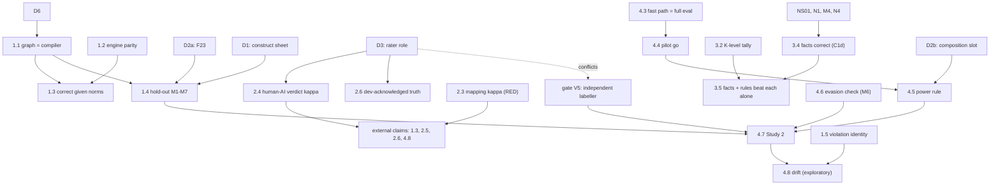

# Defensibility conditions: what must be true for each claim, and how far we are

**Status:** draft v1, 2026-10-18. This is a planning register, not thesis text. Nothing was run for it. It reads `ops/01-instrument-map.md` (v2), the tracks, `ops/decisions.md`, NS-01, the decision board and the v1.3 compendium. Every figure cites an `Nxx`/`Lxx` id (`Docs/v1.3/compendium/nulls-and-limits.md`) or a `file:line`. Thresholds marked **`proposed`** are new here and are not registered. Costs marked **`est.`** are this note's estimates. Board decision ids (NS01, D1–D7, M1–M6, N1–N4) are those of the decision board and `ops/decisions.md`. Comment inline with `> AUTHOR:`.

**Status key:** GREEN = condition met · AMBER = partly met · RED = not met · NOT STARTED = no evidence yet.

## Reconciled with REV-02 (2026-10-18). These overrides apply wherever a row below disagrees

This register and the examiner review ([`notes/rev-02-examiner-fable.md`](notes/rev-02-examiner-fable.md)) were written in parallel. Checked against the repo, the review's evidence holds. Where the two disagree, the review wins:

1. **Meaning is the weakest link, ahead of C2r.** Whether a correct blocking finding is architecturally meaningful has 0 labels (N114). Registered real-code precision is 0.328 [0.132, 0.609] (N115). 51 of 60 human style-claiming repos fail (N116). The κ 0.21 behind C2r comes from **two Claude sessions**, which the source calls "an upper bound on cross-human agreement, not an estimate of it" (`Docs/DiagnosticRuns/v1.3-spec-author-reliability.md:99-100`). So row **2.7 moves from group E (declare a limit) to closable.** The one free human labels the meaningfulness of about 60 external blocking findings, stratified by rule, under a κ definition dated before the first label (V6), plus the hand-written K3 cases. That is also what gate V5 asks of an independent labeller, so **the X1 deviation goes away** for the task. It may remain for the rater's profile, if the gate requires a professional developer.
2. **Row 2.4 (one blind human spec author) is cut to future work.** Three or four repos can't give a κ with a usable interval, since 15 repos gave Bland–Altman limits of −28 to +33 (N02).
3. **New blocker on row 1.4.** Gate V4 is per style and has no waiver. A style the hold-out only "characterises" can't use the blocking outcome (`Docs/v1.3/study2-outline-v2.md:302`). Below about 35 expected blocking findings per style, the lower bound can't pass (`Docs/v1.3/compendium/open-items.md:19`). The first step is a zero-call count of expected blocking findings per Study 2 style. If any style falls short, an ADR before the freeze redefines V4 (board decision **V4**). *(2026-10-19: the count was done and triggered it. The ADR is drafted, with one bar and the "characterised" route: [`../Docs/v1.4/adr-v4-holdout-bar.md`](../Docs/v1.4/adr-v4-holdout-bar.md), proposed. Whether the lower bound blocks is settled there, not here.)*
4. **Rows 3.4–3.5 are scoped to this month.** SO3 is reported as a **design plus the 2-case pilot**. The confirmatory bar (≥ 6 cases with twins, ≥ 5/6 correct, 0 twin false positives, two vendors) is stated now as future work. The roughly 110-call set and NS1–NS3 move to future work.
5. **Cut to future work:** the drift study, the efficiency check, mined-norm recall, the review-comment count, Q26, the DDD cycle rule, judge v2.x, the cross-family C1d arm.
6. **New rows the register lacks:** a tool baseline for C3 (parity on shared rules, N61; 4 blocking rules in 7 style rows that no other tool expresses, `Docs/DiagnosticRuns/v1.3-validity-convergent-2026-10-16.md`); three rows in the threat register (contamination, evasion, role overlap V13-TV-D1); a Codex contingency for V10(a); the pre-registration form and venue.

---

## 1. The claim tree

Sub-claims from map §1 (`ops/01-instrument-map.md:29-33`). Row ids are used in §2–§4.

- **SC0, framing.** Standards are tacit, and agents need them written down (M1).
  - 0.1 The null developer-behaviour criteria are motivation, not a hole. Parts: all.
- **SC1. The graph and the rule engine are correct** (P1, C3).
  - 1.1 The import graph matches the compiler. C1a/b
  - 1.2 The engines agree, and the rules complete. C1c
  - 1.3 Findings are correct given the norms (external set). C3
  - 1.4 Held-out blocking recall and precision. C3
  - 1.5 One violation can be followed across commits. C1e
  - 1.6 A model answers better through the graph than through raw files (sanity check). C1c
- **SC2. Where the norms come from limits everything downstream** (P2).
  - 2.1 Verdicts are sensitive to who writes the norms, and how much they say. C2, C2r
  - 2.2 The declared style libraries are a fair reading of each style. C2 declared
  - 2.3 Two authors agree on the file-to-layer mapping. C2r
  - 2.4 A human and an AI author agree on verdicts. C2r
  - 2.5 Mined norms recover the declared norms. C2 mined
  - 2.6 Findings match developers' own acknowledged rules. C2, C3
  - 2.7 Findings are architecturally meaningful (Link 4). C3, C4
- **SC3. A model helps by supplying facts, not verdicts** (C1d, C4).
  - 3.1 End-to-end judge catch rate. C4
  - 3.2 Complementarity, reported by knowledge level. C3, C4
  - 3.3 Judge vs cross-vendor panel (the registered SO3 headline). C4
  - 3.4 N1's facts are correct on hand-written K3/K2m cases. C1d
  - 3.5 Rules over graph + facts beat rules alone and the model alone, on K3/K2m. C1d, C3, C4
- **SC4. Putting the instrument in an agent's loop changes the architecture it builds** (C6, Study 2).
  - 4.1 Study 1, as registered. C6
  - 4.2 The floor: agents rarely break defining rules in greenfield code. C6, C3
  - 4.3 The MCP fast path matches the full evaluation. C6, C1c
  - 4.4 The validation pilot passes its go rule. C6
  - 4.5 The power rule holds for at least one contrast. C6
  - 4.6 Evasion check: a lower count is not rule dodging. C6, C3
  - 4.7 Study 2, confirmatory H1–H3. C6
  - 4.8 Drift in human histories (exploratory). C5, C1e

---

## 2. The conditions table

Kind: **C** confirmatory, **E** exploratory, **D** descriptive. Cost: calls = model calls; ad = agent-days; ah = author hours.

| Row | Part(s) | Kind | Condition to report it as stated | Evidence now (source) | Gap | Closing action | Cost | Depends on | Status |
|---|---|---|---|---|---|---|---|---|---|
| 0.1 | all | D | `proposed`: the claim is adopted (M1) and checked against the proposal compliance register. The nulls are reported as nulls, never as support. "Tacit" is labelled argued, not measured | 3 behaviour criteria null (N128) | M1 open; "tacit" is unmeasured (board M1 cons) | Decide M1; walk through the compliance register | 0 calls; 2 ah `est.` | M1 | AMBER |
| 1.1 | C1a/b | C | M7 import-edge precision/recall ≥ 0.95 (`Docs/v1.3/holdout-prespec.md:69`); oracle = tsc if D6 = A | 1.000/1.000 vs tsc on 15 external (`ops/track-1-instrument.md:70`); 57/60 (N31) | `human_verdict` empty (L29); silent alias gaps (N32, N33) | Register D6; M7 at the hold-out; warn on unresolved `baseUrl`/`paths` | 0 calls; 0.5 ad `est.` | D6, 1.4 | AMBER |
| 1.2 | C1c | D | `proposed`: 0 content differences at the freeze commit; every blocking rule completes, or the verdict is marked incomplete | 72,388 statements, 81 projects, 0 content (`Docs/v1.3/cypher-interpreter.md:20`) | Ledger line stale (`Docs/v1.3/compendium/claims-ledger.md:274`); FF-S02 timeouts (N45); FF-P05 parity not re-measured (N47) | Refresh the ledger; re-run parity at the freeze | 0 calls; 0.5 ad `est.` | — | GREEN |
| 1.3 | C3 | D | M3 precision (correct) ≥ 0.90 (`holdout-prespec.md:68`), quoted with the repo-level clustered bound (claims-ledger K174) and "given the spec" | 283/283; 11/11 repos, Wilson [0.741, 1] (`ops/track-2-scale.md:27`); convergent κ 0.913–1.000 (`Docs/v1.3/study2-outline-v2.md:63`), low per rule (N130) | Clustered: 3 repos hold 214 (L182); specs are AI-written (L180) | Report as is, with N130 per-rule κ | 0 | 1.1, 1.2, M2 | GREEN |
| 1.4 | C3 | C | M1 ≥ 0.90 per style; M2/M3 ≥ 0.90; claim levels (`holdout-prespec.md:67-75`). Point estimate plus Wilson LB; LB passes only at n ≥ 35 (`:75`) | Not run (L177). Dev blind recall 0.78, four styles < 0.90 (N105) | No held-out estimate; enlarged by an agent (L178) | F23 → construct sheet → freeze → hold-out once on Neo4j | 0 calls; 0.5 ad (`Docs/v1.3/gap-closing-plan.md:167`) | D2a, D1, D5, N3 | NOT STARTED |
| 1.5 | C1e | D | `proposed`: a written violation identity, applied to the fix-mining histories, with rename/delete/bot rates reported | 8,319 snapshot evaluations, 36 histories (`ops/01-instrument-map.md:152`) | No formal identity | Write it, then apply it | 0 calls; 1 ad `est.` | M3 | AMBER |
| 1.6 | C1c | E | 10 written questions, 2 repos, fixed tools and caps, both directions reported (board M5) | None (`ops/01-instrument-map.md:150`) | Not designed | After the NS thread | about 40 calls `est.` | M5 | NOT STARTED |
| 2.1 | C2, C2r | D | Already pre-stated: verdict κ against the full spec, by rung | L1 κ 0.33 (N04); L2 κ 0.68 (N03); blind authors κ 0.21 (N02) | Both authors are Claude (L25); ladder defined by a routine (L23) | Report as the SC2 evidence, with L23–L25 | 0 | — | GREEN |
| 2.2 | C2 declared | D | Every blocking rule has a source row and a support status (L01–L04); 25 construct answers confirmed (L11) | Sealed; supplement added; no expert review (`ops/track-1-instrument.md:34-35`) | 0/25 confirmed (`Docs/v1.3/compendium/open-items.md:18`); L02, L03 stricter than the source | D1; state L02/L03 explicitly; decide D5 and N3 | 0 calls; 4 ah `est.` | D1, D5, N3, N4 | AMBER |
| 2.3 | C2r | C | Per-repo mapping κ ≥ 0.80 on 12 of 15 (registered, N01) | κ 0.77 pooled; 4/15 (N01) | Missed; both authors AI (L25) | Report as a null; no rerun | 0 | — | RED |
| 2.4 | C2r | D | `proposed`: one human author writes specs blind for 3–4 repos from a codebook; verdict κ with the AI author reported before and after adjudication. At n = 3–4 this is descriptive only | AI–AI verdict κ 0.21, 10/15 (N02) | No human author | D3 = A; write the codebook; fix one κ definition (gate V6) | 0 calls; rater 2–3 h (`ops/track-2-scale.md:42`); 3 ah, 1 ad `est.` | D3, M2 | RED |
| 2.5 | C2 mined | E | `proposed`: recall of the declared blocking rules from the 15 external specs, per style. No threshold | 24/52 vs 50/52; DDD 1/12 (N07); non-dependency 0 (N05) | External recall not measured; wrong-but-consistent code (L19) | Rerun as recall against the 15 specs | 0 calls; 1 ad `est.` | M2, 2.4 | AMBER |
| 2.6 | C2, C3 | E | `proposed`: per-repo recall and precision lower bound, Wilson, as a declared second criterion | About 8 repos, about 120–150 positives (`ops/track-2-scale.md:41`); dev rules never violated in 112 commits (N138) | Not built; construct change; AI-era baselines (`ops/track-2-scale.md:44`) | Build the set and the no-restricted-paths reader | 0 calls; 3.5–4.5 ad (`ops/track-2-scale.md:41`) | D3 | NOT STARTED |
| 2.7 | C3, C4 | C | Labeller κ ≥ 0.60 (`Docs/v1.3/validation-protocol.md:32`); V5 independent rater (`Docs/v1.3/study2-readiness-gate.md:117-122`) | 0 labels (N114); registered precision 0.328 (N115) | No labels; LB can't show 0.60 (L128) | D3 settled (2026-10-18): the free rater labels about 60 findings, after the study (LAB, `decisions.md:21`). The agentic route (MEAN-02) adds consequence and style fidelity, never field A | 0 | D3 | RED |
| 3.1 | C4 | C | Catch ≥ 0.80 per operator (`aidlc-docs/inception/requirements/v1.3-validity-requirements.md:47`) | 16/21 = 0.76 [0.55, 0.89] (N63); 0/65 verdicts changed (N85); false-fails 10/55 twins (N72) | Missed | Report as a null; stop tuning | 0 | N1 | RED |
| 3.2 | C3, C4 | D | Report by level (N2): K0 12, K1 4, K2s 9, K3 1 (`ops/notes/ns-01-what-rules-cannot-see.md:56`); fair cut 8/12 (N91). `proposed`: a second person assigns the levels (NS-01 §7.5) | Tally exists; one assigner | N2 open; level reliability unknown | Decide N2; the rater assigns 26 levels | 0 calls; 1 h rater `est.` | N2, D3 | AMBER |
| 3.3 | C4 | C | Panel Fleiss κ ≥ 0.60 (`Docs/v1.3/validity-evidence-summary.md:220`) | n = 0 (N81); dry run only (L82) | No panel run | Demote it under N1 as a declared deviation, or run the panel | 0, or uncounted calls | N1 | RED |
| 3.4 | C1d | C (own set) | `proposed` pilot go: both cases labelled right, the control not flagged, runs agree. Then per-fact accuracy, twin false-label rate and run-to-run agreement on the about-6-case set, answers committed first (NS-01 §9 rows 3, 5) | Mock only; proxies 0/3 (N100, L84) | Never on a real model; A2 contract missing | NS01 read → A2 contract → K3/K2m set → 2-case pilot with a cross-family arm | Pilot 10–20 calls (`ops/01-instrument-map.md:217`); set about 110 calls (`ops/track-1-instrument.md:111`) | NS01, N1, M4, N4 | NOT STARTED |
| 3.5 | C1d, C3, C4 | C (own set) | `proposed`: pre-stated comparison of rules + facts vs rules alone vs the model alone at stated cost. NS-01 §7 falsifiers 1–4 not triggered | None | Not designed | Design after 3.4; director at design | NS3 about 312, or NS1 487 + NS2 415; Gemini 330 optional (`ops/track-1-instrument.md:111`) | 3.4, 3.2 | NOT STARTED |
| 4.1 | C6 | C | Registered v1.2E analysis, Holm | Effect reversed, p = 0.0003 (N141); no model effect (N142) | Not comparable with v1.3 (L09) | Report as registered | 0 | — | GREEN |
| 4.2 | C6, C3 | D | Deviation fallback: the floor reported as a measured result (`Docs/v1.3/study2-deviation-2026-10-16.md:38`) | 1 blocking finding in 54 steps (N153); 0/8 per condition (N150) | Single sessions, no replicate (L135) | Report as is | 0 | — | GREEN |
| 4.3 | C6, C1c | D | `proposed`: fast path = full evaluation on all DDD and Layered variants, including spec-only mode | 71/71 with a root, 64/71 spec-only (L52); missed feedback twice (N51); 7/71 disagree (N54) | Spec-only gap; no live smoke run (L57) | Fix the fast path for DDD and Layered | 0 calls; 1–2 ad `est.` | — | AMBER |
| 4.4 | C6 | C (gate) | Per style: mean Y ≥ 1.5 at step 4, ≥ 2/3 runs Y ≥ 1, unmapped ≤ 10 %, 0 errors (`Docs/v1.3/compendium/open-items.md:17`) | Not run; DDD about a coin flip (`ops/track-2-scale.md:58`) | Prerequisites open (`open-items.md:16`) | D1 → B2, T1 re-scores → frames → count calls → run | Calls uncounted (`ops/track-2-scale.md:76`) | D1, D2a, D2b, D5, 4.3 | NOT STARTED |
| 4.5 | C6 | C (gate) | Each confirmatory contrast ≥ 0.80 at RR 0.25 after the pilot, else demoted; none, then no run (`study2-deviation-2026-10-16.md:91-95`) | H3 0.92 at base 5.33 (`:78`); 0.31 at mean 1.5 (`:82`) | Base rate is pre-repair (L142). D2b keeps the Layered level base rate at 5.33 (`ops/decisions.md:50`); 2.67 is the drift mean of D (`notes/s2d-01-study2-drift-design.md:49`), a different outcome | Re-run the simulation with the pilot's mean and θ | 0 calls | 4.4, D2b | AMBER |
| 4.6 | C6, C3 | C (pre-reg) | `proposed`: acceptance tests pass (gate D12); about 10 passing diffs read for moved-only code; out-of-scope findings counted per arm | None; acceptance runner passed no test on the tapes (L152) | Not built | Write it into the pre-registration (M6) | 0 calls; 1 ad, 2 ah `est.` | M6, D12 | NOT STARTED |
| 4.7 | C6 | C | Holm over the surviving H1–H3, block sign-flip (`study2-deviation-2026-10-16.md:34`); gate all green, incl. V3–V5 and V10(a) (`:36`); author signs | Gate 1/42 green (N166) | Not run; not pre-registered (L149) | Canonical order (`study2-deviation-2026-10-16.md:98-109`) | 480 + 64 step turns (`:74`) | 1.4, 4.4, 4.5, 4.6, 2.7 (V5), D3 | NOT STARTED |
| 4.8 | C5, C1e | E | `proposed`: registered separately before any new data is read; uses 1.5's identity; never changes Study 2 (M3) | Survival 0.76 vs 0.75 (N123); slope sign test p = 0.219 (N129) | Not designed | Zero-call descriptive now; the study after 4.7 | 0 calls now | M3, 1.5, 2.4 | NOT STARTED |

**Tally:** 27 rows. GREEN 5 (1.2, 1.3, 2.1, 4.1, 4.2) · AMBER 8 (0.1, 1.1, 1.5, 2.2, 2.5, 3.2, 4.3, 4.5) · RED 5 (2.3, 2.4, 2.7, 3.1, 3.3) · NOT STARTED 9 (1.4, 1.6, 2.6, 3.4, 3.5, 4.4, 4.6, 4.7, 4.8).

---

## 3. Conditions on conditions (the alignment)

**Dependency list**
- 1.3 and 1.4 inherit 1.1 and 1.2: findings can't be better than the graph.
- **External claims (1.3 as "these repos break their architecture", 2.5, 2.6, 4.8) inherit C2r (2.3, 2.4).** Under M2 = A they stay exploratory or descriptive until 2.4 improves.
- 1.4 needs D2a (F23), D1 (construct answers), D5 and N3 settled, because the tiers freeze first.
- 3.5 needs 3.4: C4 rests on C1d. 3.4 needs NS01, N1, M4 and N4. 3.2's level reliability is the frame 3.5 is judged in.
- 4.7 needs 1.4 (gate V3/V4), 4.4 → 4.5, 4.6, and V5 (2.7).
- 4.8 needs 1.5 and M3, and runs after 4.7.



**Plain-text fallback**
```
D6 -> 1.1 -> 1.3, 1.4          1.2 -> 1.3
D2a (F23), D1 -> 1.4 -> 4.7
D3 -> 2.4, 2.6;  2.3, 2.4 -> external claims (1.3 ext, 2.5, 2.6, 4.8)
NS01, N1, M4, N4 -> 3.4 -> 3.5 <- 3.2
4.3 -> 4.4 -> 4.5 <- D2b;  4.5, 4.6, 1.4, V5 -> 4.7
1.5, 4.7, M3 -> 4.8
D3 (option A) --conflicts--> gate V5
```

**Circular or contradictory conditions (flagged)**

| # | Conflict | Why it matters | Resolution |
|---|---|---|---|
| X1 | **D3 = A vs gate V5.** V5 needs an independent professional TypeScript developer to finish the *hold-out labelling* (`Docs/v1.3/study2-readiness-gate.md:119,122`). D3 = A sends the one free rater to C2r. V4 depends on V5 (`:115`), and 4.7 needs the gate green | As written, Study 2 can't go green under D3 = A | A dated deviation that redefines V5 *before* the freeze (gate rule 1). Or the rater does both, which doesn't fit 2–3 h |
| X2 | **One rater, three jobs**: 2.4 (blind specs), 3.2 (K-levels), the K3 labels (NS-01 §8) | The time is about 2–3 h (`ops/track-2-scale.md:42`) | Order: 2.4 first, then the 26 K-level assignments (small) |
| X3 | **C2 ↔ C4 loop.** C4 proposes exceptions into C2, and C3 reads C2 (`ops/01-instrument-map.md:100`) | Circular by design | A3 is frozen and human-accepted before any C3 run in a study |
| X4 | **2.5 measures agreement with an AI author**, whose reliability is 2.4's question (L180) | Mined recall isn't recall against truth | Report it as agreement with the declared specs |
| X5 | **The go rule isn't a power rule.** Mean 1.5 passes 4.4 but gives H3 0.31 (`study2-deviation-2026-10-16.md:82`; `Docs/v1.3/level-power-sim-2026-10-16.md:195`) | A passing pilot can still end in "no run" | Not contradictory, because 4.5 runs after 4.4. Pre-state it so it doesn't read as a surprise |
| X6 | **D2b vs 4.5.** *(Resolved 2026-10-18.)* D2b keeps counting wiring-code imports, so the Layered level base rate stays 5.33 (`ops/decisions.md:50`); wiring is a stated construct limit (`notes/g12-d2b-construct-limit.md`). The 2.67 figure is the drift mean of D (`notes/s2d-01-study2-drift-design.md:49`), not a repaired level | — | No demotion from D2b |
| X7 | **4.6 leans on D12, which can be waived** ([W], `study2-readiness-gate.md:390`) | Waive D12 and the evasion check loses its first leg | Make D12 non-waivable in the pre-registration, or state it |
| X8 | **N3/D5 = limit keeps the tiers frozen.** B = add a rule, which changes Study 2's scored tiers | Any post-seal rule needs a re-freeze before 1.4 | Decide before the freeze |

---

## 4. Gap summary

**A. Closable now, zero cost** (agent work, 0 calls). Order:
1. Refresh claims-ledger line 274 (1.2).
2. F23, once D2a is OK'd (1.4, 4.4).
3. Write the K3/K2m case set and the A2 contract, with answers committed (3.4).
4. Fix the MCP fast path for DDD and Layered (4.3).
5. Write the C1e identity (1.5), then the C5 zero-call descriptive (4.8).
6. Mined-norm recall against the 15 specs (2.5).
7. Count architecture review comments on 2 repos (`ops/01-instrument-map.md:224`).

**B. Needs an author decision.** Order: NS01 → D2a → D3 (and the X1 deviation for V5) → M2 → M1 → N1, N2 → D1 → D6, D5, N3 (low) → D2b → M6 (and D12) → M4, N4 → M3 → M5.

**C. Needs model calls** (counted by a dry run first). Order:
1. C1d pilot, 10–20 calls (`ops/01-instrument-map.md:217`).
2. K3/K2m set, about 110 calls (`ops/track-1-instrument.md:111`).
3. The 3.5 comparison: NS3 about 312, or NS1 487 + NS2 415; Gemini 330 optional (`ops/track-1-instrument.md:111`).
4. The validation pilot (uncounted, `ops/track-2-scale.md:76`).
5. 1.6, about 40 `est.`

The panel (3.3) and LC1 (1,536 calls, `ops/decisions.md:24`) are not recommended.

**D. Needs the single Study 2 run.** 4.7, with 4.6 applied to its outputs and the memo §5 secondaries. Cost: 480 + 64 step turns (`study2-deviation-2026-10-16.md:74`). It runs only after the hold-out (1.4), the dress rehearsal, the pre-registration and the Codex pin (about 2026-11-09, `:36`).

**E. Can't be closed in this thesis: declare as limits.**

| Limit | Source |
|---|---|
| Practitioner meaning (field A) is unmeasured until the post-study rater labels (LAB). Meaning is the weakest link (override 1); the agentic route measures consequence and style fidelity only | N114, L183; `notes/mean-02-agentic-meaning-design.md` §0 (branch `v14/c4-mean02-design`) |
| Human–human κ at scale | L128, L181 |
| Brownfield conformance stays exploratory | N02, M2 |
| Developer-behaviour validity is null | N128 |
| A 25 % reduction is undetectable | `study2-deviation-2026-10-16.md:87` |
| The hold-out is not independent | L178 |
| Mostly Claude-family materials | L179 |
| TypeScript only | L187 |
| No expert review of the style libraries | L01 |
| The judge headline has n = 0, unless a panel runs | N81 |

---

## 5. What "solid and defensible" means here

1. **SC1 rests on the compiler and the hold-out.** Rows 1.1–1.3 stay GREEN under D6. The sealed hold-out runs once and is reported at whatever claim level it reaches (`holdout-prespec.md:75`). "Characterised" is acceptable; not running it is not.
2. **SC2 is shown by its own nulls.** Report 2.1 and 2.3 as measured sensitivity. Scope confirmatory claims to declared norms (M2). Add one human-blind author (2.4) as a descriptive check, and declare X1 before the freeze.
3. **SC3 is narrowed to its real size.** Report 3.1 and 3.3 as nulls, and 3.2 by knowledge level. One pre-stated K3/K2m comparison (3.4 → 3.5) with a cross-family arm stands or falls on NS-01 §7.
4. **SC4 has a result either way.** Study 2 runs once on a green gate, with the evasion check pre-registered (4.6). Otherwise the pre-written fallback reports the floor (4.2). Study 1 (4.1) is reported as registered.
5. **Deviation discipline.** Set a freeze date. Every post-seal change is declared and dated, and new ideas (drift, efficiency) become separate exploratory studies. Every remaining gap appears in group E, citing its N or L id.

## Changelog
- 2026-10-19: stale lines fixed (REV-04 §6 item 3): row 2.7 and group E follow override 1 and D3/LAB; rows 4.5 and X6 no longer cite a halved base rate (D2b keeps 5.33); override 3 points to the V4 ADR.
- 2026-10-18: reconciled with REV-02 (the override block at the top).
- 2026-10-18 v1: first version. 27 rows, from map v2, the tracks, the decision board and the compendium.
