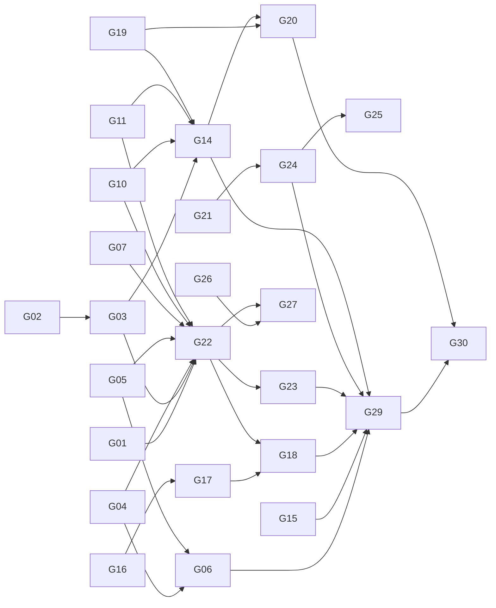

# Gap-closing plan: a solid instrument first, then Study 2

**Status:** v1, 2026-10-18. This plan replaces the one-week sprint, which the author rejected. The working mode stays as it is:
- one thread at a time for your attention;
- a note before any model call, with its call count;
- 2-case pilots;
- the director at the design stage.

The gaps come from [`02-defensibility-conditions.md`](02-defensibility-conditions.md) and REV-02. The decisions come from [`decisions.md`](decisions.md). Comment inline with `> AUTHOR:`.

**The rule:** Study 2 work beyond its design note waits until the **instrument-ready gate** (§3) is met. We close gaps in the order of the chain of trust (map §5): the graph, then the norms, then detection and meaning, then the neural layer, and only then the study.

---

## 1. Gaps by part, and how each one closes

| Part | Gap | How it closes | Model calls | Needs |
|---|---|---|---|---|
| **C1a/b** graph | The DDD rules use class facts that tsc doesn't check. Optional constructor parameters are invisible (N38). One repo's `paths` alias wasn't resolved, so its verdict came from half its graph (N33) | Fix or declare N33 and N38, then re-check against tsc. Register Link 1 as matched to the compiler for imports (D6), with the DDD limit stated | 0 | — |
| **C1c** query | Ledger line 274 is stale. The MCP tool counts disagree across docs | Refresh the line. State 11 tools = 9 spec + 2 neural everywhere | 0 | — |
| **C1d** enrichment | Never run on a real model | A2 contract and six K3/K2m cases with twins *(agent running)*, then the 2-case pilot | 10–20, counted | you read NS-01 |
| **C1e** time | No formal identity for a violation across commits | Write the identity rule, reusing the fix-mining taxonomy | 0 | — |
| **C2** declared | Sources not expert-reviewed. The "30+ rules over 7 dimensions" promise wasn't reached (K7). Two rules added after the seal (D5, N3). Wiring imports counted (D2b) | D1 changes, then confirm the sheet. Two ADRs plus the rules and tests for D5 and N3. State D2b as a construct limit. Argue SO1's rule count as a declared deviation | 0 | **D1 changes from you** |
| **C2r** reliability | κ 0.21 comes from two Claude sessions (N02) | Declared limit. Revisit if a second human becomes available | 0 | — |
| **C3** detect | Hold-out not run. V4 may be unpassable at this size. Blind recall 0.78 (N105). No tool-baseline row | F23 and the V4 count *(agent running)*, then a V4 ADR if needed. After the freeze, the hold-out once on Neo4j. Add the tool baseline (N61; 4 blocking rules that no compared tool expresses) | 0 | the freeze |
| **C3m** meaning | 0 labels (N114). Precision 0.328 (N115) | Codebook and sample *(agent running)*, then L4, then about 60 labels from the free rater plus your own, then κ and meaningful precision | 0 | **L4 from you; the rater** |
| **C4** interpret | Judge 0.76 against a 0.80 target. Development-set only | Report as F3 with its qualifiers. After C1d, interpretation is done by facts (M4) | after C1d | — |
| **C1c** efficiency (M5) | The test has no fixed design | Design and question set *(agent running)*, then a counted run | counted | your OK on the count |
| **C5** drift | No drift metric on real histories | Zero-call description from the fix-mining snapshots *(agent running)* | 0 | — |
| **C6** Study 2 | The drift redesign (M3) is not designed yet. Readiness 1/42 | Design note *(agent running)*, then an adversarial review, then the **director**, then the power simulation, then the gate. **Nothing runs until §3 is met** | later | §3 |
| Threats | Contamination, evasion and role overlap are missing from the threat register | Three rows | 0 | — |
| Deviations | M3, D5, N3, and V4 if it triggers | One dated list for the director | 0 | — |

---

## 2. Order of work, in waves

There are no dates here on purpose. Each wave starts when the one before it has closed.

1. **Wave 1: zero calls, running or startable now.**
   - F23 and the V4 count.
   - NS contract and case set.
   - Meaning codebook and sample.
   - Efficiency design.
   - Drift description.
   - Study 2 drift design note.
   - Fixes for N33 and N38.
   - The ledger line and tool counts.
   - Violation identity (C1e).
   - The threat rows.
2. **Wave 2: your input.** You read NS-01 and the drift design note. You decide **L4**, send the **D1 changes**, and find the rater. Then the deviation list and the drift design go to the director.
3. **Wave 3: instrument changes, then the freeze.**
   - D5 and N3 rules with ADRs and tests.
   - The V4 ADR, if needed.
   - The N33 and N38 fixes merged.
   - `verify-claims` at 0 FAIL.
   - **Freeze tag.**
4. **Wave 4: measure the frozen instrument.**
   - The hold-out once (C3).
   - The rater's labels (C3m).
   - The C1d 2-case pilot, then the 6-case run.
   - The efficiency run.

   Each run is counted first and OK'd by you.
5. **Wave 5: Study 2,** from its reviewed design: power simulation, readiness gate, pilot, pre-registration, then the single run.

---

## 3. The instrument-ready gate

Study 2 moves past its design note only when all of these hold:

1. The **freeze tag** exists. The D5 and N3 rules are in, with tests green, and are declared in the deviation list.
2. **F23 passed**, and the **hold-out ran once**. Each Study 2 style has a V4 result, or is "characterised" under a V4 ADR dated before the run.
3. **C1 known defects** (N33, N38) are fixed or declared, and Link 1 is registered (D6).
4. **C3m:** the codebook is dated. The labels are in with κ reported, or they are declared pending, with the reason.
5. **C1d:** the A2 contract exists and the 2-case pilot has been read with you. SO3 is reported at least at the "design plus pilot" level.
6. The claims ledger and compendium are consistent (`verify-claims`, 0 FAIL).
7. The threat register has its three new rows. The **deviation list is dated and has gone to the director.**

**On the thesis date.** If the thesis goes out at the end of October, Study 2 may not fit after this gate. Whether it is then reported as designed future work is a separate decision. It is not settled here.

---

## 4. The issues, their dependencies and their place on the map

Each gap is an issue with an id. "Depends on" lists what must close first. **Owner:** `A` is the agent, `Y` is you. Status is as of 2026-10-18.

| Id | Issue | Part | Depends on | Owner | Status |
|---|---|---|---|---|---|
| G01 | F23, the sealed-list overlap check | C3 | — | A | running |
| G02 | Expected blocking findings per style (V4 count) | C3 | — | A | running |
| G03 | V4 ADR, only if G02 shows a shortfall | C3, C6 | G02 | A, then Y signs | waiting |
| G04 | Fix N33: unresolved `paths` alias | C1a/b | — | A | starting |
| G05 | Fix N38: optional constructor parameters are invisible. This may also explain the 4 seeds that both the rules and the judge miss (express `Request` optional parameters, NS-01 §3) | C1a/b | — | A | starting |
| G06 | Link 1 registered as matched to the compiler, with the DDD limit (D6) | C1a/b | G04, G05 | A | waiting |
| G07 | Stale ledger line 274; MCP tool counts (11 = 9 spec + 2 neural) | C1c | — | A | starting |
| G08 | Formal identity of a violation across commits | C1e | — | A | starting |
| G09 | Decision-sheet changes, then confirm (D1) | C2 | — | **Y** | open |
| G10 | DDD cycle rule, with ADR and tests (D5) | C2 | — | A | waiting for G04/G05 to land |
| G11 | Q26 application purity, with ADR and tests (N3) | C2 | — | A | waiting for G04/G05 to land |
| G12 | Wiring imports in Layered stated as a construct limit (D2b) | C2 | — | A | starting |
| G13 | SO1 rule-count promise argued as a declared deviation | C2 | — | A | starting |
| G14 | One dated deviation list for the director | all | G03, G10, G11, G19 | A, then Y sends | waiting |
| G15 | Three threat-register rows: contamination, evasion, role overlap | all | — | A | starting |
| G16 | Meaning codebook and stratified sample | C3m | — | A | running |
| G17 | What counts as a meaningful finding (L4) | C3m | G16 | **Y** | open |
| G18 | Rater labels, κ and meaningful precision | C3m | G17, G22, a rater | Y + rater, A analyses | waiting |
| G19 | Study 2 drift design note (M3) | C6 | — | A | running |
| G20 | Adversarial review of G19, then the director at design stage | C6 | G19, G14 | A, then Y | waiting |
| G21 | A2 facts contract, plus six K3/K2m cases with twins | C1d | — | A | running |
| G22 | **Freeze tag** | all | G01, G03, G04, G05, G07, G10, G11, `verify-claims` 0 FAIL | A, Y OKs | waiting |
| G23 | Hold-out, run once on Neo4j | C3 | G22 | A | waiting |
| G24 | NS 2-case pilot, about 10–20 calls, counted first | C1d | G21, NS-01 read | A, Y OKs | waiting |
| G25 | NS 6-case run, two vendors | C1d, C4 | G24 | A, Y OKs | waiting |
| G26 | Efficiency design and question set (M5) | C1c | — | A | running |
| G27 | Efficiency run, counted first | C1c | G26, G22 | A, Y OKs | waiting |
| G28 | Drift description on human histories | C5 | — | A | running |
| G29 | **Instrument-ready gate check** (§3) | all | G06, G15, G18 (or declared pending), G22, G23, G24, G14 | A, Y signs | waiting |
| G30 | Study 2: power simulation, readiness gate, pilot, pre-registration, the single run | C6 | G29, G20 | A, Y signs | waiting |

**Your three issues** are G09 (the D1 changes), G17 (L4), and reading NS-01 for G24. Every other issue upstream of the freeze (G22) is agent work with zero model calls.

## Changelog
- 2026-10-18: §4 issue list G01–G30 with dependencies and map parts.
- 2026-10-18 v1: replaces the rejected one-week sprint plan.
